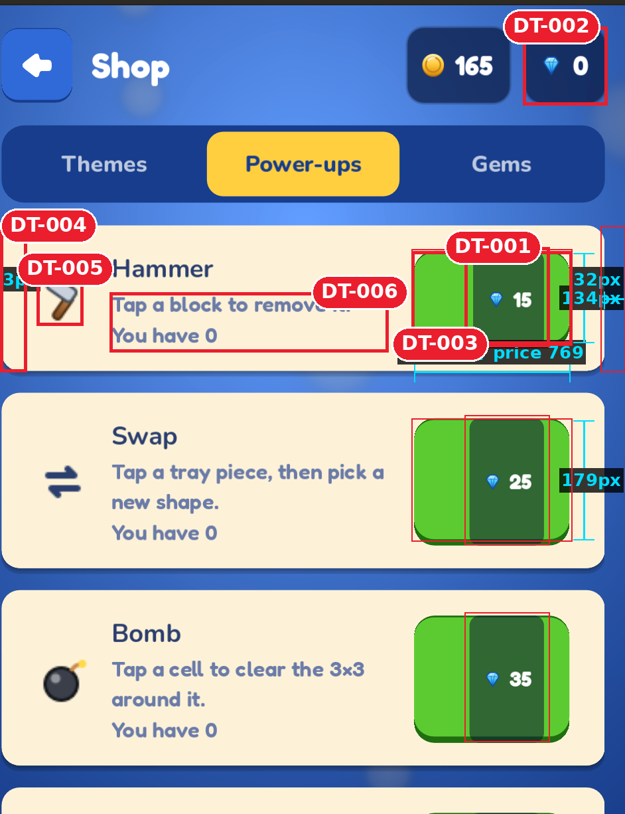
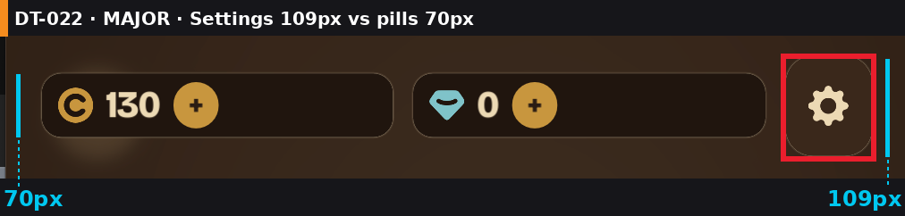
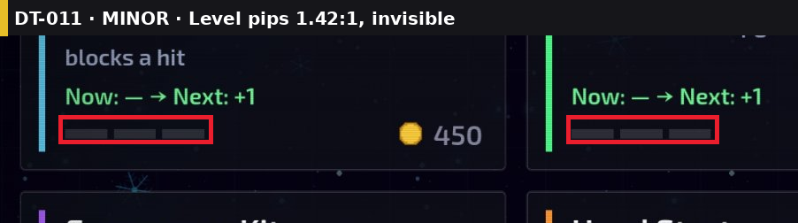
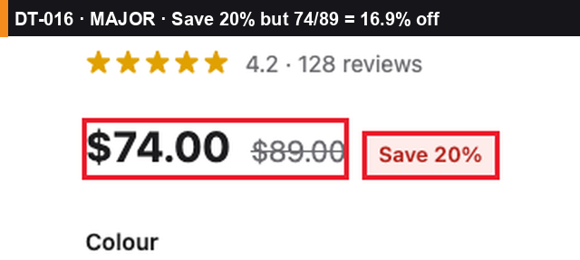
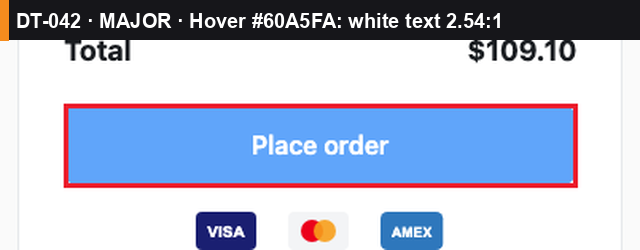
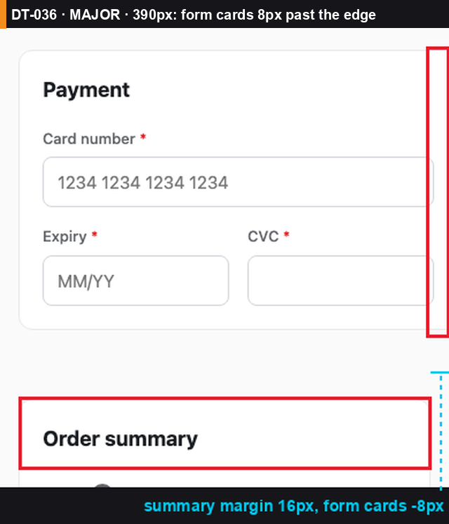
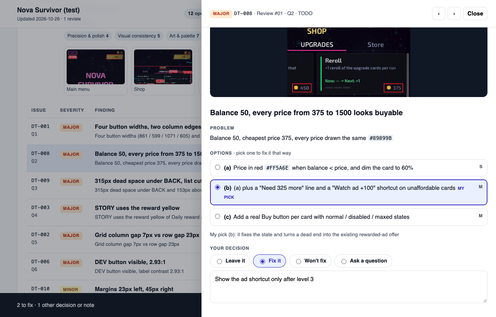

<p align="center"></p>

<h1 align="center">Harsh Design Critic</h1>

<p align="center">
A Claude skill that reviews your game, app or website like a publisher who has seen it all.<br>
It measures every flaw in pixels, marks it on your screenshot, ranks it, and proposes the fix.
</p>

<p align="center">
<b>42 of 42</b> planted defects found in a blind test, with no false positives.
</p>

<p align="center">
<a href="#install">Install</a> · <a href="#what-a-review-looks-like">Example</a> · <a href="#how-it-works">How it works</a> · <a href="#reports">Reports</a> · <a href="#tests">Tests</a>
</p>

---

## Install

**Claude Code**

```bash
git clone --depth 1 https://github.com/Suleiman700/claude-harsh-design-critic ~/.claude/skills/harsh-design-critic
cd ~/.claude/skills/harsh-design-critic
python3 -m venv .venv && .venv/bin/pip install -r requirements.txt
```

The measuring scripts need pillow, numpy and scipy. They install into the skill's own `.venv`, so your system Python stays untouched (on Windows use `.venv\Scripts\pip`). To use it in one project only, clone into `<project>/.claude/skills/harsh-design-critic` instead.

**Claude app:** download this repo as a ZIP (**Code → Download ZIP**, about 50 KB; tests and images are left out) and upload it as a skill in settings.

Then attach a screenshot, or open your project, and say *"review this screen"*, *"harsh review of the shop"*, or `/harsh-design-critic <request>`.

---

## What a review looks like

Most AI reviews say *"looks clean, maybe tweak the colors."* This one measures. Every issue is boxed on your screenshot with a task id and reported with numbers:

<p align="center"></p>

Each finding becomes a question with 2–3 fixes and one recommended pick:

```
Q4. 🟠 Settings button h=109 next to pills h=70 (Δ39px, 56%)  (DT-022)
- (a) One shared bar height: settings 70×70, icon 36px (effort S): small tap-target change
- (b) Keep sizes, align top edges (effort S): mismatch stays, just moves
- My pick: (a) because it removes the mismatch instead of moving it
```

Then it **stops**. Nothing in your project changes until you answer, for example `approve all`, `approve Q1, Q4` or `Q1b, Q2a`.

### What it catches

| | What it found |
|---|---|
|  | **Mismatched sizes:** settings button 109px tall next to 70px currency pills |
|  | **Low contrast:** level pips at 1.42:1, where WCAG asks for 3:1 |
|  | **Wrong numbers:** "Save 20%" on $89 → $74, which is 16.9% off |
|  | **Broken states:** "Place order" passes at rest (5.17:1) and drops to 2.54:1 on hover |
|  | **Phone layout:** at 390px wide the form runs 8px past the screen edge |

<details>
<summary><b>Everything it checks</b></summary>
<br>

**On screen**
- Sizes, gaps and margins within a group (sibling buttons, pills, cards, rows)
- Content centered in its container, and alignment to shared edges
- WCAG contrast for text and controls, including hover, focus and disabled states
- Clipping, overlapping text, and labels running into screen edges
- Mixed icon styles, including OS emoji used as icons
- Missing states: can't afford, empty, error, loading, toggles
- Palette: the real colors on screen as hex, and colors without a job
- Arabic and Hebrew: right-to-left order, mirrored layouts, labels too tight to translate

**Beyond pixels**
- Prices, totals and promises that disagree across pages
- Keyboard order, form input limits, values past their limits
- Brand consistency across a flow
- For games: first session, juice, ads and economy, and whether objects sit where they belong
- Colorblind, grayscale and blur tests to check that states don't depend on color alone

</details>

---

## How it works

1. **It asks first.** One short message: Quick (top 10 findings, one screen width) or Full (every finding, phone and desktop, all states); whether to mark issues on screenshots; and the report format. Nothing is captured before you answer.
2. **It measures.** It reads your screenshots, or renders your web pages itself at any width and in hover, focus, error and click states, and measures every element.
3. **It reports.** A score out of 10, a skeptical user's verdict, every issue ranked 🔴 critical, 🟠 major, 🟡 minor or ⚪ nitpick, each with options and a pick.
4. **It waits.** It is read-only until you approve.
5. **It fixes and proves it.** It applies only the option you chose, re-captures the same screen, re-measures, and saves a before/after image. A fix that works on one screen size only is marked partial.

Later in the same project: `fix DT-007` · `next task` · `what's left` · `verify` · `research competitors` · `lint` · `store mode`.

<details>
<summary><b>Quick vs Full: time and token cost</b></summary>
<br>

| Mode | Images | Measured cost per web page |
|---|---|---|
| Quick | full screens only | ~70k tokens, ~2.5 min |
| Full | one image per issue | ~90k tokens, ~6.5 min |

Most of the cost is reading the skill and the page, so Quick is mainly faster (about 2.7x) and saves about a quarter of the tokens. These come from single runs; your page will differ. Saying "no images" is cheapest, e.g. `/harsh-design-critic quick, no images, review the checkout`.

</details>

---

## Reports

Everything is written into your project under `docs/harsh-design-critic/`: the review, a task board that tracks each issue from open to verified, and the annotated screenshots and before/after proof.

Choose **HTML** (or both) at the start and you also get `REPORT.html`, an interactive page that opens offline with a double-click:

<p align="center"></p>

- Every review on one page, with an issue table per review and filters.
- Click an issue to see its screenshot zoomed to the problem, its options and the recommended pick. Click issues directly on the screenshot too.
- Mark each one **Fix it** (pick an option), **Leave it**, **Won't fix** or **Ask a question**, add notes, press **Copy decisions**, and paste the list back to Claude.
- Every fix updates the Markdown and the HTML together.

Try it: download the repo and open [`tests/nova-survivor/design-review/REPORT.html`](tests/nova-survivor/design-review/REPORT.html).

<details>
<summary><b>Where the files go</b></summary>

```
docs/harsh-design-critic/
  design-review/
    REVIEW_LOG.md · DESIGN_TASKS.md · ui-tokens.json
    report-data.json · REPORT.html          (HTML format)
    reviews/2026-10-26-review.md
    screenshots/screens/   review-01_shop_annotated.png …
    screenshots/issues/    DT-001_shop-price-overlay.png …
    screenshots/proof/     DT-001_before.png · DT-001_after.png · DT-001_proof.png
  market-research/          only when you allow competitor research
```

The first review in a project also asks once about audience, languages, monetization and competitor research, and remembers the answers.
</details>

---

## Tests

The skill was run on four real mobile games and one website. Each test folder has the full review, annotated screens and one image per issue.

| Test | Score | 🔴 | 🟠 | 🟡 | |
|---|:-:|:-:|:-:|:-:|---|
| Block puzzle + hotel tycoon (6 screens) | 4/10 | 3 | 11 | 4 | [findings](tests/block-puzzle-hotel-tycoon/README.md) |
| Synthwave survivor shooter (2 screens) | 5/10 | 0 | 6 | 6 | [findings](tests/nova-survivor/README.md) · [HTML report](tests/nova-survivor/design-review/REPORT.html) |
| Swipe-to-spell word puzzle (4 screens) | 6/10 | 0 | 3 | 5 | [findings](tests/word-wheel/README.md) |
| E-commerce site, **blind test** (3 pages) | 3/10 | 4 | 18 | 26 | [results](tests/ecommerce-site/README.md) |

**The blind test:** three store pages were built with 42 hidden defects, from obvious to 1px-subtle, and the answer key was kept where the skill couldn't read it. It found all 42, plus 16 real problems nobody planted. See the [results](tests/ecommerce-site/README.md), the [answer key](tests/ecommerce-site/ANSWER_KEY.md) and the [test pages](tests/ecommerce-site/site/).

---

## Works with mobile-game-specs

When a project follows [claude-mobile-game-specs](https://github.com/Suleiman700/claude-mobile-game-specs), a library of 28 mobile-game build specs, the critic uses them as the rulebook: findings cite the spec ("floating label 4px from the edge; `04-hud-layout` requires 20px"), and the first option is usually "apply the spec's default".

## Known limits

- Numbers are in screenshot pixels. Converting to dp needs the device's pixel density, which a screenshot doesn't include.
- Some measurements depend on the colors picked for each element. Check the annotated image before trusting a number.
- The scores come from a handful of test projects; only the blind test has an independent answer key.

<details>
<summary><b>What's in the repo</b></summary>

```
SKILL.md          persona, rules and workflow
references/       loaded only when a step needs them (checklists, report format, tasks, research)
scripts/          measure · annotate · issue_shots · palette · perception · compare · ui_lint · web_capture · html_report
templates/        starter ui-tokens.json
tests/            one folder per test: README with every finding, the review, task board and screenshots
```
</details>

## License

[MIT](LICENSE) © 2026 Suleiman700
