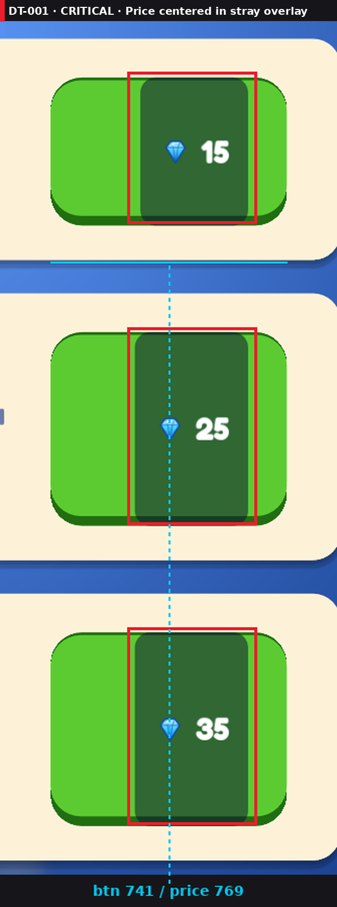

# Harsh Design Critic — a Claude skill

> A brutal, publisher-grade design reviewer for games, apps and websites. It measures every pixel, marks each issue on your screenshots, compares you with the market, gives 2–3 fixes per problem with its pick, and changes nothing until you approve.

<p align="center">
  
  
</p>

Most AI reviews say "looks clean, maybe tweak the colors". This skill acts like a senior reviewer who has seen a thousand games and a skeptical player looking for a reason to uninstall. It doesn't guess: it runs scripts on your screenshots and reports numbers.

## What it catches

Real findings from the sample review in [`examples/`](examples/sample-review/design-review/reviews/2026-10-26-review.md):

| Finding | Measured |
|---|---|
|  | Price centered inside a stray dark overlay instead of the button: **28px off center**, and the overlay is 107px wide in one row, 112px in the next |
|  | Settings button **109px** tall next to **70px** currency pills (Δ39px, 56%) |
|  | A status message spawns on top of a world label, so neither is readable |

Plus the things a glance misses: emoji mixed with icon glyphs, buy buttons that look active at 0 gems, 3px vs 32px screen margins, white-on-green text at 2.09:1 contrast, toggles with no on/off state.

<p align="center">
  
  <br><em>Perception sheet: the blur test shows the booster buttons dissolving into the background, and in grayscale the green, purple and pink pieces become one gray.</em>
</p>

## How a review looks

Every finding becomes a question with options and a pick:

```
Q4. 🟠 Settings button h=109 next to pills h=70 (Δ39px, 56%)  (DT-022)
- (a) One shared bar height: settings 70×70, icon 36px (effort S): small tap-target change
- (b) Keep sizes, align top edges (effort S): mismatch stays, just moves
- My pick: (a) because it removes the mismatch instead of moving it
```

Then it **stops**. You reply `approve all`, `approve Q1, Q4`, `Q1b, Q2a` or `approve quick wins`. After fixing, it re-captures the same screen, re-measures, and saves a before/after proof image. A fix that works on one screen size only is marked ⚠️ partial, not ✅.

## Features

- **Measured, not eyeballed.** Element boxes, content-vs-container centering, sibling heights, margins, WCAG contrast, all computed from your screenshot.
- **Annotated screenshots.** Every box is labeled with its task id (`DT-018`), the same id used in the file names and the task list, so you can jump from image to task and back.
- **One cropped image per issue**, e.g. `screenshots/issues/DT-022_settings-button-height.png`, embedded under each question in the review.
- **Perception tests:** blur/squint, grayscale, deuteranopia, protanopia, tritanopia.
- **Market comparison** (asks permission once): researches 3–5 competitors, builds a comparison board, a ✅/➖/❌/⭐ feature matrix and an HTML report.
- **Game depth:** juice checklist, flow and first-session review, ads and economy judged retention-first, placement logic ("does a supply shelf belong in the lobby?").
- **Arabic / Hebrew / RTL checks:** mirroring, letter shaping, clipped diacritics, fallback fonts, overflow.
- **A living task board** (`DESIGN_TASKS.md`) with severity, effort, options, your choice, status and proof, plus a review log that calls out issues that were reported before and are still broken.
- **UI tokens + lint:** extracts your real sizes and colors, then `ui_lint.py` scans Godot and React Native code for emoji icons, mismatched row heights and off-token values before every build.
- **Read-only until approved.** It never edits your project during a review.

## Install

**Claude Code**
```bash
git clone https://github.com/Suleiman700/claude-harsh-design-critic ~/.claude/skills/harsh-design-critic
pip install -r ~/.claude/skills/harsh-design-critic/requirements.txt
```
For one project only, clone into `<project>/.claude/skills/harsh-design-critic` instead.

**Claude app:** download this repo as a ZIP and upload it as a skill in the app's settings.

## Use

Attach a screenshot (or run it inside your project) and say:

- "review this screen"
- "harsh review of the shop"
- "critique / roast this UI"
- or `/harsh-design-critic <request>` in Claude Code

The first review in a project asks one short set of questions (audience, languages, monetization, competitor research, screenshots) and remembers the answers. Everything it writes goes to `docs/game-prompts/design-review/` in your project:

```
docs/game-prompts/design-review/
  REVIEW_LOG.md · DESIGN_TASKS.md · ui-tokens.json
  reviews/2026-10-26-review.md
  screenshots/screens/  review-01_shop_annotated.png …
  screenshots/issues/   DT-001_shop-price-overlay.png …
  screenshots/proof/    DT-001_before.png · DT-001_after.png · DT-001_proof.png
```

Later commands: `fix DT-007` · `next task` · `what's left` · `verify` · `research competitors` · `lint` · `store mode`.

## Works with mobile-game-specs

Pairs with [claude-mobile-game-specs](https://github.com/Suleiman700/claude-mobile-game-specs), a library of 28 mobile-game build specs. When a project follows those specs, the critic uses them as the rulebook: findings cite the spec ("floating label 4px from the edge; `04-hud-layout` requires 20px"), and option (a) is usually "apply the spec's default".

## What's inside

```
SKILL.md                     core: persona, rules, workflow
references/                  loaded only when a step needs them
  inspection-checklist.md    capture plan, measurement tables, precision defects, placement logic
  feel-flow-economy.md       juice, flow/FTUE, ads & economy, consumer criteria
  market-research.md         competitors, comparison board, gap table, HTML report
  tokens-devices-perception.md  tokens, device matrix, perception tests, lint, proof images
  screenshots.md             asking, capture, naming by task id, linking
  output-format.md           report layout, question blocks, approval prompt
  tasks-and-log.md           task board, statuses, fixing, review log
  house-standards.md         grading against mobile-game-specs
scripts/                     measure · annotate · issue_shots · palette · perception · compare · ui_lint
templates/ui-tokens.json     starter tokens
examples/sample-review/      a full real review: report, task board, all images
```

## License

[MIT](LICENSE) © 2026 Suleiman700
