<p align="center">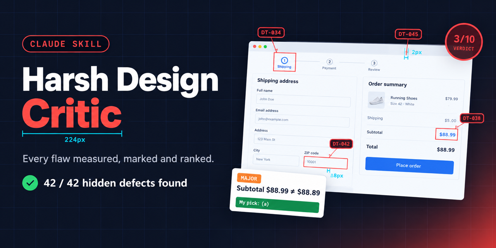</p>

# Harsh Design Critic — a Claude skill

> A brutal, publisher-grade design reviewer for games, apps and websites. It measures your screenshots, marks each issue on them, gives 2–3 fixes per problem with its pick, and changes nothing until you approve.

Most AI reviews say "looks clean, maybe tweak the colors". This skill acts like a senior reviewer who has seen a thousand games and a skeptical player looking for a reason to uninstall. It doesn't guess: it runs scripts on your screenshots and reports numbers.

**[What it can do](#what-it-can-do)** · **[Real-world tests](#real-world-tests)** · **[How a review looks](#how-a-review-looks)** · **[Install](#install)** · **[Use](#use)**

## What it can do

Every example below is a real finding from one of the [three test reviews](#real-world-tests).

| Capability | Example | What it found |
|---|---|---|
| **Measures sizes in a row** | 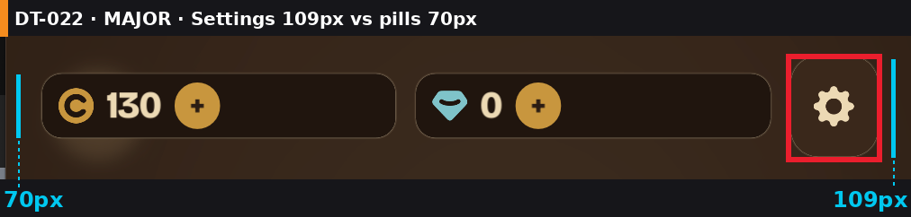 | Settings button **109px** tall next to **70px** currency pills (Δ39px, 56%) |
| **Finds four sizes where there should be one** | 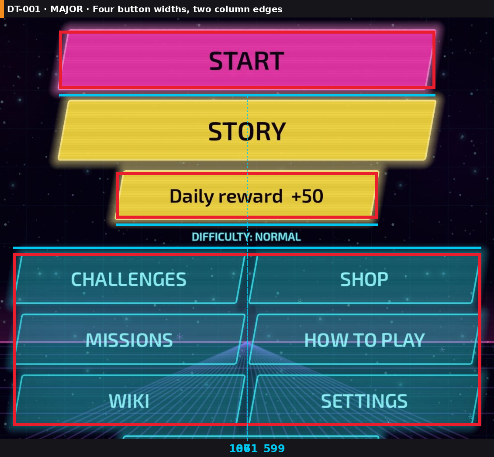 | Menu buttons **861 / 599 / 1071 / 605px** wide, left edge jumps from 164 to 59 |
| **Checks if content is centered** | 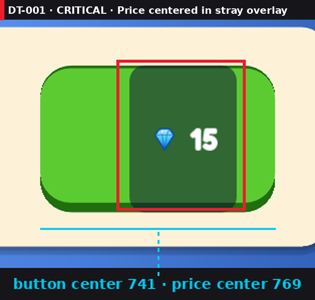 | Price centered in a stray dark overlay, **28px** off the button center |
| **Spots titles centered on the wrong thing** |  | Title centered between two buttons, **35px** left of the screen center |
| **Measures WCAG contrast** |  | Level pips at **1.42:1** (needs 3:1); in another game, white on green at 2.09:1 |
| **Catches missing states** |  | Balance **50**, cheapest price **375**, every price still looks buyable |
| **Checks gaps and margins** |  | Column gap **7px** vs row gap **23px**; in another game, screen margins 3px vs 32px |
| **Finds mixed icon styles** | 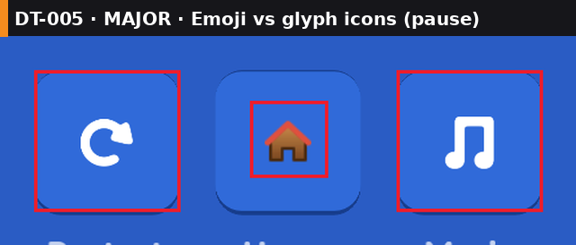 | Home is an **OS emoji** next to white glyph icons; elsewhere, one outline coin among filled ones |
| **Finds clipping and overlapping text** |  | "No free room!" printed on top of "RECEPTION", so neither is readable |
| **Judges use of space** | 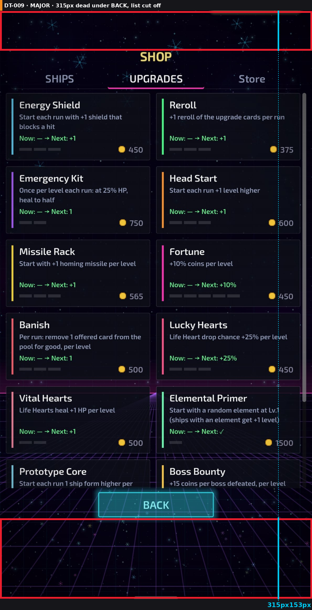 | **315px** empty under BACK while the list you came for is cut off |
| **Checks baselines across states** |  | Level digits **7px** lower on locked tiles than on unlocked ones |
| **Flags translation risks** |  | "More games" has **12px** padding: Arabic or Hebrew won't fit |
| **Audits the palette** | 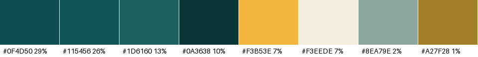 | Real colors on screen as hex with share: 4 teals, 1 yellow, 1 cream |

### Perception tests

Blur, grayscale and three colorblind simulations in one sheet. They show problems a normal look misses.

<p align="center">
  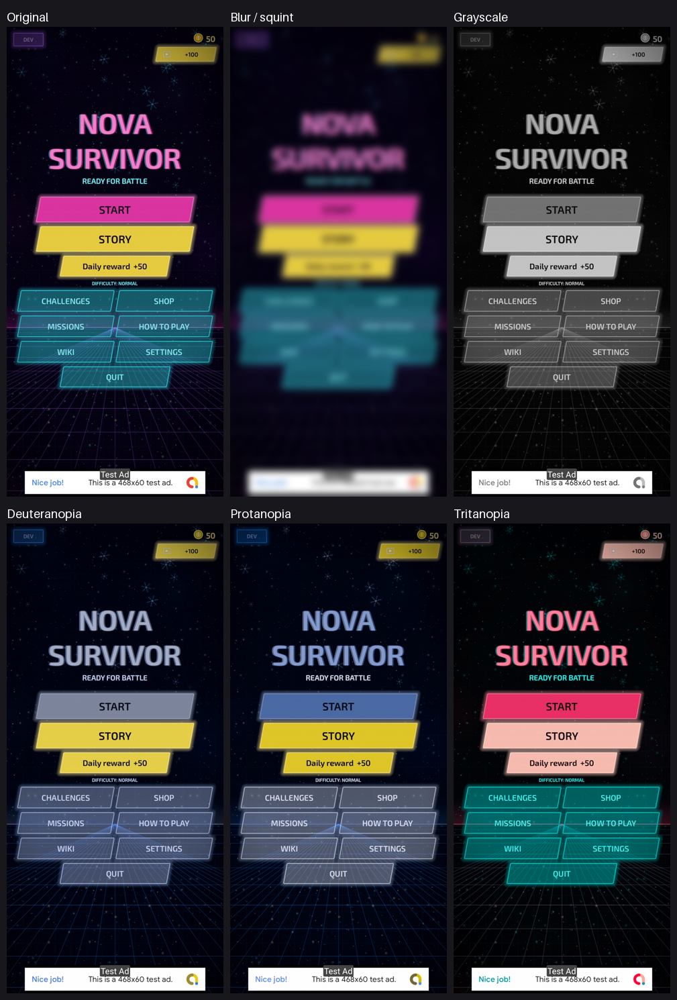
  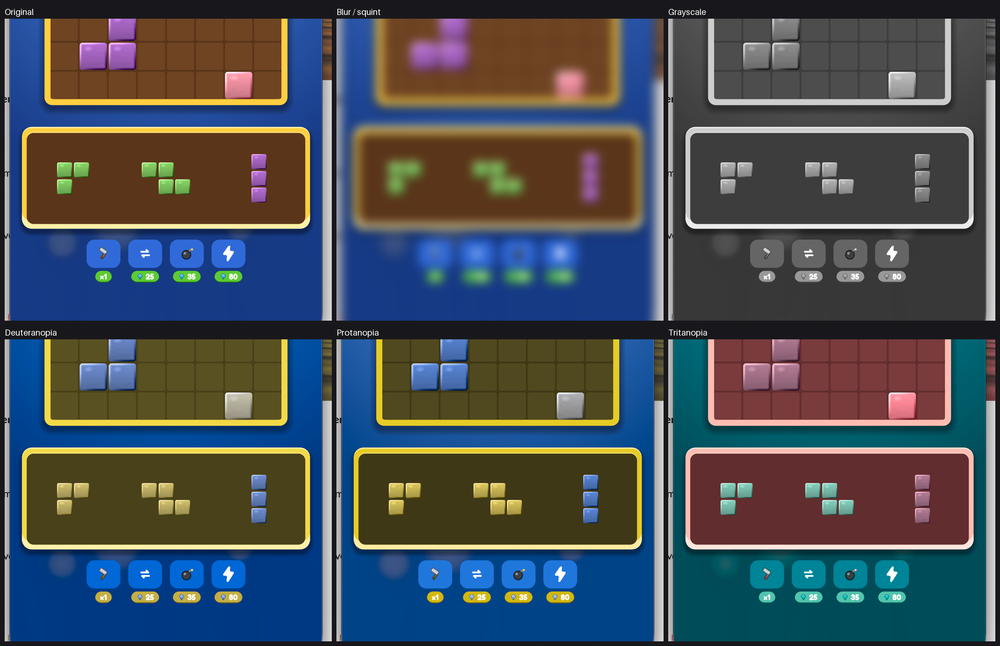
  <br><em>Left (survivor shooter): in grayscale STORY is brighter than START, so the second option is the loudest button. Right (block puzzle): the green, purple and pink pieces turn into one gray.</em>
</p>

## Real-world tests

The skill has been run on screens from four real mobile games in three tests. Each test has a full review, annotated screens and one cropped image per issue.

| # | Games tested | Screens | Score | 🔴 | 🟠 | 🟡 | Full review |
|---|---|---|---|---|---|---|---|
| 1 | A block puzzle game + a hotel tycoon game | 6 | **4/10** | 3 | 11 | 4 | [review](examples/sample-review/design-review/reviews/2026-10-26-review.md) · [tasks](examples/sample-review/design-review/DESIGN_TASKS.md) |
| 2 | A synthwave survivor shooter | 2 | **5/10** | 0 | 6 | 6 | [review](examples/nova-survivor/design-review/reviews/2026-10-26-review.md) |
| 3 | A swipe-to-spell word puzzle | 4 | **6/10** | 0 | 3 | 5 | [review](examples/word-wheel/design-review/reviews/2026-10-26-review.md) |

Every box on the annotated screens is labeled with its task id, the same id as in the table under it; cyan lines are measurements in pixels.

### Test 1 · Block puzzle game + hotel tycoon game — 4/10

> "The board looks like a game. Everything around it looks like a prototype."

25 issues across 6 screens from two games. Click an ID to see its close-up.

#### Block puzzle
**Shop**

<p align="center">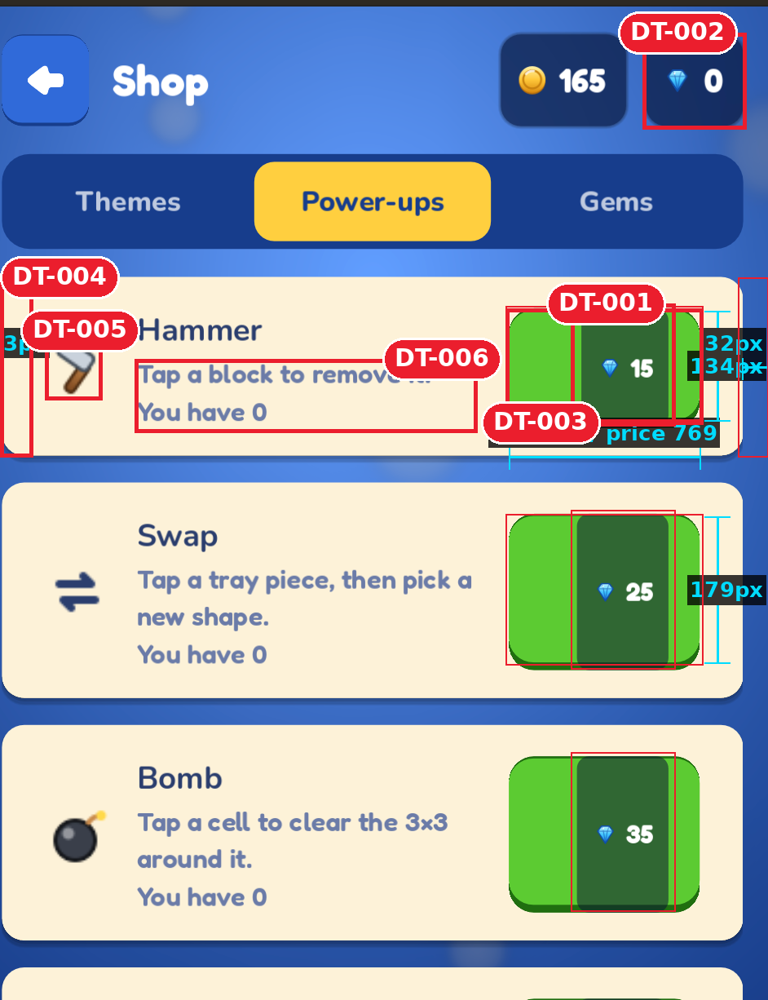</p>

| ID | Level | Issue |
|---|---|---|
| [DT&#8209;001](examples/sample-review/design-review/screenshots/issues/DT-001_shop-price-overlay.png) | 🔴&nbsp;Critical | Price centered inside a stray dark overlay, **28px** right of the button center; overlay 107px wide in one row, 112px in the others |
| [DT&#8209;002](examples/sample-review/design-review/screenshots/issues/DT-002_cant-afford-buttons.png) | 🟠&nbsp;Major | Every buy button looks active while the player has **0 gems**: no can't-afford state |
| [DT&#8209;003](examples/sample-review/design-review/screenshots/issues/DT-003_shop-button-heights.png) | 🟠&nbsp;Major | Buy buttons **134px** tall in row 1, **179px** in rows 2–3: they stretch with the card |
| [DT&#8209;004](examples/sample-review/design-review/screenshots/issues/DT-004_shop-card-margins.png) | 🟠&nbsp;Major | Cards **3px** from the left edge, **32px** from the right |
| [DT&#8209;005](examples/sample-review/design-review/screenshots/issues/DT-005_mixed-icons_shop.png) | 🟠&nbsp;Major | Hammer and bomb are emoji-style art, swap is a flat glyph: mixed icon styles |
| [DT&#8209;006](examples/sample-review/design-review/screenshots/issues/DT-006_shop-description-contrast.png) | 🟡&nbsp;Minor | Descriptions `#6B7BA8` on cream: **3.76:1**, below 4.5:1 |
**Gameplay and booster bar**

<p align="center">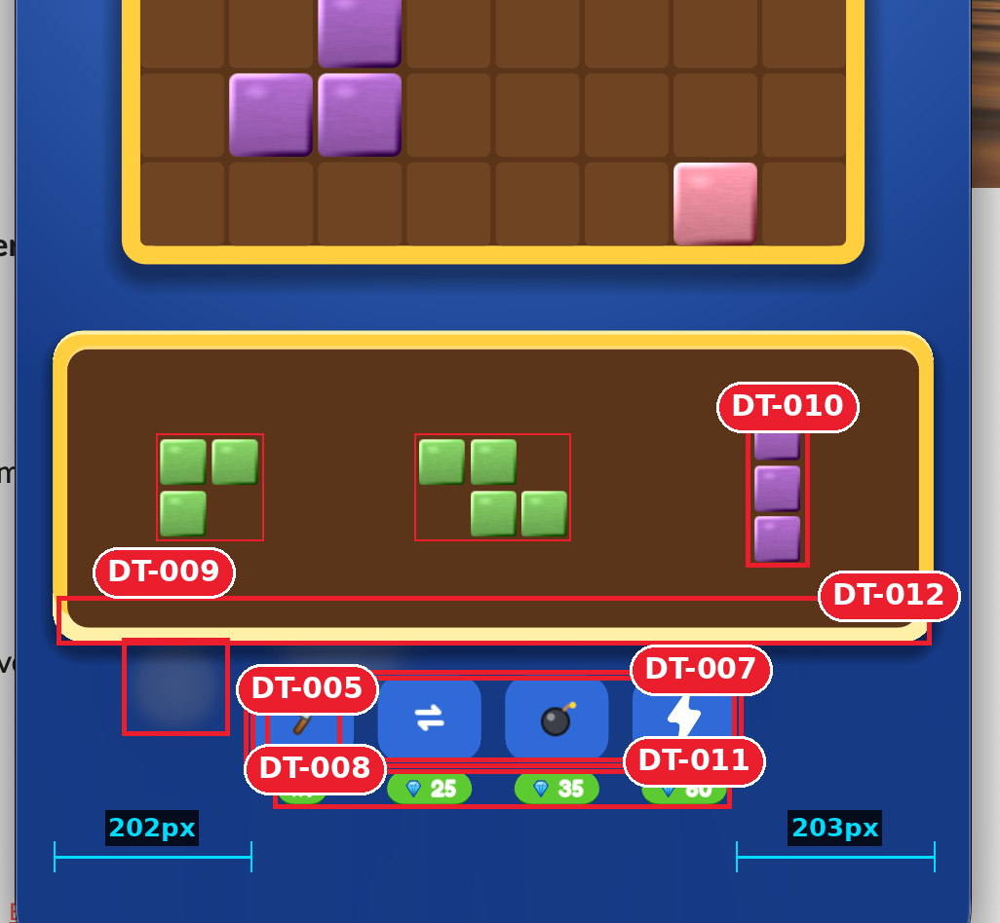</p>

| ID | Level | Issue |
|---|---|---|
| [DT&#8209;007](examples/sample-review/design-review/screenshots/issues/DT-007_booster-off-theme.png) | 🟠&nbsp;Major | Boosters flat blue on a blue background (**2.11:1**), ignore the wood-and-gold theme |
| [DT&#8209;005](examples/sample-review/design-review/screenshots/issues/DT-005_mixed-icons_booster.png) | 🟠&nbsp;Major | Booster icons mix emoji (hammer, bomb) with white glyphs (swap, lightning) |
| [DT&#8209;008](examples/sample-review/design-review/screenshots/issues/DT-008_pill-count-vs-price.png) | 🟠&nbsp;Major | The same green pill means "owned count" (x1) and "price" (💎25) |
| [DT&#8209;013](examples/sample-review/design-review/screenshots/issues/DT-013_pieces-grayscale.png) | 🟠&nbsp;Major | Green, purple and pink pieces turn into one gray (see the perception sheet above) |
| [DT&#8209;010](examples/sample-review/design-review/screenshots/issues/DT-010_tray-piece-spacing.png) | 🟡&nbsp;Minor | Tray pieces unevenly spaced across the tray |
| [DT&#8209;011](examples/sample-review/design-review/screenshots/issues/DT-011_booster-bar-width.png) | 🟡&nbsp;Minor | Booster bar ~500px wide under a ~900px tray: ~200px dead space each side |
| [DT&#8209;009](examples/sample-review/design-review/screenshots/issues/DT-009_ghost-blob.png) | ⚪&nbsp;Nitpick | Grey ghost blobs left of the booster bar |
| [DT&#8209;012](examples/sample-review/design-review/screenshots/issues/DT-012_tray-lip.png) | ⚪&nbsp;Nitpick | Tray frame has a cream bottom lip, the board frame doesn't |
**Pause menu**

<p align="center">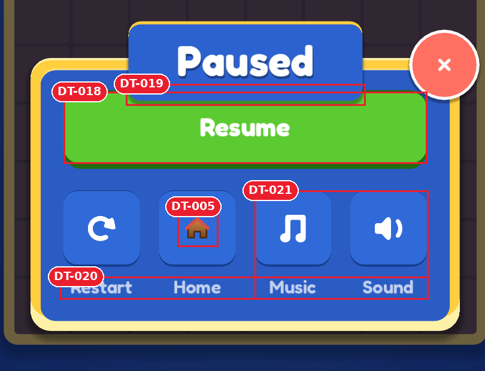</p>

| ID | Level | Issue |
|---|---|---|
| [DT&#8209;018](examples/sample-review/design-review/screenshots/issues/DT-018_resume-contrast.png) | 🟠&nbsp;Major | White "Resume" on green: **2.09:1** |
| [DT&#8209;021](examples/sample-review/design-review/screenshots/issues/DT-021_toggle-no-state.png) | 🟠&nbsp;Major | Music and Sound toggles show no on/off state |
| [DT&#8209;005](examples/sample-review/design-review/screenshots/issues/DT-005_mixed-icons_pause.png) | 🟠&nbsp;Major | Home is an OS emoji 🏠 next to white glyph icons |
| [DT&#8209;019](examples/sample-review/design-review/screenshots/issues/DT-019_header-overlaps-resume.png) | 🟡&nbsp;Minor | "Paused" header overlaps the Resume button by **15px** |
| [DT&#8209;020](examples/sample-review/design-review/screenshots/issues/DT-020_pause-label-contrast.png) | 🟡&nbsp;Minor | Button labels `#C3D1EE` on blue: **3.99:1** |
**Top bar**

<p align="center">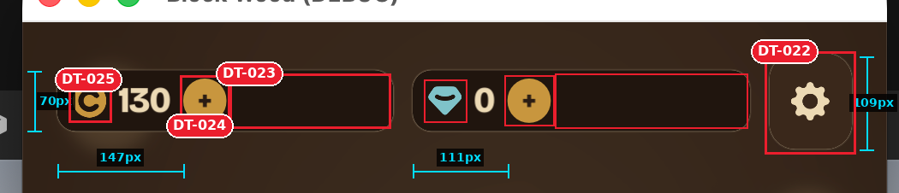</p>

| ID | Level | Issue |
|---|---|---|
| [DT&#8209;022](examples/sample-review/design-review/screenshots/issues/DT-022_settings-button-height.png) | 🟠&nbsp;Major | Settings button **109px** tall next to **70px** currency pills (Δ39px, 56%) |
| [DT&#8209;023](examples/sample-review/design-review/screenshots/issues/DT-023_pill-dead-space.png) | 🟡&nbsp;Minor | Currency pills 50–59% empty |
| [DT&#8209;024](examples/sample-review/design-review/screenshots/issues/DT-024_plus-position.png) | 🟡&nbsp;Minor | "+" moves with the number: **147px** vs **111px** from the pill edge |
| [DT&#8209;025](examples/sample-review/design-review/screenshots/issues/DT-025_currency-icon-styles.png) | ⚪&nbsp;Nitpick | Coin is a letter "C" glyph, gem is a stylized icon: two icon styles |

#### Hotel tycoon

**HUD**

<p align="center">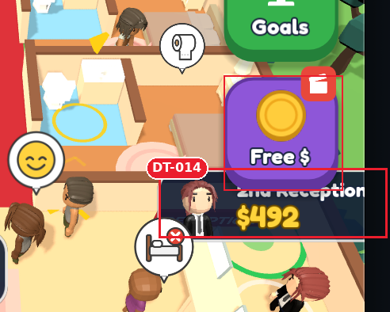</p>

| ID | Level | Issue |
|---|---|---|
| [DT&#8209;014](examples/sample-review/design-review/screenshots/issues/DT-014_world-label-clipped.png) | 🔴&nbsp;Critical | "2nd Reception" name plate clipped by the screen edge and covered by the Free $ button |
**Reception**

<p align="center">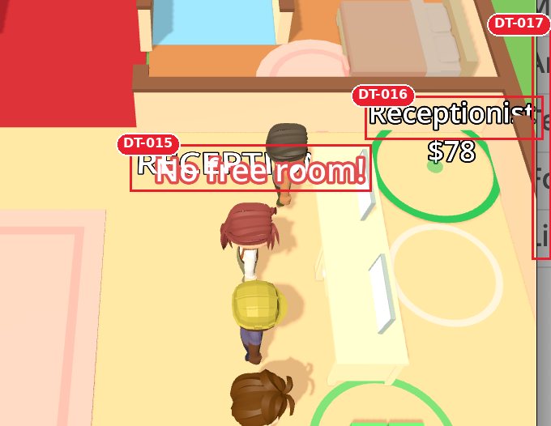</p>

| ID | Level | Issue |
|---|---|---|
| [DT&#8209;015](examples/sample-review/design-review/screenshots/issues/DT-015_message-over-label.png) | 🔴&nbsp;Critical | "No free room!" printed on top of "RECEPTION": neither is readable |
| [DT&#8209;016](examples/sample-review/design-review/screenshots/issues/DT-016_receptionist-label-clipped.png) | 🟠&nbsp;Major | "Receptionist" label clipped at the right edge |
| [DT&#8209;017](examples/sample-review/design-review/screenshots/issues/DT-017_cut-off-side-panel.png) | 🟡&nbsp;Minor | A side panel cut off at the right edge |

### Test 2 · Synthwave survivor shooter — 5/10

> "Strong synthwave mood, but the menu is four different button systems and the shop sells things I can't afford without telling me."

12 issues across 2 screens.

**Main menu**

<p align="center"></p>

| ID | Level | Issue |
|---|---|---|
| [DT&#8209;001](examples/nova-survivor/design-review/screenshots/issues/DT-001_menu-button-widths.png) | 🟠&nbsp;Major | Four button widths (**861 / 599 / 1071 / 605px**) and five heights; left edge jumps from 164 to 59 |
| [DT&#8209;002](examples/nova-survivor/design-review/screenshots/issues/DT-002_grid-gaps.png) | 🟠&nbsp;Major | Grid column gap **7px** vs row gap **23px** |
| [DT&#8209;003](examples/nova-survivor/design-review/screenshots/issues/DT-003_story-reads-as-reward.png) | 🟠&nbsp;Major | STORY uses the same yellow as the reward buttons, and out-shines START in grayscale |
| [DT&#8209;006](examples/nova-survivor/design-review/screenshots/issues/DT-006_dev-button.png) | 🟠&nbsp;Major | DEV button visible in the build, label at **2.93:1** |
| [DT&#8209;004](examples/nova-survivor/design-review/screenshots/issues/DT-004_lines-through-labels.png) | 🟡&nbsp;Minor | Grid and horizon lines run through MISSIONS and HOW TO PLAY |
| [DT&#8209;005](examples/nova-survivor/design-review/screenshots/issues/DT-005_difficulty-label.png) | 🟡&nbsp;Minor | "DIFFICULTY: NORMAL" is **17px** tall text with no control look |
| [DT&#8209;007](examples/nova-survivor/design-review/screenshots/issues/DT-007_quit-button.png) | 🟡&nbsp;Minor | QUIT (605×114) takes the thumb zone; Android back already exits |
**Shop**

<p align="center"></p>

| ID | Level | Issue |
|---|---|---|
| [DT&#8209;008](examples/nova-survivor/design-review/screenshots/issues/DT-008_cant-afford.png) | 🟠&nbsp;Major | Balance **50**, cheapest price **375**, yet every price looks buyable |
| [DT&#8209;009](examples/nova-survivor/design-review/screenshots/issues/DT-009_dead-space.png) | 🟠&nbsp;Major | **315px** dead space under BACK and 153px above SHOP while the list is cut mid-card |
| [DT&#8209;010](examples/nova-survivor/design-review/screenshots/issues/DT-010_unequal-margins.png) | 🟡&nbsp;Minor | Margins **23px** left vs **45px** right; content 11px left of center |
| [DT&#8209;011](examples/nova-survivor/design-review/screenshots/issues/DT-011_level-pips.png) | 🟡&nbsp;Minor | Level pips `#2B2C36` on `#090B16`: **1.42:1** |
| [DT&#8209;012](examples/nova-survivor/design-review/screenshots/issues/DT-012_tab-case.png) | 🟡&nbsp;Minor | Tabs "SHIPS · UPGRADES · Store": one tab breaks the uppercase set |

### Test 3 · Swipe-to-spell word puzzle — 6/10

> "Clean and calm, but locked, unearned and disabled all look the same faded teal."

8 issues across 4 screens. What works: home margins equal to the pixel, one tight palette, primary action always in thumb reach.

**Home**

<p align="center">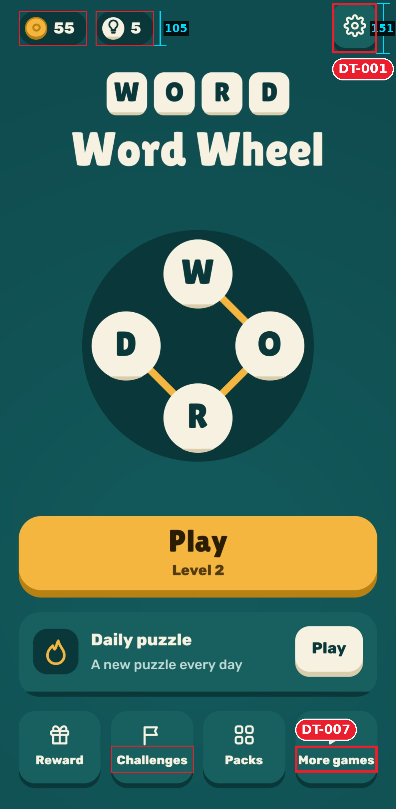</p>

| ID | Level | Issue |
|---|---|---|
| [DT&#8209;001](examples/word-wheel/design-review/screenshots/issues/DT-001_top-bar-heights.png) | 🟠&nbsp;Major | Gear button **136×151** with a 3D lip next to flat **105px** pills; top edges at y 9 vs 32 |
| [DT&#8209;007](examples/word-wheel/design-review/screenshots/issues/DT-007_nav-label-padding.png) | 🟡&nbsp;Minor | "More games" label has **12px** padding in its tile: Arabic or Hebrew won't fit |
**Daily reward**

<p align="center">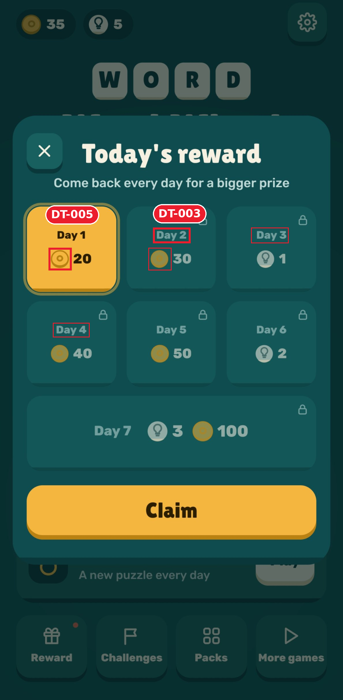</p>

| ID | Level | Issue |
|---|---|---|
| [DT&#8209;003](examples/word-wheel/design-review/screenshots/issues/DT-003_locked-label-contrast.png) | 🟠&nbsp;Major | Locked day labels `#73A1A1` on `#135758`: **2.90:1** |
| [DT&#8209;005](examples/word-wheel/design-review/screenshots/issues/DT-005_coin-icon-styles.png) | 🟡&nbsp;Minor | Day 1 coin is an outline ring; every other coin is filled |
**Challenges**

<p align="center">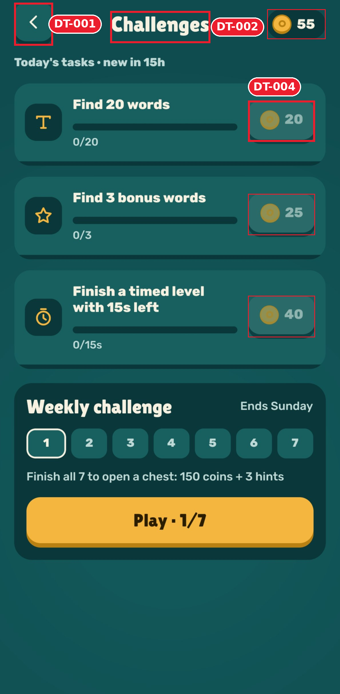</p>

| ID | Level | Issue |
|---|---|---|
| [DT&#8209;004](examples/word-wheel/design-review/screenshots/issues/DT-004_rewards-look-disabled.png) | 🟠&nbsp;Major | Rewards you can still earn look disabled: number `#8EB4B0` on `#2A6A69`, **2.77:1** |
| [DT&#8209;001](examples/word-wheel/design-review/screenshots/issues/DT-001_top-bar-heights.png) | 🟠&nbsp;Major | Back button with a 3D lip next to the flat coin pill |
| [DT&#8209;002](examples/word-wheel/design-review/screenshots/issues/DT-002_header-title-offset.png) | 🟡&nbsp;Minor | Title centered between two buttons, **35px** left of the screen center |
**Packs**

<p align="center"></p>

| ID | Level | Issue |
|---|---|---|
| [DT&#8209;008](examples/word-wheel/design-review/screenshots/issues/DT-008_locked-packs-no-goal.png) | 🟡&nbsp;Minor | Locked packs show an empty bar and never say how to unlock them |
| [DT&#8209;006](examples/word-wheel/design-review/screenshots/issues/DT-006_level-digit-offset.png) | 🟡&nbsp;Minor | Level digits **7px** lower on locked tiles than on unlocked ones |
| [DT&#8209;002](examples/word-wheel/design-review/screenshots/issues/DT-002_header-title-offset.png) | 🟡&nbsp;Minor | Title 35px left of the screen center, as on every screen |

The clean screenshots used in tests 2 and 3 are in [`tests/screenshots/`](tests/screenshots/), with the phone status bar and gesture bar removed.

## How a review looks

Every finding becomes a question with options and a pick:

```
Q4. 🟠 Settings button h=109 next to pills h=70 (Δ39px, 56%)  (DT-022)
- (a) One shared bar height: settings 70×70, icon 36px (effort S): small tap-target change
- (b) Keep sizes, align top edges (effort S): mismatch stays, just moves
- My pick: (a) because it removes the mismatch instead of moving it
```

Then it **stops**. You reply `approve all`, `approve Q1, Q4`, `Q1b, Q2a` or `approve quick wins`. After fixing, it re-captures the same screen, re-measures, and saves a before/after proof image. A fix that works on one screen size only is marked ⚠️ partial, not ✅.

Each review also has a skeptical player's take, a scorecard across 13 areas, a measurement table, and a coverage list of what it could not check.

## Features

- **Measured, not eyeballed.** Element boxes, content-vs-container centering, sibling heights, margins and WCAG contrast, computed from your screenshot.
- **Annotated screenshots.** Every box is labeled with its task id (`DT-018`), the same id used in the file names and the task list.
- **One cropped image per issue**, e.g. `screenshots/issues/DT-022_settings-button-height.png`, embedded under each question in the review.
- **Perception tests:** blur/squint, grayscale, deuteranopia, protanopia, tritanopia.
- **Market comparison** (asks permission once): 3–5 competitors, a comparison board, a ✅/➖/❌/⭐ feature matrix and an HTML report.
- **Game depth:** juice checklist, first-session flow, ads and economy judged retention-first, placement logic ("does a supply shelf belong in the lobby?").
- **Arabic / Hebrew / RTL checks:** mirroring, letter shaping, clipped diacritics, fallback fonts, overflow.
- **A living task board** (`DESIGN_TASKS.md`) with severity, effort, options, your choice, status and proof, plus a review log that calls out issues reported before and still broken.
- **UI tokens + lint:** `ui_lint.py` scans Godot and React Native code for emoji icons, mismatched row heights and off-token values.
- **Read-only until approved.** It never edits your project during a review.

## Install

**Claude Code**
```bash
git clone https://github.com/Suleiman700/claude-harsh-design-critic ~/.claude/skills/harsh-design-critic
pip install -r ~/.claude/skills/harsh-design-critic/requirements.txt
```
For one project only, clone into `<project>/.claude/skills/harsh-design-critic` instead.

**Claude app:** download this repo as a ZIP and upload it as a skill in the app's settings.

## Use

Attach a screenshot (or run it inside your project) and say:

- "review this screen"
- "harsh review of the shop"
- "critique / roast this UI"
- or `/harsh-design-critic <request>` in Claude Code

The first review in a project asks one short set of questions (audience, languages, monetization, competitor research, screenshots) and remembers the answers. Everything it writes goes to `docs/game-prompts/design-review/` in your project:

```
docs/game-prompts/design-review/
  REVIEW_LOG.md · DESIGN_TASKS.md · ui-tokens.json
  reviews/2026-10-26-review.md
  screenshots/screens/  review-01_shop_annotated.png …
  screenshots/issues/   DT-001_shop-price-overlay.png …
  screenshots/proof/    DT-001_before.png · DT-001_after.png · DT-001_proof.png
```

Later commands: `fix DT-007` · `next task` · `what's left` · `verify` · `research competitors` · `lint` · `store mode`.

## Known limits

- Numbers are in screenshot pixels. Converting to dp needs the device density, which a screenshot alone doesn't give.
- Color-based measurements depend on the colors picked for each element. Check the annotated image before trusting a number.
- There is no automated score yet for how many known issues a review catches. The screenshots in `tests/screenshots/` are the start of that test set.

## Works with mobile-game-specs

Pairs with [claude-mobile-game-specs](https://github.com/Suleiman700/claude-mobile-game-specs), a library of 28 mobile-game build specs. When a project follows those specs, the critic uses them as the rulebook: findings cite the spec ("floating label 4px from the edge; `04-hud-layout` requires 20px"), and option (a) is usually "apply the spec's default".

## What's inside

```
SKILL.md                     core: persona, rules, workflow
references/                  loaded only when a step needs them
  inspection-checklist.md    capture plan, measurement tables, precision defects, placement logic
  feel-flow-economy.md       juice, flow/FTUE, ads & economy, consumer criteria
  market-research.md         competitors, comparison board, gap table, HTML report
  tokens-devices-perception.md  tokens, device matrix, perception tests, lint, proof images
  screenshots.md             asking, capture, naming by task id, linking
  output-format.md           report layout, question blocks, approval prompt
  tasks-and-log.md           task board, statuses, fixing, review log
  house-standards.md         grading against mobile-game-specs
scripts/                     measure · annotate · issue_shots · palette · perception · compare · ui_lint
templates/ui-tokens.json     starter tokens
examples/sample-review/      test 1: block puzzle + hotel tycoon (report, task board, all images)
examples/nova-survivor/      test 2: survivor shooter (menu + shop)
examples/word-wheel/         test 3: word puzzle (home, reward, challenges, packs)
tests/screenshots/           clean phone screenshots used by tests 2 and 3
```

## License

[MIT](LICENSE) © 2026 Suleiman700
