<p align="center"></p>

# Harsh Design Critic — a Claude skill

> A brutal, publisher-grade design reviewer for games, apps and websites. It measures your screenshots, marks each issue on them, gives 2–3 fixes per problem with its pick, and changes nothing until you approve.

Most AI reviews say "looks clean, maybe tweak the colors". This skill acts like a senior reviewer who has seen a thousand games and a skeptical player looking for a reason to uninstall. It doesn't guess: it runs scripts on your screenshots and reports numbers.

**[What it can do](#what-it-can-do)** · **[Real-world tests](#real-world-tests)** · **[How a review looks](#how-a-review-looks)** · **[Install](#install)** · **[Use](#use)**

## What it can do

Every example below is a real finding from one of the [test reviews](#real-world-tests).

| Capability | Example | What it found |
|---|---|---|
| **Measures sizes in a row** |  | Settings button **109px** tall next to **70px** currency pills (Δ39px, 56%) |
| **Finds four sizes where there should be one** |  | Menu buttons **861 / 599 / 1071 / 605px** wide, left edge jumps from 164 to 59 |
| **Checks if content is centered** |  | Price centered in a stray dark overlay, **28px** off the button center |
| **Spots titles centered on the wrong thing** | 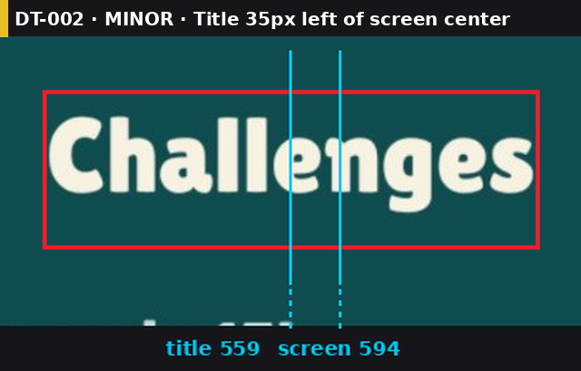 | Title centered between two buttons, **35px** left of the screen center |
| **Measures WCAG contrast** | 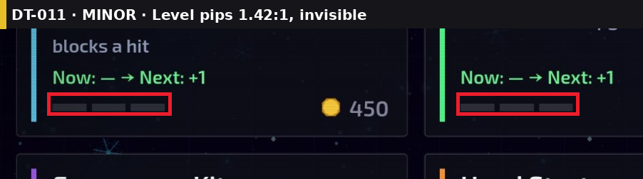 | Level pips at **1.42:1** (needs 3:1); in another game, white on green at 2.09:1 |
| **Catches missing states** | 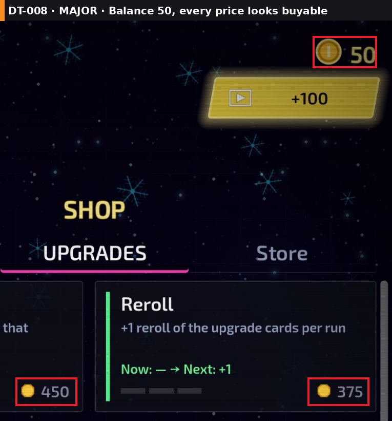 | Balance **50**, cheapest price **375**, every price still looks buyable |
| **Checks gaps and margins** | 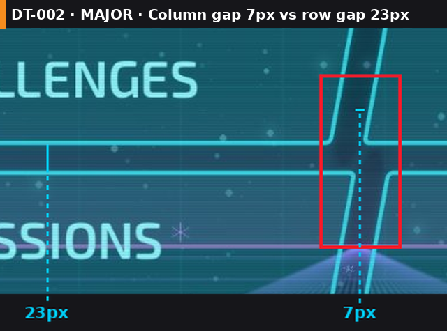 | Column gap **7px** vs row gap **23px**; in another game, screen margins 3px vs 32px |
| **Finds mixed icon styles** |  | Home is an **OS emoji** next to white glyph icons; elsewhere, one outline coin among filled ones |
| **Finds clipping and overlapping text** |  | "No free room!" printed on top of "RECEPTION", so neither is readable |
| **Judges use of space** |  | **315px** empty under BACK while the list you came for is cut off |
| **Checks baselines across states** | 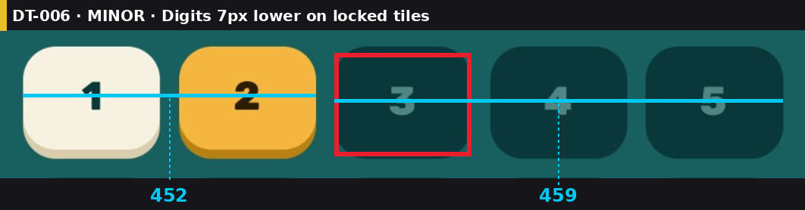 | Level digits **7px** lower on locked tiles than on unlocked ones |
| **Flags translation risks** | 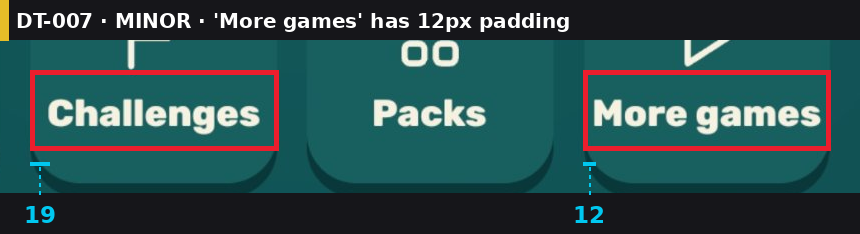 | "More games" has **12px** padding: Arabic or Hebrew won't fit |
| **Audits the palette** |  | Real colors on screen as hex with share: 4 teals, 1 yellow, 1 cream |

### Beyond pixels

The [e-commerce blind test](tests/ecommerce-site/README.md) checks what a shopper runs into, not only what a screenshot shows. The skill rendered the pages itself and forced each state (click, type, hover, keyboard focus) on a copy of the page.

| Capability | Example | What it found |
|---|---|---|
| **Checks the numbers** | 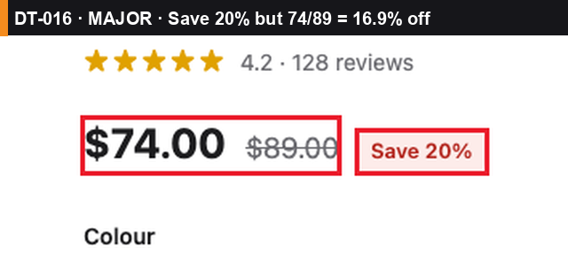 | "Save 20%" badge on **$89 → $74**, which is **16.9%** off |
| **Catches broken promises across pages** | 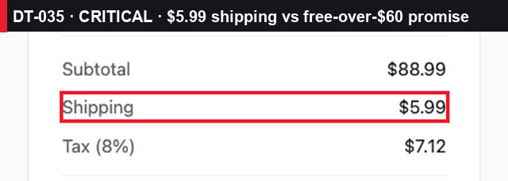 | Checkout charges **$5.99** shipping; the landing page promised free delivery over $60 |
| **Tests hover, focus and error states** | 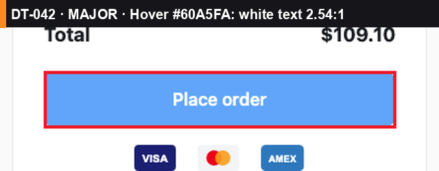 | "Place order" is fine at rest (5.17:1) but drops to **2.54:1** on hover |
| **Walks the page with the keyboard** | 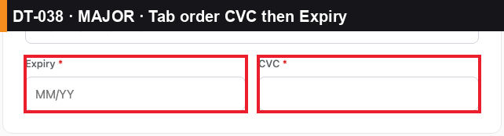 | Tab goes **CVC → Expiry** while the screen shows Expiry → CVC |
| **Types into the forms** | 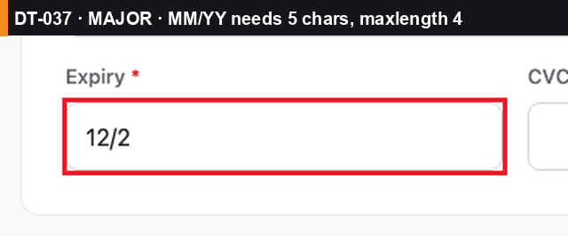 | Placeholder asks for "MM/YY" (5 chars) but the field stops at **4**: "12/2" |
| **Pushes inputs past their limits** | 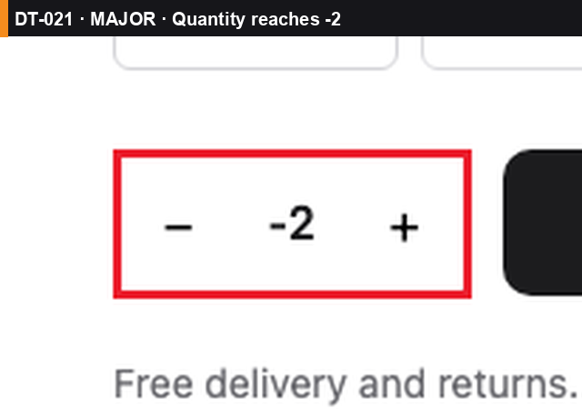 | Three taps on minus: quantity **−2**, no lower limit |
| **Renders at phone width itself** | 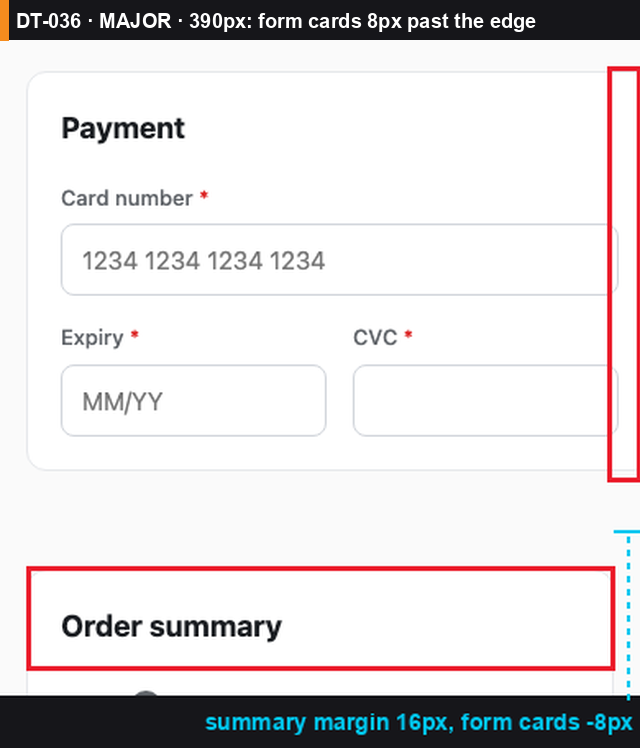 | At **390px** the form cards run **8px** past the screen edge |
| **Compares pages of one product** | 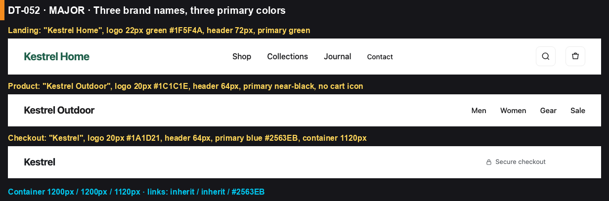 | Three brand names, three primary colors, headers **72 / 64 / 64px** across one shopping flow |

Also part of every review: a consumer verdict and a score out of 10, 2–3 fixes per issue with a pick, and a task board with before/after proof once you approve. Competitor comparison, game feel and economy, and RTL checks run when they apply. See [Features](#features).

## Real-world tests

The skill has been run on four real mobile games and one website with planted defects, in four tests. Each test has a full review, annotated screens and one cropped image per issue.

| # | Tested | Screens | Score | 🔴 | 🟠 | 🟡 | Full review |
|---|---|---|---|---|---|---|---|
| 1 | A block puzzle game + a hotel tycoon game | 6 | **4/10** | 3 | 11 | 4 | [review](tests/block-puzzle-hotel-tycoon/design-review/reviews/2026-10-26-review.md) · [tasks](tests/block-puzzle-hotel-tycoon/design-review/DESIGN_TASKS.md) |
| 2 | A synthwave survivor shooter | 2 | **5/10** | 0 | 6 | 6 | [review](tests/nova-survivor/design-review/reviews/2026-10-26-review.md) |
| 3 | A swipe-to-spell word puzzle | 4 | **6/10** | 0 | 3 | 5 | [review](tests/word-wheel/design-review/reviews/2026-10-26-review.md) |
| 4 | An e-commerce site, blind test with 42 planted defects | 3 pages | **3/10** | 4 | 18 | 26 | [full test](tests/ecommerce-site/README.md) · [review](tests/ecommerce-site/design-review/reviews/2026-10-26-review.md) |

Every box on the annotated screens is labeled with its task id, the same id as in the table under it; cyan lines are measurements in pixels.

### Test 1 · Block puzzle game + hotel tycoon game — 4/10

25 issues across 6 screens from two games.

<p align="center"></p>

📄 **Full test:** [every finding with screenshots](tests/block-puzzle-hotel-tycoon/README.md) · [review](tests/block-puzzle-hotel-tycoon/design-review/reviews/2026-10-26-review.md)

### Test 2 · Synthwave survivor shooter — 5/10

12 issues across 2 screens.

<p align="center">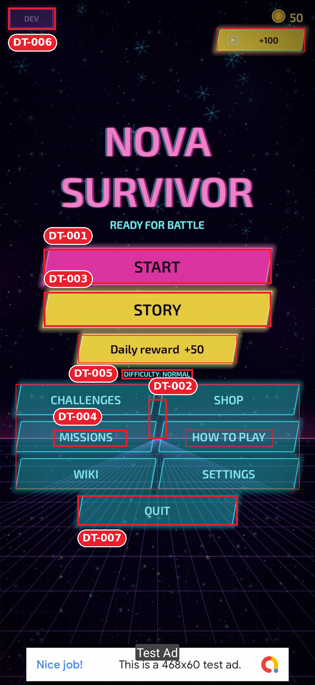</p>

📄 **Full test:** [every finding with screenshots](tests/nova-survivor/README.md) · [review](tests/nova-survivor/design-review/reviews/2026-10-26-review.md)

### Test 3 · Swipe-to-spell word puzzle — 6/10

8 issues across 4 screens. What works: home margins equal to the pixel, one tight palette, primary action always in thumb reach.

<p align="center"></p>

📄 **Full test:** [every finding with screenshots](tests/word-wheel/README.md) · [review](tests/word-wheel/design-review/reviews/2026-10-26-review.md)

### Test 4 · E-commerce site, blind test — 3/10

Three store pages (landing, product, checkout) were built with **42 hidden defects**, from easy to 1px-subtle. The answer key was kept where the skill couldn't read it.

**Found 42 / 42 planted defects**, plus **16 real problems nobody planted**, with no false positives.

| Page | Planted | Found | Extra |
|---|---|---|---|
| Landing (easy) | 10 | **10** | 4 |
| Product (medium) | 15 | **15** | 5 |
| Checkout (hard) | 17 | **17** | 4 (+3 across pages) |

<p align="center">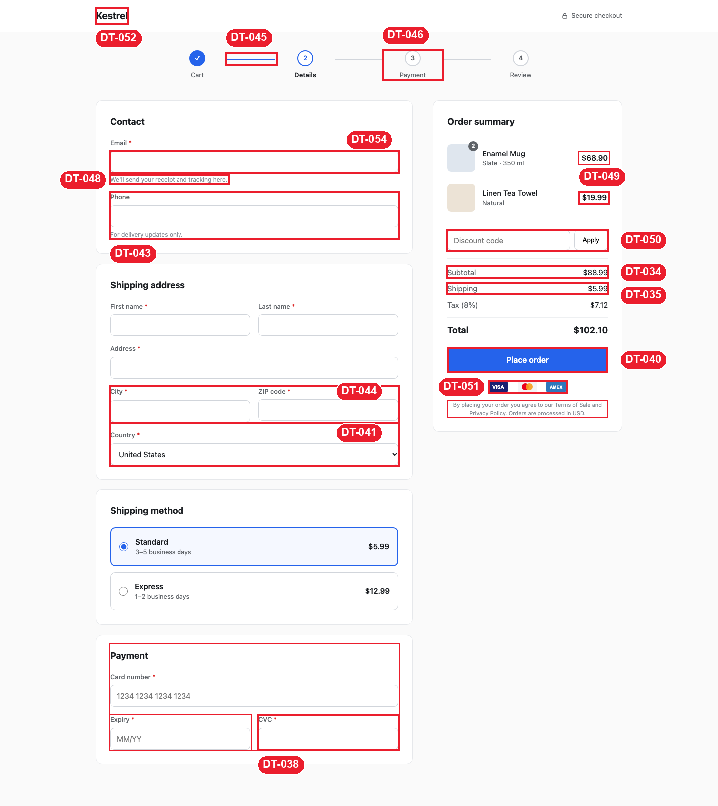</p>

📄 **Full test:** [results, scorecard and every finding](tests/ecommerce-site/README.md) · [review](tests/ecommerce-site/design-review/reviews/2026-10-26-review.md) · [answer key](tests/ecommerce-site/ANSWER_KEY.md) · [test pages](tests/ecommerce-site/site/)

## How a review looks

Every finding becomes a question with options and a pick:

```
Q4. 🟠 Settings button h=109 next to pills h=70 (Δ39px, 56%)  (DT-022)
- (a) One shared bar height: settings 70×70, icon 36px (effort S): small tap-target change
- (b) Keep sizes, align top edges (effort S): mismatch stays, just moves
- My pick: (a) because it removes the mismatch instead of moving it
```

Then it **stops**. You reply `approve all`, `approve Q1, Q4`, `Q1b, Q2a` or `approve quick wins`. After fixing, it re-captures the same screen, re-measures, and saves a before/after proof image. A fix that works on one screen size only is marked ⚠️ partial, not ✅.

Each review also has a skeptical player's take, a scorecard across 13 areas, a measurement table, and a coverage list of what it could not check.

## Features

- **Quick or Full, your choice.** Quick gives the top 10 findings at one width; Full covers everything. You also decide whether issues are marked on screenshots, which costs extra credits and time.
- **Websites captured and measured in one command:** `web_capture.py` renders the page at any width (390px phones included) and in forced states (hover, focus, errors, clicks), and writes every element's box, font, colors and WCAG contrast to JSON.
- **Measured, not eyeballed.** Element boxes, content-vs-container centering, sibling heights, margins and WCAG contrast, computed from your screenshot.
- **Annotated screenshots.** Every box is labeled with its task id (`DT-018`), the same id used in the file names and the task list.
- **One cropped image per issue**, e.g. `screenshots/issues/DT-022_settings-button-height.png`, embedded under each question in the review.
- **Perception tests:** blur/squint, grayscale, deuteranopia, protanopia, tritanopia.
- **Market comparison** (asks permission once): 3–5 competitors, a comparison board, a ✅/➖/❌/⭐ feature matrix and an HTML report.
- **Game depth:** juice checklist, first-session flow, ads and economy judged retention-first, placement logic ("does a supply shelf belong in the lobby?").
- **Arabic / Hebrew / RTL checks:** mirroring, letter shaping, clipped diacritics, fallback fonts, overflow.
- **A living task board** (`DESIGN_TASKS.md`) with severity, effort, options, your choice, status and proof, plus a review log that calls out issues reported before and still broken.
- **UI tokens + lint:** `ui_lint.py` scans Godot, React Native and HTML/CSS code for emoji icons, mismatched row heights, off-token values, removed focus outlines and pages with no phone layout.
- **Read-only until approved.** It never edits your project during a review.

## Install

**Claude Code**
```bash
git clone --depth 1 https://github.com/Suleiman700/claude-harsh-design-critic ~/.claude/skills/harsh-design-critic
cd ~/.claude/skills/harsh-design-critic
python3 -m venv .venv && .venv/bin/pip install -r requirements.txt
```
The scripts' packages (pillow, numpy, scipy) go into the skill's own `.venv`, so your system Python stays untouched; this also avoids the `externally-managed-environment` error on macOS/Homebrew Python. On Windows use `.venv\Scripts\pip`.

For one project only, clone into `<project>/.claude/skills/harsh-design-critic` instead.

The repo includes the test reviews and their screenshots (about 38 MB). To install only the skill, use the ZIP download below: it leaves the tests out.

**Claude app:** download this repo as a ZIP (**Code → Download ZIP**, about 50 KB, tests and images excluded) and upload it as a skill in the app's settings.

## Use

Attach a screenshot (or run it inside your project) and say:

- "review this screen"
- "harsh review of the shop"
- "critique / roast this UI"
- or `/harsh-design-critic <request>` in Claude Code
- `/harsh-design-critic quick <request>` for a fast top-10 pass

### Before it starts, you choose
Every review starts with one short question. Nothing is captured or marked until you answer:

1. **Quick or Full.** Quick: the top 10 findings at one screen width. Full: every finding, phone + desktop, hover/focus/error states, perception and palette.
2. **Mark issues on screenshots?** Per-issue images, full screens only, or no images. Marking takes extra credits and time, so it's your call.

| Mode | Images | Measured cost per web page |
|---|---|---|
| Quick | full screens only | ~70k tokens · ~2.5 min (product page test: found 14 of its 15 planted issues) |
| Full | per-issue | ~90k tokens · ~6.5 min (the [blind test](tests/ecommerce-site/README.md): 277k tokens, ~20 min for 3 pages, 42/42 found) |

Quick is mostly **faster** (about 2.7x); it saves about a quarter of the tokens, because most of the cost is reading the skill and the page. Numbers come from single runs; your page will differ.

"No images" is cheapest: measurements and text only. Say it in the request to skip the question, e.g. `/harsh-design-critic quick, no images, review the checkout`.

The first review in a project also asks about audience, languages, monetization and competitor research once, and remembers the answers. Everything it writes goes to `docs/harsh-design-critic/` in your project:

```
docs/harsh-design-critic/
  market-research/    INDEX.md · competitors/ · gap-table.md (only when research is allowed)
  design-review/
    REVIEW_LOG.md · DESIGN_TASKS.md · ui-tokens.json
    reviews/2026-10-26-review.md
    screenshots/screens/  review-01_shop_annotated.png …
    screenshots/issues/   DT-001_shop-price-overlay.png …
    screenshots/proof/    DT-001_before.png · DT-001_after.png · DT-001_proof.png
```

Later commands: `fix DT-007` · `next task` · `what's left` · `verify` · `research competitors` · `lint` · `store mode`.

## Known limits

- Numbers are in screenshot pixels. Converting to dp needs the device density, which a screenshot alone doesn't give.
- Color-based measurements depend on the colors picked for each element. Check the annotated image before trusting a number.
- There is no automated score yet for how many known issues a review catches. The screenshots in `tests/screenshots/` are the start of that test set.

## Works with mobile-game-specs

Pairs with [claude-mobile-game-specs](https://github.com/Suleiman700/claude-mobile-game-specs), a library of 28 mobile-game build specs. When a project follows those specs, the critic uses them as the rulebook: findings cite the spec ("floating label 4px from the edge; `04-hud-layout` requires 20px"), and option (a) is usually "apply the spec's default".

## What's inside

```
SKILL.md                     core: persona, rules, workflow
references/                  loaded only when a step needs them
  inspection-checklist.md    capture plan, measurement tables, precision defects, placement logic
  feel-flow-economy.md       juice, flow/FTUE, ads & economy, consumer criteria
  market-research.md         competitors, comparison board, gap table, HTML report
  tokens-devices-perception.md  tokens, device matrix, perception tests, lint, proof images
  screenshots.md             asking, capture, naming by task id, linking
  output-format.md           report layout, question blocks, approval prompt
  tasks-and-log.md           task board, statuses, fixing, review log
  house-standards.md         grading against mobile-game-specs
scripts/                     measure · annotate · issue_shots · palette · perception · compare · ui_lint · web_capture
templates/ui-tokens.json     starter tokens
tests/                       one folder per test: README with every finding, review, task board, screenshots
  block-puzzle-hotel-tycoon/ test 1: block puzzle + hotel tycoon
  nova-survivor/             test 2: survivor shooter (menu + shop), input/ = clean phone screenshots
  word-wheel/                test 3: word puzzle (home, reward, challenges, packs), input/ = clean phone screenshots
  ecommerce-site/            test 4: blind test, 3 store pages with 42 planted defects + answer key
```

## License

[MIT](LICENSE) © 2026 Suleiman700
