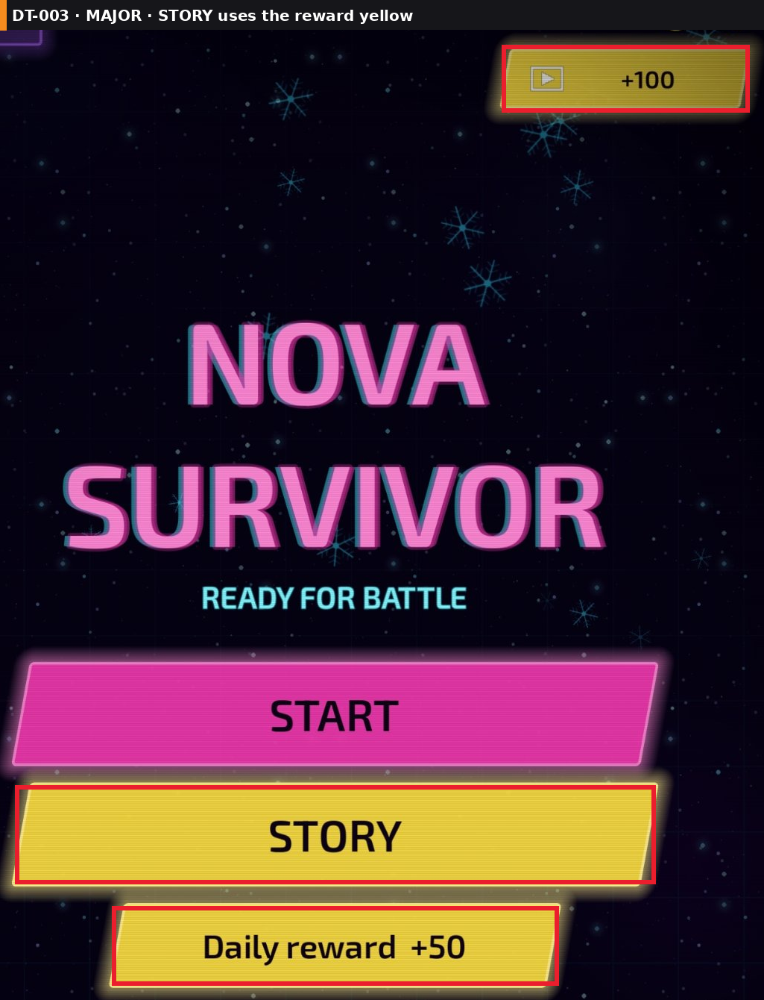
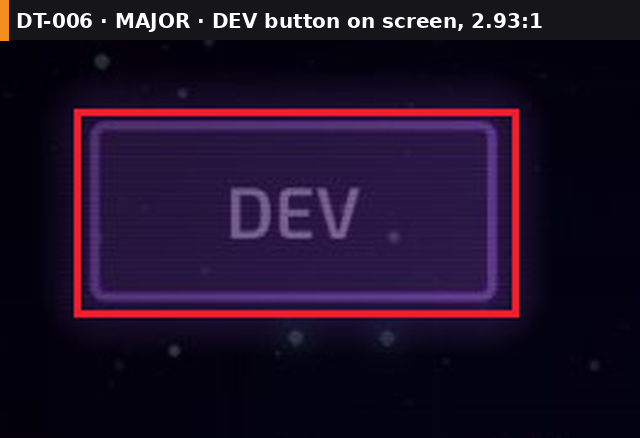
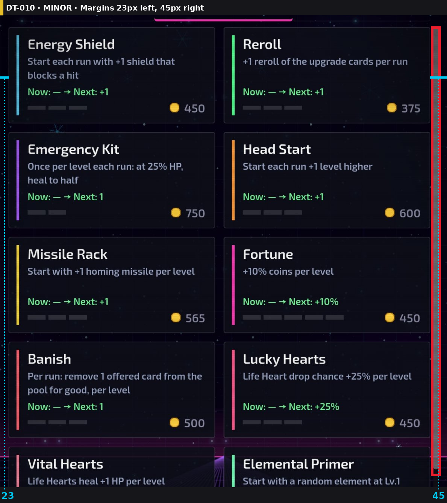
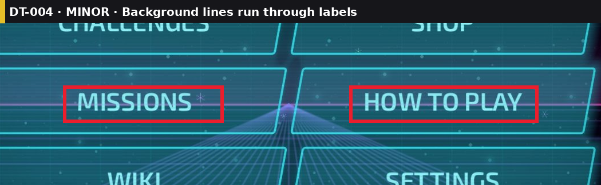
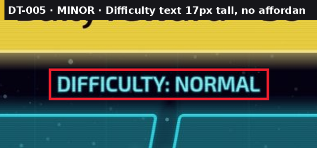
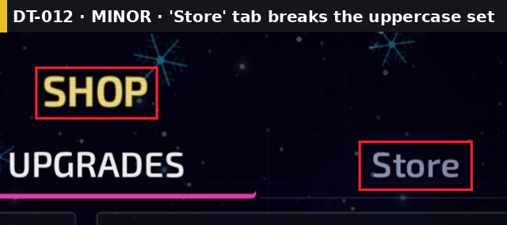
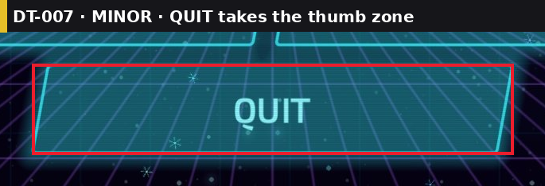

# Design Review: Nova Survivor — Main menu + Shop (Upgrades) — Review #1

**Verdict:** 5/10 — "Strong synthwave mood, but the menu is four different button systems and the shop sells things I can't afford without telling me."

## The consumer's take
The first second works: pink neon title, perspective grid, it looks like a game. Then I look at the buttons and nothing lines up. START is wide, Daily reward is narrow, the grid below is wider than both, and its two columns almost touch. STORY is the same yellow as the free-coins button, so I'm not sure if it's a mode or an ad. There's a DEV button in the corner. In the shop I have 50 coins and every upgrade costs 375 or more, yet every price looks the same as if I could tap it. Half the screen under BACK is empty while the list I came for is cut off. I'd keep playing, but I'd stop trusting the menus.

## What (barely) works
- Strong, consistent theme: neon palette and grid floor read as one style on both screens.
- Shop cards are consistent: 548/549px wide, 24px gutter, equal row pitch.
- Grid edge margins are equal (59px left and right) and every menu button is centered on the screen (cx 594.5).

## Scorecard
Precision & polish 4 · Visual consistency 5 · Art & palette 7 · Hierarchy 4 · Layout 4 · Game feel n/a (screenshots only) ·
Flow & FTUE n/a · Placement logic 5 · Localization/RTL n/a (English only) · Accessibility 5 · Audience fit 6 ·
Monetization 5 · Market positioning n/a (no research) · **Overall 5**

## Evidence
- [review-01_main-menu_annotated.png](../screenshots/screens/review-01_main-menu_annotated.png)
- [review-01_shop_annotated.png](../screenshots/screens/review-01_shop_annotated.png)
- Palette: pink `#DF37A4`, yellow `#DEC135`, cyan text `#93F0F7` on teal `#145768`, shop cards `#090B16`.

## Findings
| Q | Task | Severity | Area | Finding (with the key number) | Evidence |
|---|------|----------|------|-------------------------------|----------|
| 1 | DT-001 | 🟠 | Menu | Four button widths (861 / 599 / 1071 / 605) and five heights (133 / 132 / 106 / 117 / 114); left edge jumps 164 → 59 | [DT-001](../screenshots/issues/DT-001_menu-button-widths.png) |
| 2 | DT-008 | 🟠 | Shop | Balance 50, cheapest price 375, every price drawn the same `#89899B` | [DT-008](../screenshots/issues/DT-008_cant-afford.png) |
| 3 | DT-009 | 🟠 | Shop | 315px dead space under BACK and 153px above SHOP while the list is cut mid-card | [DT-009](../screenshots/issues/DT-009_dead-space.png) |
| 4 | DT-003 | 🟠 | Menu | STORY uses the reward yellow of Daily reward and +100 | [DT-003](../screenshots/issues/DT-003_story-reads-as-reward.png) |
| 5 | DT-002 | 🟠 | Menu | Grid column gap 7px vs row gap 23px | [DT-002](../screenshots/issues/DT-002_grid-gaps.png) |
| 6 | DT-006 | 🟠 | Menu | DEV button visible, label contrast 2.93:1 | [DT-006](../screenshots/issues/DT-006_dev-button.png) |
| 7 | DT-010 | 🟡 | Shop | Margins 23px left vs 45px right; content 11px left of center | [DT-010](../screenshots/issues/DT-010_unequal-margins.png) |
| 8 | DT-011 | 🟡 | Shop | Level pips `#2B2C36` on `#090B16`: 1.42:1 | [DT-011](../screenshots/issues/DT-011_level-pips.png) |
| 9 | DT-004 | 🟡 | Menu | Grid lines and the horizon line run through MISSIONS / HOW TO PLAY | [DT-004](../screenshots/issues/DT-004_lines-through-labels.png) |
| 10 | DT-005 | 🟡 | Menu | "DIFFICULTY: NORMAL" text is 17px tall with no control look | [DT-005](../screenshots/issues/DT-005_difficulty-label.png) |
| 11 | DT-012 | 🟡 | Shop | Tabs "SHIPS · UPGRADES · Store": one tab breaks the case; "Store" inside "SHOP" | [DT-012](../screenshots/issues/DT-012_tab-case.png) |
| 12 | DT-007 | 🟡 | Menu | QUIT (605×114) sits in the thumb zone; Android back already exits | [DT-007](../screenshots/issues/DT-007_quit-button.png) |

## UI measurements
| Screen | Group | Member | x | y | w | h | Flag |
|---|---|---|---|---|---|---|---|
| Menu | Main stack | START | 164 | 935 | 861 | 133 | width ≠ grid |
| Menu | Main stack | STORY | 165 | 1097 | 859 | 132 | |
| Menu | Main stack | Daily reward | 295 | 1259 | 599 | 106 | 3rd width, 3rd height |
| Menu | Grid | each of 6 | 59 / 598 | 1444–1723 | 532 | 117 | col gap 7 vs row gap 23 |
| Menu | Grid | QUIT | 292 | 1862 | 605 | 114 | 4th width |
| Shop | Layout | list viewport | 23–1144 | 507–2009 | — | 1502 | 315px dead below BACK |
| Shop | Margins | left / right | 23 / 45 | | | | Δ22px |

Checked OK: menu buttons centered (cx 594.5 on a 1189px screen) · grid margins 59/59 · shop cards 548/549 wide, gutter 24 · grid button text 6.19:1 · START text 5.15:1 · descriptions 7.11:1.

Density unknown, so all numbers are in screenshot pixels. On a ~3x phone, divide by 3 for dp (unverified).

## Coverage
- Audited: main menu, shop Upgrades tab, one phone size, English.
- Not audited: Ships and Store tabs, gameplay HUD, pause, can-afford and max-level states, small and tablet sizes, Arabic/Hebrew. No market research (permission not asked).

## Summary
🔴 Deal-breakers: 0 · 🟠 Major: 6 · 🟡 Minor: 6 · ⚪ Nitpick: 2

**Q1. 🟠 Four button widths, two column edges: 861 / 599 / 1071 / 605 px** (DT-001)

- (a) One column width for everything: all buttons 1071 wide, aligned with the grid (effort S): START/STORY get wider and louder
- (b) Two tiers: START/STORY 861, grid shrunk to 861 total (2 × 419 + 23 gap), Daily reward and QUIT 599 (effort S): narrower grid labels
- (c) Rebuild the menu on one 8px spacing scale with height tokens 132 / 112 (effort M)
- **My pick: (b)** because it keeps START dominant and gives the whole menu one left and right edge

**Q2. 🟠 Balance 50, every price from 375 to 1500 looks buyable** (DT-008)

- (a) Price in red `#FF5A6E` when balance < price, and dim the card to 60% (effort S): standard, clear
- (b) (a) plus a "Need 325 more" line and a "Watch ad +100" shortcut on unaffordable cards (effort M): converts frustration into rewarded views
- (c) Add a real Buy button per card with normal / disabled / maxed states (effort M)
- **My pick: (b)** because it fixes the state and turns a dead end into the existing rewarded-ad offer

**Q3. 🟠 315px dead space under BACK, list cut off mid-card** (DT-009)

- (a) Move BACK to the top-left as a back arrow and let the list run to the ad (effort S): +~400px of list, about 1.5 more rows
- (b) Keep BACK at the bottom but dock it 16px above the ad and extend the viewport (effort S)
- (c) Also shrink the top area: SHOP title into the top bar line (effort M): +153px more
- **My pick: (a)** because it gives the list the most room and matches where players look for back

**Q4. 🟠 STORY uses the reward yellow** (DT-003)

- (a) STORY in the cyan secondary style, keep yellow for rewards only (effort S): START becomes the only loud button
- (b) STORY as a second pink in outline style (effort S)
- **My pick: (a)** because one color = one meaning: yellow means free coins

**Q5. 🟠 Grid column gap 7px vs row gap 23px** (DT-002)

- (a) Column gap 23px (buttons 524 wide) (effort S)
- (b) Both gaps 16px (effort S)
- **My pick: (a)** because it matches the existing row rhythm and the main stack gap (29px) better

**Q6. 🟠 DEV button visible, 2.93:1** (DT-006)

- (a) Hide it in release builds behind a build flag (effort S)
- (b) Remove it and open dev tools with a 5-tap on the title (effort S)
- **My pick: (a)** because it's one flag and can't leak to players
- (unverified) This screenshot is a test build (AdMob test ad). If the store build already hides it, mark it won't fix.

**Q7. 🟡 Margins 23px left, 45px right** (DT-010)

- (a) Overlay the scrollbar inside the right margin and set both margins to 32px (effort S)
- (b) Keep the scrollbar outside and set left = right = 45px (effort S): cards 11px narrower each
- **My pick: (a)** because margins become equal without losing card width

**Q8. 🟡 Level pips 1.42:1, invisible** (DT-011)

- (a) Empty pips `#5E6280` (3.30:1 on `#090B16`), filled pips in the card's accent color (effort S)
- (b) Replace pips with "Lv 0/3" text (effort S)
- **My pick: (a)** because it keeps the visual progress and passes 3:1

**Q9. 🟡 Background lines run through labels** (DT-004)

- (a) Grid buttons 85% opaque fill `#0F3F4C` (effort S)
- (b) Add a 2px dark text outline to button labels (effort S)
- **My pick: (a)** because the labels stop fighting the floor grid and the neon border stays

**Q10. 🟡 Difficulty text 17px tall, no affordance** (DT-005)

- (a) If it's tappable: make it a pill button "Normal ▾" ≥ 112px tall (effort S)
- (b) If it's info only: move it under START at 24px+ (effort S)
- **My pick: (a)** (unverified: couldn't tell from a screenshot whether it's tappable)

**Q11. 🟡 'Store' tab breaks the uppercase set** (DT-012)

- (a) "STORE" and rename it "COIN PACKS" so it isn't a store inside the shop (effort S)
- (b) "STORE" only (effort S)
- **My pick: (a)** because it fixes the case and the naming confusion in one change

**Q12. 🟡 QUIT takes the thumb zone** (DT-007)

- (a) Remove QUIT, keep Android back to exit with a confirm dialog (effort S)
- (b) Move it into Settings (effort S)
- **My pick: (a)** because Android players already exit with back, and the free space helps Q1

⚪ Nitpicks
- Upgrade values mix formats: "Next: +1", "Next: 1", "Next: ✓". Pick one.
- Card accent bars use 7+ colors with no meaning. Use one color per category or none.

> **Example review: no project folder, so no task board or log was written.**
> Reply with one of: `approve all` · `approve Q1, Q3` · `Q1b, Q2a` · `approve quick wins` · `skip` · `more detail on Q<n>`
