# Design Review: Block Wood + hotel tycoon — 6 screenshots — Review #1

**Verdict:** 4/10 — "The board looks like a game. Everything around it looks like a prototype."

## The consumer's take
The wooden board and glossy blocks drew me in. Then I opened the shop. The prices sit on weird dark stripes, every button glows green even though I have zero gems, and the cards hug the left edge of my phone. The boosters under the board look like they came from a different app: flat blue squares, half of them emoji, half of them white icons. In the hotel game, the floating labels pile on top of each other: "No free room!" is printed over "RECEPTION" so I can read neither, and the receptionist's name is cut off by the screen. None of this would make me uninstall on its own. Together, it tells me nobody looked closely, and that makes me wonder what else nobody looked at.

## What (barely) works
- Board and piece tray share a coherent wood + gold frame language.
- Top-bar gaps are consistent (22px between pills and settings).

## Scorecard
Precision 3 · Visual consistency 4 · Art & palette 6 · Hierarchy 5 · Layout 4 · Game feel N/A (static) · Flow N/A · Placement logic N/A (hotel layout not fully visible) · Localization N/A (English only shown) · Accessibility 3 · Audience fit N/A (no profile yet) · Monetization 4 · Market N/A (no research yet) · **Overall 4** (capped by 🔴)

## Evidence
[review-01_booster-bar_annotated.png](../screenshots/screens/review-01_booster-bar_annotated.png) · [review-01_booster-bar_perception.png](../screenshots/screens/review-01_booster-bar_perception.png) · [review-01_hotel-hud_annotated.png](../screenshots/screens/review-01_hotel-hud_annotated.png) · [review-01_pause_annotated.png](../screenshots/screens/review-01_pause_annotated.png) · [review-01_reception_annotated.png](../screenshots/screens/review-01_reception_annotated.png) · [review-01_shop_annotated.png](../screenshots/screens/review-01_shop_annotated.png) · [review-01_shop_palette.png](../screenshots/screens/review-01_shop_palette.png) · [review-01_topbar_annotated.png](../screenshots/screens/review-01_topbar_annotated.png)
Every box on these images is labeled with its task id (e.g. DT-018), the same id used in the file names below and in DESIGN_TASKS.md.
Shop palette: #FCF2D8 45% · #1C4088 12% · #3665BB 10% · #4F84DF 10% · #8CCA36 7% · #2F6030 6% (the stray overlay color)

## Findings
| Q | Task | Sev | Area | Finding | Evidence |
|---|------|-----|------|---------|----------|
| 1 | DT-001 | 🔴 | Shop | Price centered in stray dark overlay, 28px right of button center | [DT-001_shop-price-overlay.png](../screenshots/issues/DT-001_shop-price-overlay.png) |
| 2 | DT-014 | 🔴 | Hotel | "2nd Reception" label clipped by screen edge and covered by Free $ | [DT-014_world-label-clipped.png](../screenshots/issues/DT-014_world-label-clipped.png) |
| 3 | DT-015 | 🔴 | Hotel | "No free room!" printed over "RECEPTION" | [DT-015_message-over-label.png](../screenshots/issues/DT-015_message-over-label.png) |
| 4 | DT-022 | 🟠 | Top bar | Settings h=109 vs pills h=70 (Δ39px, 56%) | [DT-022_settings-button-height.png](../screenshots/issues/DT-022_settings-button-height.png) |
| 5 | DT-002 | 🟠 | Shop | Buy buttons fully active at 0 gems | [DT-002_cant-afford-buttons.png](../screenshots/issues/DT-002_cant-afford-buttons.png) |
| 6 | DT-005 | 🟠 | All | Emoji and glyph icons mixed (shop, boosters, pause) | [DT-005_mixed-icons_booster.png](../screenshots/issues/DT-005_mixed-icons_booster.png) · [DT-005_mixed-icons_pause.png](../screenshots/issues/DT-005_mixed-icons_pause.png) · [DT-005_mixed-icons_shop.png](../screenshots/issues/DT-005_mixed-icons_shop.png) |
| 7 | DT-007 | 🟠 | Gameplay | Boosters flat blue on blue (2.11:1), off-theme | [DT-007_booster-off-theme.png](../screenshots/issues/DT-007_booster-off-theme.png) |
| 8 | DT-003 | 🟠 | Shop | Buy buttons 134px vs 179px tall | [DT-003_shop-button-heights.png](../screenshots/issues/DT-003_shop-button-heights.png) |
| 9 | DT-004 | 🟠 | Shop | Card margins 3px left vs 32px right | [DT-004_shop-card-margins.png](../screenshots/issues/DT-004_shop-card-margins.png) |
| 10 | DT-008 | 🟠 | Gameplay | Same pill = owned count and price | [DT-008_pill-count-vs-price.png](../screenshots/issues/DT-008_pill-count-vs-price.png) |
| 11 | DT-013 | 🟠 | A11y | Pieces collapse to one gray | [DT-013_pieces-grayscale.png](../screenshots/issues/DT-013_pieces-grayscale.png) |
| 12 | DT-018 | 🟠 | Pause | "Resume" white on green 2.09:1 | [DT-018_resume-contrast.png](../screenshots/issues/DT-018_resume-contrast.png) |
| 13 | DT-021 | 🟠 | Pause | Music/Sound have no on/off state | [DT-021_toggle-no-state.png](../screenshots/issues/DT-021_toggle-no-state.png) |
| 14 | DT-016 | 🟠 | Hotel | "Receptionist" clipped at right edge | [DT-016_receptionist-label-clipped.png](../screenshots/issues/DT-016_receptionist-label-clipped.png) |
| 15 | DT-023 | 🟡 | Top bar | Pills 50–59% empty, "+" floats mid-pill | [DT-023_pill-dead-space.png](../screenshots/issues/DT-023_pill-dead-space.png) |
| 16 | DT-006 | 🟡 | Shop | Descriptions 3.76:1 on cream | [DT-006_shop-description-contrast.png](../screenshots/issues/DT-006_shop-description-contrast.png) |
| 17 | DT-019 | 🟡 | Pause | "Paused" header overlaps Resume by 15px | [DT-019_header-overlaps-resume.png](../screenshots/issues/DT-019_header-overlaps-resume.png) |
| 18 | DT-011 | 🟡 | Gameplay | Booster bar ~500px under ~900px tray | [DT-011_booster-bar-width.png](../screenshots/issues/DT-011_booster-bar-width.png) |

## UI measurements
| Screen | Group | Member | x | y | w | h | Flag |
|---|---|---|---|---|---|---|---|
| Top bar | row | coin pill | 67 | 83 | 392 | 70 | h ≠ settings |
| Top bar | row | gem pill | 482 | 83 | 394 | 70 | h ≠ settings |
| Top bar | row | settings | 897 | 66 | 96 | 109 | Δ39px, top 17px higher |
| Shop | buy buttons | row 1 | 624 | 381 | 234 | 134 | h ≠ rows 2–3 |
| Shop | buy buttons | rows 2–3 | 624 | 633 / 930 | 234 | 179 | — |
| Shop | inner overlay | row 1 / rows 2–3 | 713 / 708 | — | 107 / 112 | — | inconsistent, off-center |
| Shop | cards | all | 3 | — | 907 | — | margin 3 vs 32 |
checked OK: booster buttons equal size (106×88, gaps 25px) · top-bar vertical centers equal (y=118) · top-bar gaps equal (22px)

## Coverage
- Audited: 6 static screenshots, one size each, English only.
- Not audited: pressed/disabled states, animations and juice, Arabic/Hebrew layouts, extreme values (9,999,999 coins, long names), other device sizes, full hotel floor plan (placement logic), first-launch flow, market comparison (no permission yet).

## Summary
🔴 Deal-breakers: 3 · 🟠 Major: 11 · 🟡 Minor: 4 · ⚪ Nitpick: 3

**Q1. 🔴 Shop price centered in a stray overlay, 28px right of the button center** (DT-001)

- (a) Delete the overlay node and center the price group in the button (effort S): if it was meant as a pressed state, that state is gone until re-added properly
- (b) Keep it as the pressed state: anchor it full-rect with the button's corner radius and show it only while pressed (effort S): slightly more work, keeps press feedback
- (c) Rebuild the buy button as one reusable component (price, can't-afford, pressed states) used in every row (effort M): fixes Q1, Q5 and Q8 together
- **My pick: (c)** because three shop findings share this one button; fixing it once fixes all of them

**Q2. 🔴 World label "2nd Reception" clipped by the screen edge and covered by the Free $ button** (DT-014)
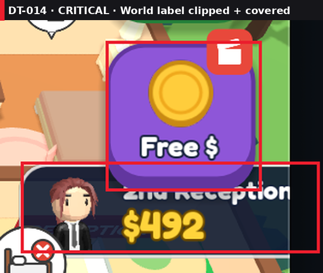
- (a) Clamp world-label screen positions to a 16px safe margin (effort S): labels slide inward near edges
- (b) Clamp + hide/fade labels that intersect HUD rectangles (effort M): no overlap with HUD, ever
- (c) Move station name plates into a tap-to-show info card (effort L): cleaner screen, one extra tap
- **My pick: (b)** because clamping alone still lets HUD buttons cover the plate

**Q3. 🔴 "No free room!" printed over the "RECEPTION" label** (DT-015)
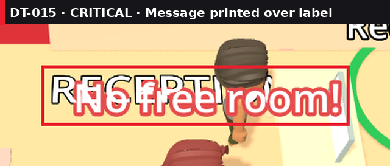
- (a) Spawn transient messages 40px above the station label with a dark plate (effort S): fixes this case only
- (b) A message lane system: transient messages stack in their own lane and fade the static label while visible (effort M): fixes every future collision
- **My pick: (b)** because more stations will spawn more messages; (a) just moves the next collision

**Q4. 🟠 Settings button h=109 next to pills h=70 (Δ39px, 56%)** (DT-022)

- (a) One shared bar height: settings 70×70, icon 36px (effort S): small tap-target change on settings
- (b) Keep sizes, align top edges (effort S): mismatch stays, just moves
- **My pick: (a)** because it removes the mismatch instead of moving it, and it's a one-constant change

**Q5. 🟠 Buy buttons look fully active with 0 gems** (DT-002)
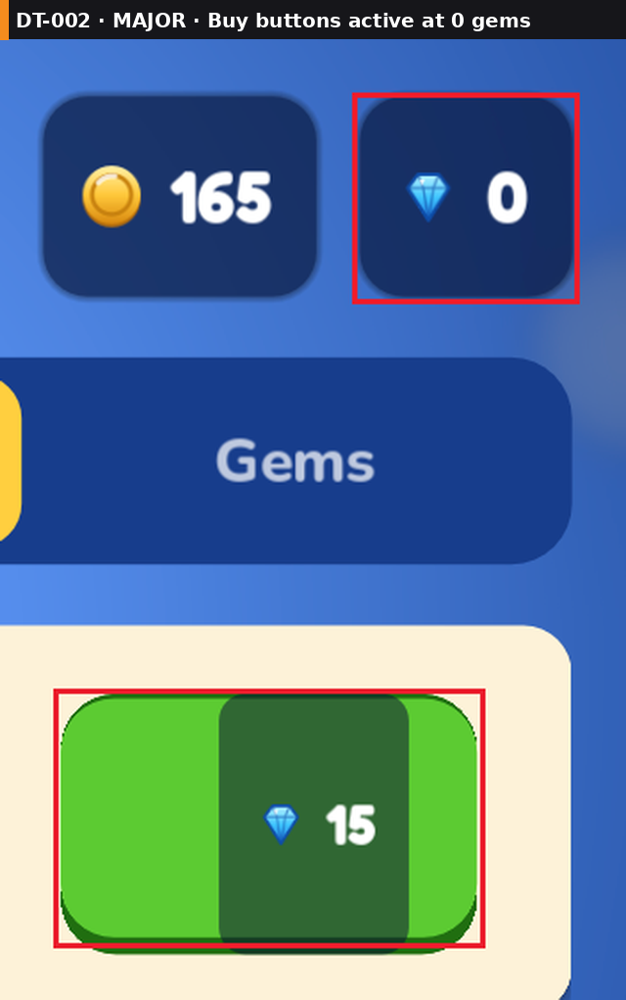
- (a) Can't-afford state: desaturated button + red price (effort S): honest, but a dead end
- (b) Can't-afford state + tapping it opens the Gems tab (effort S): turns a dead end into a path
- (c) Can't-afford state + "Watch ad for 5 gems" offer on tap (effort M): monetizes the moment of need
- **My pick: (b)** because it's still S effort and gives the player somewhere to go; (c) can follow later

**Q6. 🟠 Emoji and glyph icons mixed across shop, booster bar and pause menu** (DT-005)
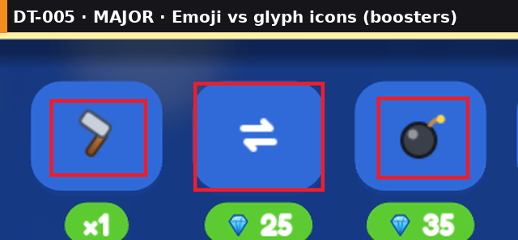

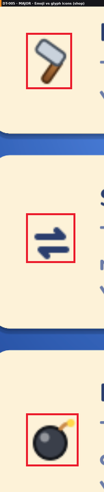
- (a) Replace only the emoji (Home, hammer, bomb) with white glyphs matching swap/lightning (effort S): consistent, but plain
- (b) Adopt one icon set (white glyph + dark outline) for every UI icon in the game (effort M): consistent everywhere
- (c) Commission/illustrate a themed icon set matching the wood/gold style (effort L): best look, most work
- **My pick: (b)** because one set fixes all three screens and future ones; run ui_lint.py to catch emoji afterwards

**Q7. 🟠 Booster buttons flat blue on blue (2.11:1) and off-theme** (DT-007)
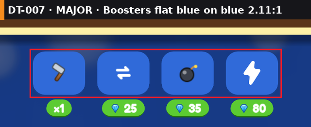
- (a) Gold outline + inner highlight + darker bottom lip on each button (effort S): readable, still a bit generic
- (b) Put the boosters on a wood tray with a gold frame like the piece tray (effort M): matches the board's material language
- **My pick: (b)** because the board and tray already define the style; the boosters should join it

**Q8. 🟠 Shop buy buttons 134px tall in row 1, 179px in rows 2–3** (DT-003)
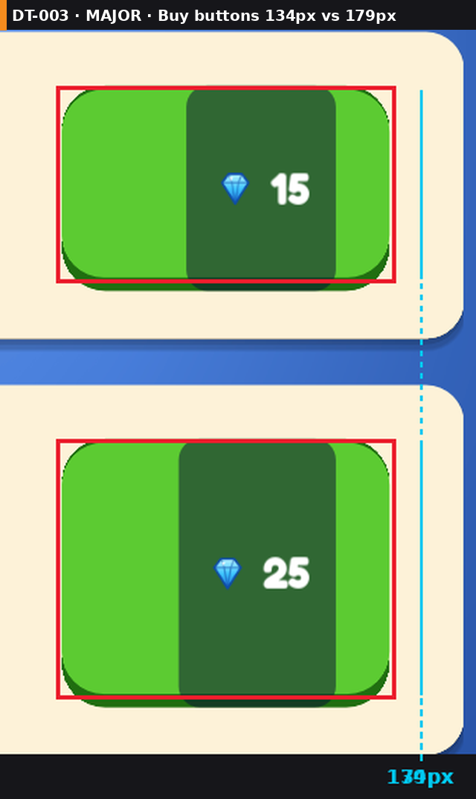
- (a) Fixed button height 96px, vertically centered in the card (effort S): rows look consistent
- (b) Fixed card height with 2-line description limit (effort S): uniform cards, may truncate text in Arabic
- **My pick: (a)** because it fixes the button without risking truncated translations

**Q9. 🟠 Shop cards: 3px left margin vs 32px right** (DT-004)
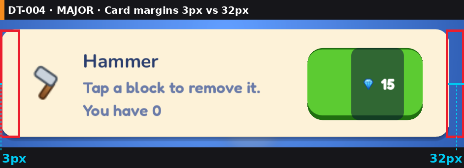
- (a) 16px margin on both sides for cards, tabs and header (effort S)
- (b) Use the safe-area inset + 16px (effort S): also correct on notched/rounded phones
- **My pick: (b)** because it's the same effort and survives every device

**Q10. 🟠 The same green pill means "owned count" (x1) and "price" (💎25)** (DT-008)
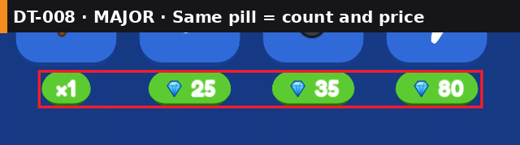
- (a) Corner count badge when owned; price pill only when empty (effort S): matches genre convention
- (b) Different pill colors for count and price (effort S): quick, still two pill styles under the buttons
- **My pick: (a)** because it's the convention players already know from match-3 games (unverified until research runs)

**Q11. 🟠 Green, purple and pink pieces collapse to the same gray** (DT-013)
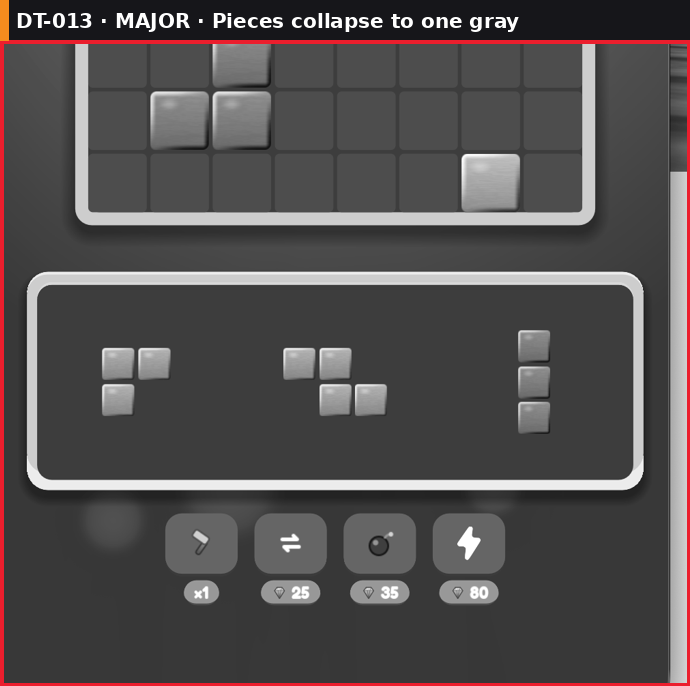
- (a) Spread piece lightness further apart (e.g. light green, mid pink, dark purple) (effort S): helps grayscale and most colorblind players
- (b) (a) + optional colorblind mode with a small symbol on each piece color (effort M): fully accessible
- **My pick: (b)** because it costs little more and is a store-listing feature

**Q12. 🟠 "Resume" white on green fails contrast (2.09:1)** (DT-018)
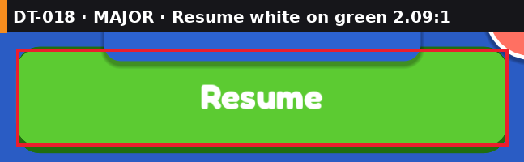
- (a) 3–4px dark-green text outline (#1E6B12) (effort S): keeps the bright button
- (b) Darker button green (effort S): changes the color identity of every primary button
- **My pick: (a)** because the game already uses outlined text style elsewhere

**Q13. 🟠 Music and Sound toggles have no on/off state** (DT-021)
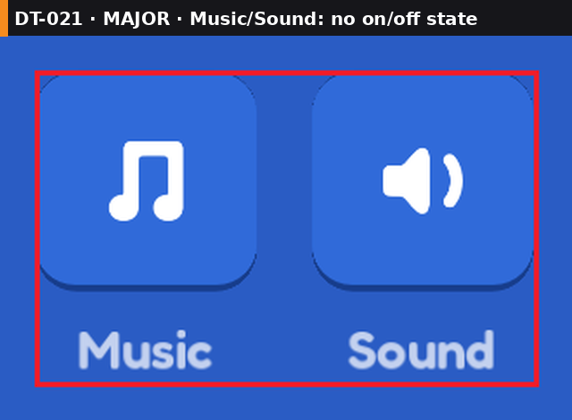
- (a) Slashed icon + dimmed button when off (effort S)
- (b) Replace with labeled on/off switches (effort S): clearer, but breaks the 4-button row style
- **My pick: (a)** because it keeps the row consistent

**Q14. 🟠 "Receptionist" label clipped at the right edge** (DT-016)
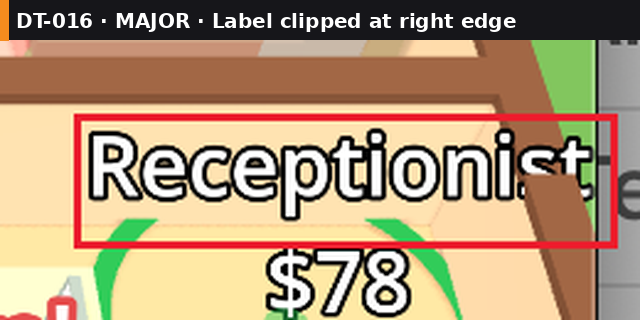
- (a) Covered by Q2's clamping (effort —)
- (b) Shorten to a role icon + amount (effort S): saves space at every station
- **My pick: (a)** because Q2 fixes it for free; do it first

**Q15. 🟡 Currency pills 50–59% empty; "+" moves with number width (147px vs 111px from pill start)** (DT-023)
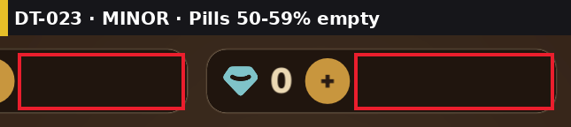
- (a) Anchor "+" to the pill's right end (effort S): fills the pill, position stable as numbers grow
- (b) Shrink pills to content (effort S): frees space, but widths change with the number
- **My pick: (a)** because the pill width stays stable as values grow

**Q16. 🟡 Shop descriptions #6B7BA8 on cream (3.76:1)** (DT-006)
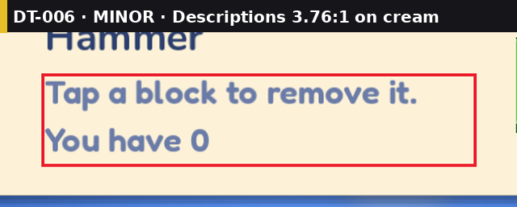
- (a) Darken to #4A5578 (passes 4.5:1) (effort S)
- (b) Keep the color, increase weight and size (effort S): passes only as "large text"
- **My pick: (a)** because it's one value and passes cleanly

**Q17. 🟡 "Paused" header overlaps the Resume button by 15px** (DT-019)
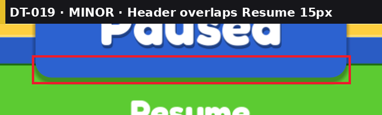
- (a) Move Resume down 24px (effort S)
- (b) Make the header tab shorter (effort S): smaller title
- **My pick: (a)** because the title is the strongest element on the panel and should stay big

**Q18. 🟡 Booster bar ~500px wide under a ~900px tray (~200px dead each side)** (DT-011)
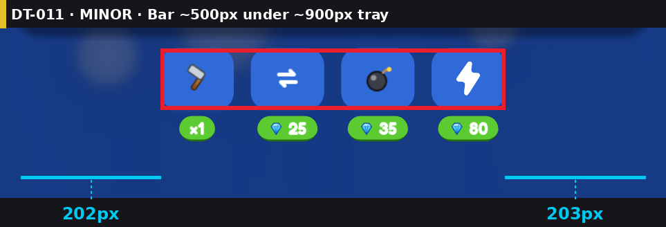
- (a) Bigger booster buttons filling the tray width (effort S): larger tap targets too
- (b) Comes free with Q7 (b) if the booster tray matches the piece tray width (effort —)
- **My pick: (b)** because Q7 already rebuilds this bar

⚪ Nitpicks: DT-009 ghost blobs left of the booster bar · DT-012 tray has a cream bottom lip, board doesn't · DT-025 coin "C" glyph vs stylized gem icon.

---
> **Report saved to `docs/game-prompts/design-review/reviews/2026-10-26-review.md`. My picks are pre-selected. Nothing else has been changed.**
> Reply with one of:
> - `approve all` — apply my pick for every Q, in severity order
> - `approve Q1, Q3` — apply my picks for those Qs only
> - `Q1b, Q2a` — choose a different option per Q
> - `approve quick wins` / `approve all critical`
> - `skip` · `more detail on Q<n>` · `won't fix Q<n> because …`
