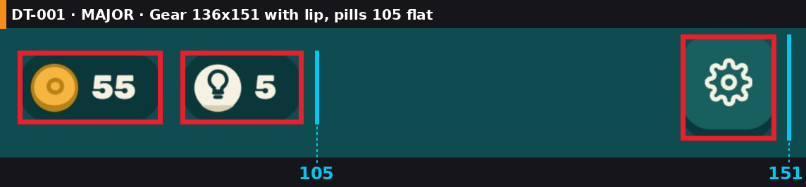
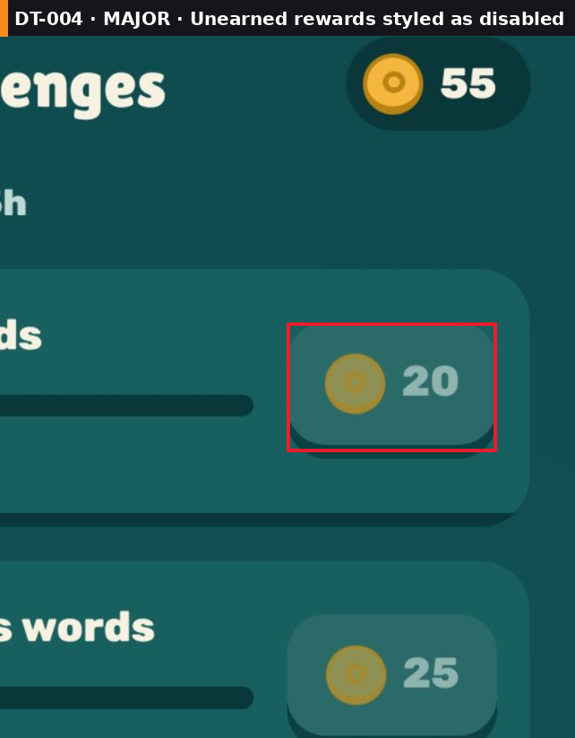
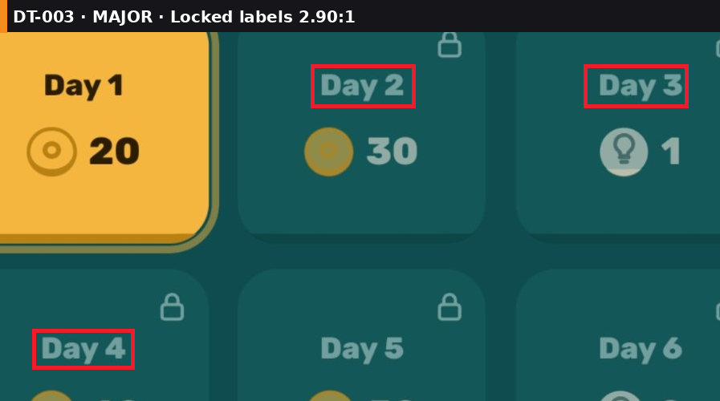
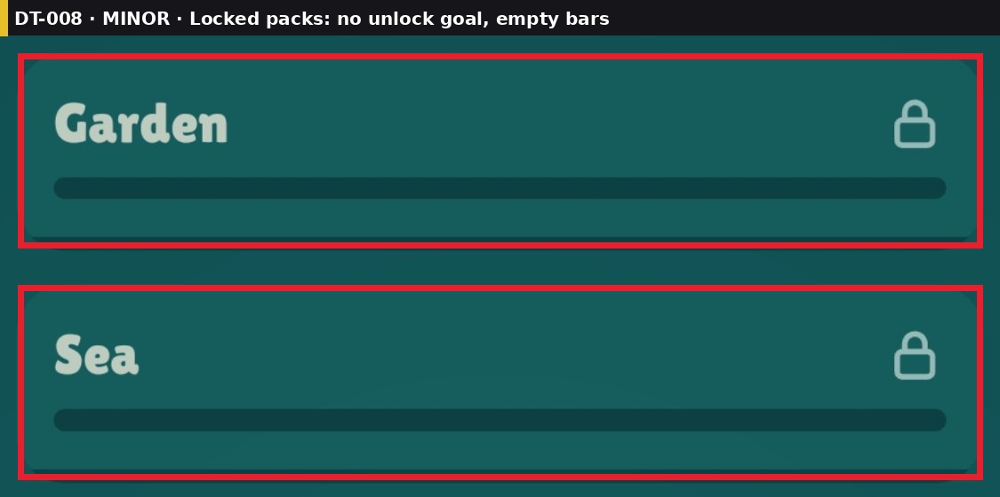
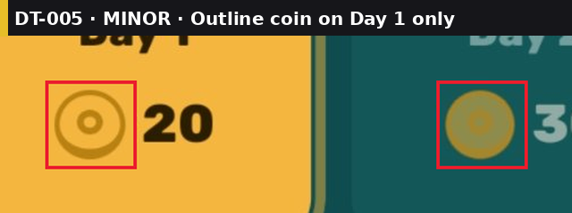

# Design Review: Word Wheel — Home, Daily reward, Challenges, Packs — Review #1

**Verdict:** 6/10 — "Clean and calm, but locked, unearned and disabled all look the same faded teal."

## The consumer's take
This looks like a real word game: one font family, one teal, one yellow for actions, big Play button where my thumb is. Then the small things add up. The gear is taller than the coin pill next to it. The screen titles sit a little left. On the reward popup, the locked days are hard to read. On Challenges, the rewards I'm working toward look greyed out, as if they're off. Packs are locked but nothing says how to open them. None of this makes me uninstall, but it's the gap between "nice indie" and "top chart".

## What (barely) works
- Home layout is precise: Play 1075 wide with 57/57 margins, nav tiles 247–249 wide with 28–30px gaps.
- One color system: yellow `#F4B63F` = primary action, cream = secondary, teal surfaces. Applied on all four screens.
- Primary actions in the thumb zone on every screen (Play, Claim, Play · 1/7).

## Scorecard
Precision & polish 6 · Visual consistency 7 · Art & palette 7 · Hierarchy 7 · Layout 7 · Game feel n/a (screenshots only) ·
Flow & FTUE 6 · Placement logic 7 · Localization/RTL 5 · Accessibility 5 · Audience fit 7 ·
Monetization n/a · Market positioning n/a (no research) · **Overall 6**

## Evidence
- [review-01_home_annotated.png](../screenshots/screens/review-01_home_annotated.png)
- [review-01_daily-reward_annotated.png](../screenshots/screens/review-01_daily-reward_annotated.png)
- [review-01_challenges_annotated.png](../screenshots/screens/review-01_challenges_annotated.png)
- [review-01_packs_annotated.png](../screenshots/screens/review-01_packs_annotated.png)

## Findings
| Q | Task | Severity | Area | Finding (with the key number) | Evidence |
|---|------|----------|------|-------------------------------|----------|
| 1 | DT-001 | 🟠 | Top bar | Gear / back 136×151 with a 3D lip next to flat pills 206×105; top edges y 9 vs 32 | [DT-001](../screenshots/issues/DT-001_top-bar-heights.png) |
| 2 | DT-004 | 🟠 | Challenges | Rewards you can still earn are styled like disabled: number `#8EB4B0` on `#2A6A69`, 2.77:1 | [DT-004](../screenshots/issues/DT-004_rewards-look-disabled.png) |
| 3 | DT-003 | 🟠 | Reward | Locked day labels `#73A1A1` on `#135758`: 2.90:1 | [DT-003](../screenshots/issues/DT-003_locked-label-contrast.png) |
| 4 | DT-002 | 🟡 | Headers | Titles centered between back and coin pill: center x 559.5 vs screen 594.5 (35px left) | [DT-002](../screenshots/issues/DT-002_header-title-offset.png) |
| 5 | DT-008 | 🟡 | Packs | Locked packs show an empty bar and no unlock goal | [DT-008](../screenshots/issues/DT-008_locked-packs-no-goal.png) |
| 6 | DT-007 | 🟡 | Nav | "More games" label has 12px padding in a 247px tile ("Challenges" 19px) | [DT-007](../screenshots/issues/DT-007_nav-label-padding.png) |
| 7 | DT-005 | 🟡 | Reward | Day 1 coin is an outline ring; every other coin is filled | [DT-005](../screenshots/issues/DT-005_coin-icon-styles.png) |
| 8 | DT-006 | 🟡 | Packs | Level digits 7px lower on flat locked tiles (center y 459) than on raised tiles (452) | [DT-006](../screenshots/issues/DT-006_level-digit-offset.png) |

## UI measurements
| Screen | Group | Member | x | y | w | h | Flag |
|---|---|---|---|---|---|---|---|
| Home | Top bar | coin pill | 56 | 32 | 206 | 105 | |
| Home | Top bar | hint pill | 287 | 32 | 175 | 105 | |
| Home | Top bar | gear (with lip) | 997 | 9 | 136 | 151 | top Δ23, style ≠ pills |
| Challenges | Header | title center | 559.5 | | | | 35px left of 594.5 |
| Packs | Level row | digit centers 1–2 / 3–5 | | 452 / 459 | | | Δ7px |

Checked OK: home margins 56–57 left = right · nav tiles 247–249, gaps 28–30 · Play button centered · reward modal title centered (594 vs 594.5) · Start pack bar fill = 10% for 1/10 · subtitle text 6.73:1.

Density unknown, so all numbers are in screenshot pixels. On a ~3x phone, divide by 3 for dp (unverified).

## Coverage
- Audited: home, daily reward popup, challenges, packs; one phone size; English.
- Not audited: the word wheel in play, level complete, out-of-hints, settings, small and tablet sizes, Arabic/Hebrew (RTL mirroring of the back arrow and progress bars still to check). No market research (permission not asked).

## Summary
🔴 Deal-breakers: 0 · 🟠 Major: 3 · 🟡 Minor: 5 · ⚪ Nitpick: 2

**Q1. 🟠 Gear and back buttons 136×151 with a lip, pills 105 flat** (DT-001)

- (a) Make gear and back 105×105, same flat style and top y as the pills (effort S): still ≥ 35dp at 3x
- (b) Give the pills the same lip and 136 height (effort S): heavier top bar
- **My pick: (a)** because the top bar is information, not the main action, and should stay quiet

**Q2. 🟠 Rewards you can earn look disabled, 2.77:1** (DT-004)

- (a) Full-color coin and cream number `#F5EFE0` on the chip; dim only after claiming (effort S)
- (b) (a) plus a yellow "Claim" chip when the task is done (effort M)
- **My pick: (b)** because the reward should pull the player forward and the done state needs its own look

**Q3. 🟠 Locked day labels 2.90:1** (DT-003)

- (a) Labels `#A9C9C7` (≥ 4.5:1 on `#135758`); keep the lock icon as the "locked" signal (effort S)
- (b) Keep the dim style but bump the font to bold 32px+ so 3:1 applies (effort S)
- **My pick: (a)** because the lock icon already says locked; the text doesn't need to fade too

**Q4. 🟡 Header titles 35px left of center** (DT-002)

- (a) Center the title on the screen width, back and pill as overlays (effort S)
- **My pick: (a)** because it's one layout change and fixes Challenges and Packs together

**Q5. 🟡 Locked packs: no unlock goal, empty bars** (DT-008)

- (a) Replace the empty bar with "Finish Start to unlock" (effort S)
- (b) (a) plus a 4-letter preview of the pack theme (effort M)
- **My pick: (a)** because it answers the only question the player has

**Q6. 🟡 'More games' has 12px padding** (DT-007)

- (a) Shorten to "Games" and set a min 24px padding per side (effort S)
- (b) Auto-shrink labels to fit, min 80% size (effort S): Arabic and Hebrew will need it
- **My pick: (a)** because it also leaves room for translations without shrinking

**Q7. 🟡 Outline coin on Day 1 only** (DT-005)

- (a) Use the filled coin on the yellow tile too, with a dark outline for contrast (effort S)
- **My pick: (a)** because one currency = one icon

**Q8. 🟡 Digits 7px lower on locked tiles** (DT-006)

- (a) Give locked tiles the same lip as raised tiles, in a darker shade (effort S)
- (b) Center digits on the tile face height for all states (effort S)
- **My pick: (a)** because the row then shares one shape and one baseline

⚪ Nitpicks
- "0/15s" for "finish with 15s left" reads as a timer. Use "Best: —".
- The logo says "Word" twice (WORD tiles + "Word Wheel").

> **Example review: no project folder, so no task board or log was written.**
> Reply with one of: `approve all` · `approve Q1, Q3` · `Q1b, Q2a` · `approve quick wins` · `skip` · `more detail on Q<n>`
