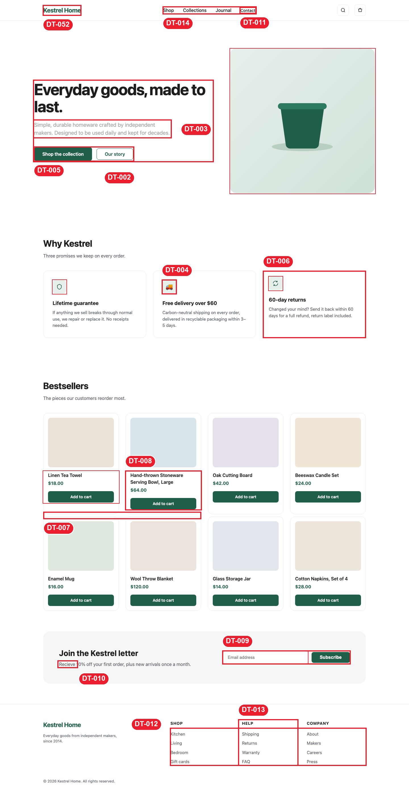
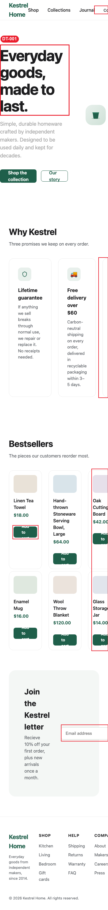
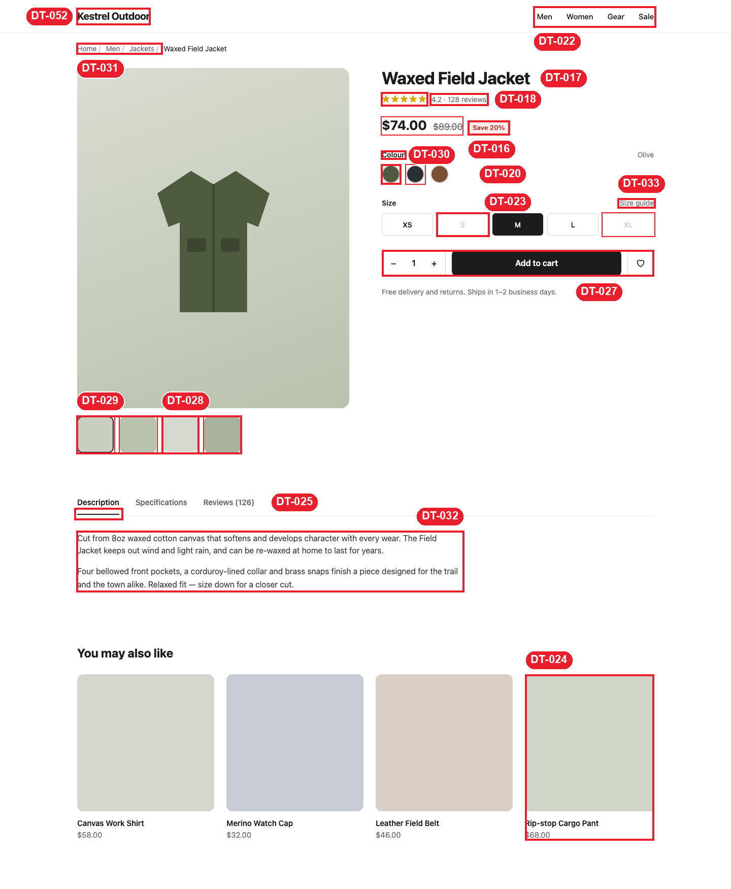
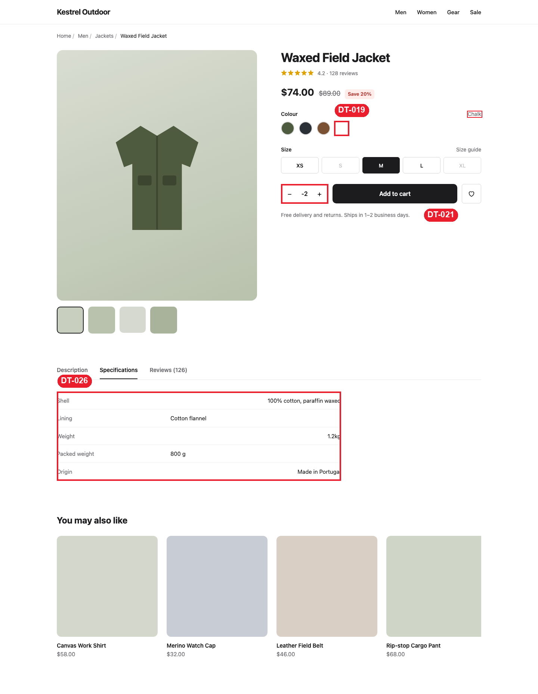
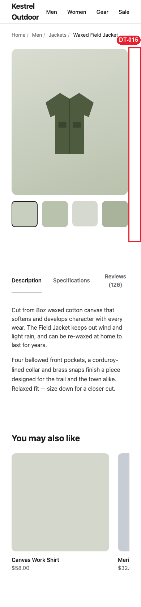
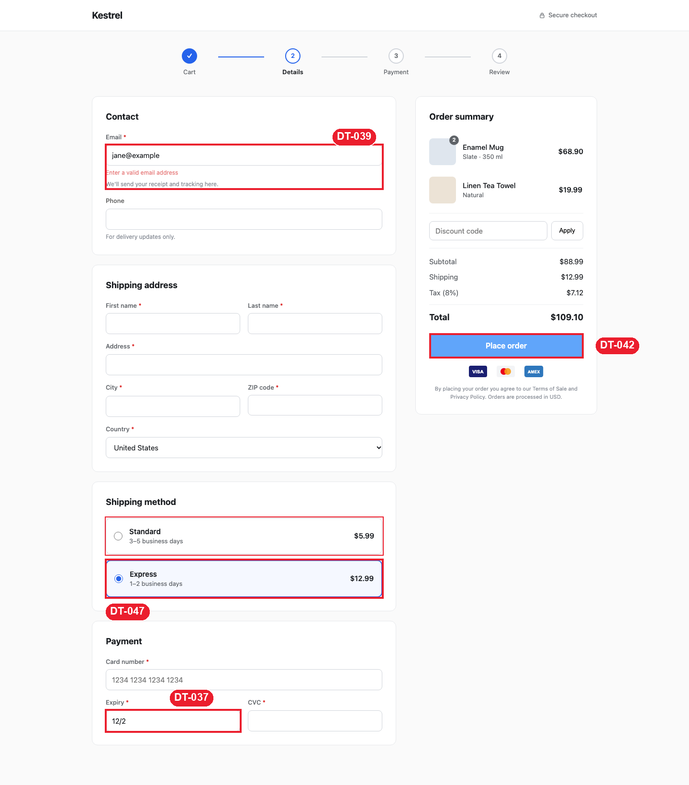
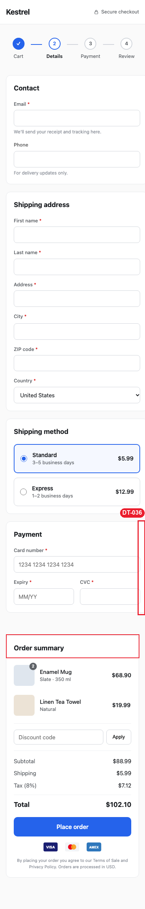

# E-commerce site: blind test

**Planted issues found: 42 / 42**, plus **16 real problems nobody planted**. Score **3/10**.

## How the test was run
1. Three pages of a fictional store, "Kestrel", were written with **42 planted defects** of increasing difficulty ([`site/`](site/)):
   - [`easy.html`](site/easy.html): a landing page, with visible mismatches.
   - [`medium.html`](site/medium.html): a product page, with wrong numbers and weak states.
   - [`hard.html`](site/hard.html): a checkout, with 1–2px offsets, hover-only and keyboard-only defects, form traps and wrong totals.
   
   The code has no comments or class names that point at a defect.
2. The [answer key](ANSWER_KEY.md) was kept **outside the project**. The skill ran in a fresh agent that could not read it.
3. The skill captured each page at 1440px and 390px. It also forced states on copies of the pages: selected swatch, quantity below 1, tabs, keyboard focus, invalid email, shipping switch, hover. Then it measured, annotated and wrote the [full review](design-review/reviews/2026-10-26-review.md).
4. Its findings were then matched against the key.

## Scorecard
| Page | Planted | Found | Extra real issues | Page score |
|---|---|---|---|---|
| easy.html (landing) | 10 | **10** | 4 | 4/10 |
| medium.html (product) | 15 | **15** | 5 | 4/10 |
| hard.html (checkout) | 17 | **17** | 4 | 3/10 |
| Across pages | – | – | 3 | – |
| **Total** | **42** | **42** | **16** | **3/10** |

### Real issues that were never planted
- DT-001 and DT-015: no mobile layout on the landing and product pages; the buy box is off-screen at 390px.
- DT-002: the hero is 32px off the page grid. A `.hero` padding shorthand overrides the container padding. The test author listed the hero as a "clean control", so this was an accidental bug, and the skill caught it.
- DT-035: the checkout charges $5.99 shipping, but the landing page promises "Free delivery over $60".
- DT-040: "Place order" on an empty form does nothing and gives no feedback.
- DT-041: no State field for a US address, and a "ZIP code" label for Canada and the UK.
- DT-052: three brand names and three primary colours across one shopping flow.
- Also DT-012 (footer items aren't links), DT-014, DT-022, DT-029, DT-030, DT-033, DT-046, DT-053 and DT-054.

False positives against the clean controls: none.

Planted issue → finding, one by one

| Key | Planted issue | Found as |
|---|---|---|
| E1 | Nav "Contact" 14px vs 16px | DT-011 |
| E2 | Hero buttons 48 vs 40px | DT-005 |
| E3 | Subtitle contrast 2.4:1 | DT-003 |
| E4 | 3rd feature card padding 20 vs 32 | DT-006 |
| E5 | 🚚 emoji among SVG icons | DT-004 |
| E6 | Grid row gap 8 vs column gap 24 | DT-007 |
| E7 | Wrapped title pushes button down 24px | DT-008 |
| E8 | Newsletter input 44 vs button 38, no label | DT-009, DT-012 |
| E9 | Typo "Recieve" | DT-010 |
| E10 | Footer column indented 12px | DT-013 |
| M1 | Breadcrumb separator 4px / 10px | DT-031 |
| M2 | Thumbnail 70 vs 72px | DT-028 |
| M3 | "Save 20%" is really 16.9% | DT-016 |
| M4 | 5 stars for a 4.2 rating | DT-017 |
| M5 | 128 vs 126 reviews | DT-018 |
| M6 | White swatch invisible on white | DT-019 |
| M7 | Selected swatch ring barely differs | DT-020 |
| M8 | Swatch focus outline removed | DT-020 |
| M9 | Sold-out sizes only 0.85 opacity | DT-023 |
| M10 | Quantity goes negative | DT-021 |
| M11 | Add to cart radius 10 vs 6 | DT-027 |
| M12 | Tab underline floats 1px | DT-025 |
| M13 | Paragraph line-height 1.5 vs 1.65 | DT-032 |
| M14 | Specs alignment zigzag, "1.2kg" vs "800 g" | DT-026 |
| M15 | Related rail cuts card 4, hides card 5 | DT-024 |
| H1 | Stepper lines 2px below circle centre | DT-045 |
| H2 | Phone label #616161 vs #5f6368 | DT-043 |
| H3 | Phone required, no asterisk | DT-043 |
| H4 | City label gap 8 vs 6px | DT-044 |
| H5 | ZIP input 43 vs 44px | DT-044 |
| H6 | Hint text 3.3:1 | DT-048 |
| H7 | Email error 2.9:1, colour-only, shifts layout | DT-039 |
| H8 | Selected shipping card 2px border shifts content | DT-047 |
| H9 | Tab order CVC → Expiry, shown Expiry → CVC | DT-038 |
| H10 | Expiry "MM/YY" but maxlength 4 | DT-037 |
| H11 | Line items sum $88.89, subtotal $88.99 | DT-034 |
| H12 | One price 2px off the right edge | DT-049 |
| H13 | "Apply" button font not inherited (13.3px) | DT-050 |
| H14 | Place-order hover drops to 2.5:1 | DT-042 |
| H15 | AMEX badge renders larger | DT-051 |
| H16 | Legal text 11px, 3.3:1 | DT-048 |
| H17 | Card-number min-width overflows 390px phone | DT-036 |

## Findings
54 issues across 3 pages of a fictional retail site, captured at 1440px and 390px plus forced states (selected swatch, quantity, tabs, keyboard focus, invalid email, hover). Page scores: landing 4/10, product page 4/10, checkout 3/10. 🔴 4 · 🟠 18 · 🟡 26 · ⚪ 6. Click an ID to see its close-up. Full [review](design-review/reviews/2026-10-26-review.md) · [tasks](design-review/DESIGN_TASKS.md) · [pages](site/).

### Landing page (4/10)
**Desktop 1440px**

| ID | Level | Issue |
|---|---|---|
| [DT&#8209;002](design-review/screenshots/issues/DT-002_hero-off-grid.png) | 🟠&nbsp;Major | Hero content starts at **x=120**, logo and every section at **x=152** (Δ32px); hero art ends at 1320 vs 1288 |
| [DT&#8209;003](design-review/screenshots/issues/DT-003_hero-subtitle-contrast.png) | 🟠&nbsp;Major | Subtitle `#A8A8A8` on white: **2.38:1** (needs 4.5:1) |
| [DT&#8209;004](design-review/screenshots/issues/DT-004_emoji-feature-icon.png) | 🟠&nbsp;Major | "Free delivery" uses the **🚚 emoji**; the other two cards use 1.8px green line SVGs |
| [DT&#8209;005](design-review/screenshots/issues/DT-005_hero-button-heights.png) | 🟡&nbsp;Minor | "Shop the collection" **48px** tall, "Our story" **40px** (Δ8px, 17%) |
| [DT&#8209;006](design-review/screenshots/issues/DT-006_feature-card-padding.png) | 🟡&nbsp;Minor | Card 3 padding **20px** vs **32px**: its icon sits 12px higher and 12px further left |
| [DT&#8209;007](design-review/screenshots/issues/DT-007_product-grid-gaps.png) | 🟡&nbsp;Minor | Grid `gap: 8px 24px`: rows nearly touch (**8px**) while columns get **24px** |
| [DT&#8209;008](design-review/screenshots/issues/DT-008_product-card-button-drop.png) | 🟡&nbsp;Minor | "Hand-thrown Stoneware Serving Bowl, Large" wraps to 2 lines: its price and button sit **24px lower** than the row |
| [DT&#8209;009](design-review/screenshots/issues/DT-009_newsletter-control-heights.png) | 🟡&nbsp;Minor | Input **44px**, Subscribe **38px** (Δ6px) on one row |
| [DT&#8209;010](design-review/screenshots/issues/DT-010_typo-recieve.png) | 🟡&nbsp;Minor | Newsletter copy: "**Recieve** 10% off…" |
| [DT&#8209;011](design-review/screenshots/issues/DT-011_nav-contact-size.png) | 🟡&nbsp;Minor | Nav "Contact" **14px** vs **16px** for Shop/Collections/Journal; top 28 vs 27 |
| [DT&#8209;012](design-review/screenshots/issues/DT-012_footer-dead-links.png) | 🟡&nbsp;Minor | 12 footer items (Shipping, Returns, FAQ…) are `<li>` text with **no links**; email field has only a placeholder |
| [DT&#8209;013](design-review/screenshots/issues/DT-013_footer-help-indent.png) | ⚪&nbsp;Nitpick | HELP column has `padding-left:12px`: heading at x=852 vs column x=840 |
| [DT&#8209;014](design-review/screenshots/issues/DT-014_nav-off-center.png) | ⚪&nbsp;Nitpick | Nav group center x=736 vs page center 720 (space-between with a 133px logo and 100px icon group) |

**Phone 390px**

| ID | Level | Issue |
|---|---|---|
| [DT&#8209;001](design-review/screenshots/issues/DT-001_landing-no-mobile-layout.png) | 🔴&nbsp;Critical | At 390px the page is **667px** wide: hero text at x=0, nav and 3rd feature card cut off, 4 product columns, "Add to cart" overflows 85px buttons |
| [DT&#8209;001](design-review/screenshots/issues/DT-001_landing-no-mobile-layout_products.png) | 🔴&nbsp;Critical | Product grid stays 4 columns; newsletter input starts at x=220 and runs off-screen |

### Product page (4/10)
**Desktop 1440px**

| ID | Level | Issue |
|---|---|---|
| [DT&#8209;016](design-review/screenshots/issues/DT-016_discount-math.png) | 🟠&nbsp;Major | $74.00 vs $89.00 is **16.9%** off, badge says **Save 20%** |
| [DT&#8209;017](design-review/screenshots/issues/DT-017_stars-vs-rating.png) | 🟠&nbsp;Major | `★★★★★` shown for **4.2**; stars `#E0A100` on white **2.27:1** |
| [DT&#8209;018](design-review/screenshots/issues/DT-018_review-count-mismatch.png) | 🟠&nbsp;Major | Rating says **128 reviews**, tab says **Reviews (126)**, the tab lists **2** |
| [DT&#8209;020](design-review/screenshots/issues/DT-020_swatch-selected-state.png) | 🟠&nbsp;Major | Selected ring `#C8C8C8` vs default `#DDDDDD`: **1.23:1** between states; `outline:none` removes the keyboard focus ring |
| [DT&#8209;022](design-review/screenshots/issues/DT-022_pdp-no-cart.png) | 🟠&nbsp;Major | PDP header has only Men/Women/Gear/Sale; the landing header has search + cart icons |
| [DT&#8209;023](design-review/screenshots/issues/DT-023_disabled-sizes.png) | 🟡&nbsp;Minor | S and XL: same border `#D4D4D8`, only faded text (opacity 0.85 on the UA disabled color); no strike-through or "sold out" hint |
| [DT&#8209;024](design-review/screenshots/issues/DT-024_related-rail-clipped.png) | 🟡&nbsp;Minor | 5 cards × 270px + gaps = **1446px** in a 1136px box with `overflow:hidden`: card 4 cut at 1288 (254/270px), card 5 unreachable |
| [DT&#8209;025](design-review/screenshots/issues/DT-025_tab-underline-gap.png) | 🟡&nbsp;Minor | Underline at y 1012–1013, white gap at **1014**, divider at 1015 |
| [DT&#8209;027](design-review/screenshots/issues/DT-027_buy-row-radii.png) | 🟡&nbsp;Minor | Qty box radius **6**, Add to cart **10**, wishlist **6** (sizes 6, landing buttons 8) |
| [DT&#8209;028](design-review/screenshots/issues/DT-028_thumb-size.png) | 🟡&nbsp;Minor | Thumb 3 **70×70**, others **72×72**; its bottom edge 2px higher |
| [DT&#8209;029](design-review/screenshots/issues/DT-029_thumbs-not-clickable.png) | 🟡&nbsp;Minor | Thumbs have `cursor:pointer` and an active border, but **no click handler** |
| [DT&#8209;030](design-review/screenshots/issues/DT-030_colour-spelling.png) | 🟡&nbsp;Minor | UK spelling "**Colour**" for a US audience; "Navy" swatch is `#2B2F36` (charcoal), "Tan" is `#7A5233` (dark brown) |
| [DT&#8209;031](design-review/screenshots/issues/DT-031_breadcrumb-spacing.png) | ⚪&nbsp;Nitpick | "/" has **4px** before and **10px** after |
| [DT&#8209;032](design-review/screenshots/issues/DT-032_paragraph-line-height.png) | ⚪&nbsp;Nitpick | Paragraph 1 line-height **1.5**, paragraph 2 **1.65** (`p + p` rule) |
| [DT&#8209;033](design-review/screenshots/issues/DT-033_size-guide-link.png) | ⚪&nbsp;Nitpick | Same grey `#6B6B70`, no underline: reads as a label |

**States: Chalk selected, quantity −2, Specifications tab**

| ID | Level | Issue |
|---|---|---|
| [DT&#8209;019](design-review/screenshots/issues/DT-019_chalk-swatch-invisible.png) | 🟠&nbsp;Major | Chalk = white fill + inline white border on a white page: **1.0:1**; when selected, still no ring (inline style beats `.selected`) |
| [DT&#8209;021](design-review/screenshots/issues/DT-021_qty-negative.png) | 🟠&nbsp;Major | Three clicks on − from 1 gives **-2**; no min, no max, minus never disables |
| [DT&#8209;026](design-review/screenshots/issues/DT-026_specs-table.png) | 🟡&nbsp;Minor | Odd rows right-aligned, even rows left-aligned; "1.2kg" vs "800 g"; packed weight **800 g** lighter than the **1.2 kg** jacket |
| [DT&#8209;018](design-review/screenshots/issues/DT-018_review-count-mismatch_tab.png) | 🟠&nbsp;Major | Reviews tab: "Reviews (126)" lists only **2** reviews, no "load more" |
| [DT&#8209;020](design-review/screenshots/issues/DT-020_swatch-selected-state_focus.png) | 🟠&nbsp;Major | Keyboard focus on a swatch: **no ring** (`outline:none`) |

**Phone 390px**

| ID | Level | Issue |
|---|---|---|
| [DT&#8209;015](design-review/screenshots/issues/DT-015_pdp-buy-box-offscreen.png) | 🔴&nbsp;Critical | At 390px the info column starts at **x=418**: title, price, sizes and Add to cart are off-screen (Add to cart **30.5px** wide) |

### Checkout (3/10)
**Desktop 1440px**

| ID | Level | Issue |
|---|---|---|
| [DT&#8209;034](design-review/screenshots/issues/DT-034_order-math.png) | 🔴&nbsp;Critical | $68.90 + $19.99 = **$88.89**, subtotal shows **$88.99** (+$0.10); 2× Enamel Mug = $68.90 ($34.45 each) vs **$16.00** on the landing; Tea Towel $19.99 vs **$18.00** |
| [DT&#8209;035](design-review/screenshots/issues/DT-035_shipping-charged.png) | 🔴&nbsp;Critical | $88.99 order charged **$5.99** Standard shipping; landing promises "**Free delivery over $60**", PDP "Free delivery and returns" |
| [DT&#8209;038](design-review/screenshots/issues/DT-038_cvc-expiry-tab-order.png) | 🟠&nbsp;Major | DOM order CVC then Expiry; CSS `order` swaps them visually: Tab jumps right, then back left |
| [DT&#8209;040](design-review/screenshots/issues/DT-040_place-order-no-validation.png) | 🟠&nbsp;Major | `novalidate` + `onsubmit="return false"`: clicking **Place order** with every field empty gives no feedback |
| [DT&#8209;041](design-review/screenshots/issues/DT-041_missing-state-field.png) | 🟠&nbsp;Major | Address = street, city, ZIP, country; **no State** (and no apartment line); Canada/UK offered with a "ZIP code" label |
| [DT&#8209;043](design-review/screenshots/issues/DT-043_phone-required-mismatch.png) | 🟡&nbsp;Minor | Phone input has `required`, label has no asterisk and the hint says "For delivery updates only"; label color `#616161` vs `#5F6368` |
| [DT&#8209;044](design-review/screenshots/issues/DT-044_city-zip-misaligned.png) | 🟡&nbsp;Minor | City input y **803–847**, ZIP **801–844**: tops Δ2px, bottoms Δ3px (ZIP 43px tall, label gap 8 vs 6) |
| [DT&#8209;045](design-review/screenshots/issues/DT-045_stepper-line-low.png) | 🟡&nbsp;Minor | Connector center **y=119**, dot center **y=117** |
| [DT&#8209;046](design-review/screenshots/issues/DT-046_stepper-mismatch.png) | 🟡&nbsp;Minor | Step 2 "Details" is current, step 3 "Payment" is grey, yet the Payment card is on the same page |
| [DT&#8209;048](design-review/screenshots/issues/DT-048_hint-contrast.png) | 🟡&nbsp;Minor | Hints `#8A8F98` 12px and legal 11px on white: **3.25:1** |
| [DT&#8209;049](design-review/screenshots/issues/DT-049_amount-alignment.png) | 🟡&nbsp;Minor | $19.99 ends at x=**1217**, $68.90 at **1219** (`.item:nth-child(2) .amt{padding-right:2px}`) |
| [DT&#8209;050](design-review/screenshots/issues/DT-050_promo-row.png) | 🟡&nbsp;Minor | "Apply" text **13.3px** (button font not inherited) vs 15px; promo controls **40px** vs 44px fields |
| [DT&#8209;051](design-review/screenshots/issues/DT-051_payment-badges.png) | ⚪&nbsp;Nitpick | AMEX **39.3×24** (viewBox 36×22) vs 38×24; Mastercard tile `#F3F4F6` on white 1.1:1 (no edge) |

**States: invalid email, Express selected, Place order hover, expiry typed**

| ID | Level | Issue |
|---|---|---|
| [DT&#8209;037](design-review/screenshots/issues/DT-037_expiry-maxlength.png) | 🟠&nbsp;Major | Placeholder **MM/YY** (5 chars), `maxlength="4"`: typing "12/28" stops at "**12/2**" |
| [DT&#8209;039](design-review/screenshots/issues/DT-039_email-error-state.png) | 🟠&nbsp;Major | Error text `#E57373` on white **2.99:1**; input border stays grey `#D1D5DB`; error appears above the hint and pushes the page **24px**; empty email never errors |
| [DT&#8209;042](design-review/screenshots/issues/DT-042_place-order-hover.png) | 🟠&nbsp;Major | Hover background `#60A5FA` with white text: **2.54:1** (rest state `#2563EB` is 5.17:1) |
| [DT&#8209;047](design-review/screenshots/issues/DT-047_shipping-option-shift.png) | 🟡&nbsp;Minor | Selected option border **2px** vs 1px: card 78px vs 76px, content shifts 1px right, everything below moves 2px |

**Phone 390px**

| ID | Level | Issue |
|---|---|---|
| [DT&#8209;036](design-review/screenshots/issues/DT-036_checkout-mobile-overflow.png) | 🟠&nbsp;Major | At 390px form cards are **382px** wide in a 358px column: right edge at 398 (**8px** past the screen), summary card keeps a 16px margin |

### Across all three pages

| ID | Level | Issue |
|---|---|---|
| [DT&#8209;052](design-review/screenshots/issues/DT-052_brand-inconsistency.png) | 🟠&nbsp;Major | "Kestrel Home" green `#1F5F4A` / "Kestrel Outdoor" black `#1C1C1E` / "Kestrel" blue `#2563EB`; header 72/64/64px; container 1200/1200/1120px |
| [DT&#8209;053](design-review/screenshots/issues/DT-053_button-token-sprawl.png) | 🟡&nbsp;Minor | Button heights **38 / 40 / 44 / 48 / 52px**, radii **6 / 8 / 10px** across the flow |
| [DT&#8209;054](design-review/screenshots/issues/DT-054_input-border-contrast.png) | 🟡&nbsp;Minor | Field borders `#D1D5DB` **1.47:1**, `#D0D5D2` 1.49:1, `#D4D4D8` 1.48:1 (WCAG 1.4.11 needs 3:1) |
