# Design Review: Kestrel store — landing, product page, checkout — Review #1

**Verdict:** 3/10 — "The checkout adds my mugs up wrong, charges shipping it promised was free, and the product page has no Add to cart on my phone."

## The consumer's take
The landing looks like every calm Shopify homeware theme: green button, beige squares, a truck emoji. Fine until I open it on my phone and the hero text is glued to the left edge and the page scrolls sideways. On the jacket page the stars say five, the number says 4.2, the badge says 20% off a 17% discount, and a white "Chalk" color I cannot even see. Then checkout: the logo changed, the green turned blue, two mugs that were $16 each are now $68.90, the subtotal is ten cents more than the lines above it, and I am paying $5.99 for the "free delivery over $60" the first page promised. That is the moment I close the tab. A shop that cannot add two numbers does not get my card.

## What (barely) works
- Desktop checkout structure is conventional and scannable: one column of cards, sticky summary, 44px fields, visible blue focus ring on inputs.
- Landing typography scale is calm and consistent (56/32/18/16) and the body grey `#5F6368` passes at 6.05:1.

## Scorecard
Precision & polish 4 · Visual consistency 3 · Art & palette 5 · Hierarchy 5 · Layout 3 (mobile 1) · Game feel n/a · Flow & checkout 3 · Placement logic 6 · Localization/RTL n/a (English-only, US; see coverage) · Accessibility 3 · Audience fit 5 · Monetization/trust 2 · Market positioning n/a (no research) · **Overall 3** (capped by 4 🔴)

Per page: **Landing 4/10** · **Product page 4/10** · **Checkout 3/10**.

## Evidence
Annotated screens (every box labeled with its task id):

- [review-01_landing_annotated.png](../screenshots/screens/review-01_landing_annotated.png)
- [review-01_landing_phone_annotated.png](../screenshots/screens/review-01_landing_phone_annotated.png)
- [review-01_product_annotated.png](../screenshots/screens/review-01_product_annotated.png)
- [review-01_product_states_annotated.png](../screenshots/screens/review-01_product_states_annotated.png)
- [review-01_product_phone_annotated.png](../screenshots/screens/review-01_product_phone_annotated.png)
- [review-01_checkout_annotated.png](../screenshots/screens/review-01_checkout_annotated.png)
- [review-01_checkout_states_annotated.png](../screenshots/screens/review-01_checkout_states_annotated.png)
- [review-01_checkout_phone_annotated.png](../screenshots/screens/review-01_checkout_phone_annotated.png)
- Perception sheets: [landing](../screenshots/screens/review-01_landing_perception.png) · [product](../screenshots/screens/review-01_product_perception.png) · [checkout](../screenshots/screens/review-01_checkout_perception.png). Blur test: the hero subtitle vanishes (DT-003) and the eight identical green "Add to cart" bars outweigh the hero CTA.
- Palettes: [landing](../screenshots/screens/review-01_landing_palette.png) (white, sage `#DFE4DF`, green `#306553`) · [product](../screenshots/screens/review-01_product_palette.png) (white, olive greys, `#434939`) · [checkout](../screenshots/screens/review-01_checkout_palette.png) (grey `#F9F9FA`, blue `#2E68E7`). Three palettes for one store: see DT-052. Proposed: one primary `#1F5F4A`, text `#1D1D1F`, secondary text `#5F6368`, border `#8A8F98` (inputs) / `#E6E8EB` (cards), surface `#FAFAFA`, error `#B91C1C`.
- Raw captures: `review-01_<page>.png` (1440px), `_phone.png` (390px via iframe), `_states.png` (Chalk selected + qty −2 + Specs tab; invalid email + Express + Place-order hover + expiry typed), `_reviews-tab.png`, `_swatch-focus.png`.

## Findings

### Landing (easy.html)

| Q | Task | Severity | Area | Finding (with the key number) | Evidence |
|---|------|----------|------|-------------------------------|----------|
| 1 | DT-001 | 🔴 | Mobile/Layout | At 390px the page is **667px** wide: hero text at x=0, nav and 3rd feature card cut off, 4 product columns, "Add to cart" overflows 85px buttons | [DT-001_landing-no-mobile-layout.png](../screenshots/issues/DT-001_landing-no-mobile-layout.png) · [DT-001_landing-no-mobile-layout_products.png](../screenshots/issues/DT-001_landing-no-mobile-layout_products.png) |
| 5 | DT-002 | 🟠 | Precision/A5 | Hero content starts at **x=120**, logo and every section at **x=152** (Δ32px); hero art ends at 1320 vs 1288 | [DT-002_hero-off-grid.png](../screenshots/issues/DT-002_hero-off-grid.png) |
| 6 | DT-003 | 🟠 | Contrast | Subtitle `#A8A8A8` on white: **2.38:1** (needs 4.5:1) | [DT-003_hero-subtitle-contrast.png](../screenshots/issues/DT-003_hero-subtitle-contrast.png) |
| 7 | DT-004 | 🟠 | Icons/A4 | "Free delivery" uses the **🚚 emoji**; the other two cards use 1.8px green line SVGs | [DT-004_emoji-feature-icon.png](../screenshots/issues/DT-004_emoji-feature-icon.png) |
| 23 | DT-005 | 🟡 | Precision/A5 | "Shop the collection" **48px** tall, "Our story" **40px** (Δ8px, 17%) | [DT-005_hero-button-heights.png](../screenshots/issues/DT-005_hero-button-heights.png) |
| 24 | DT-006 | 🟡 | Precision/A1 | Card 3 padding **20px** vs **32px**: its icon sits 12px higher and 12px further left | [DT-006_feature-card-padding.png](../screenshots/issues/DT-006_feature-card-padding.png) |
| 25 | DT-007 | 🟡 | Spacing | Grid `gap: 8px 24px`: rows nearly touch (**8px**) while columns get **24px** | [DT-007_product-grid-gaps.png](../screenshots/issues/DT-007_product-grid-gaps.png) |
| 26 | DT-008 | 🟡 | Precision/A1 | "Hand-thrown Stoneware Serving Bowl, Large" wraps to 2 lines: its price and button sit **24px lower** than the row | [DT-008_product-card-button-drop.png](../screenshots/issues/DT-008_product-card-button-drop.png) |
| 27 | DT-009 | 🟡 | Precision/A5 | Input **44px**, Subscribe **38px** (Δ6px) on one row | [DT-009_newsletter-control-heights.png](../screenshots/issues/DT-009_newsletter-control-heights.png) |
| 28 | DT-010 | 🟡 | Copy | Newsletter copy: "**Recieve** 10% off…" | [DT-010_typo-recieve.png](../screenshots/issues/DT-010_typo-recieve.png) |
| 29 | DT-011 | 🟡 | Typography | Nav "Contact" **14px** vs **16px** for Shop/Collections/Journal; top 28 vs 27 | [DT-011_nav-contact-size.png](../screenshots/issues/DT-011_nav-contact-size.png) |
| 30 | DT-012 | 🟡 | Function/A11y | 12 footer items (Shipping, Returns, FAQ…) are `<li>` text with **no links**; email field has only a placeholder | [DT-012_footer-dead-links.png](../screenshots/issues/DT-012_footer-dead-links.png) |
| 49 | DT-013 | ⚪ | Precision/A5 | HELP column has `padding-left:12px`: heading at x=852 vs column x=840 | [DT-013_footer-help-indent.png](../screenshots/issues/DT-013_footer-help-indent.png) |
| 50 | DT-014 | ⚪ | Layout | Nav group center x=736 vs page center 720 (space-between with a 133px logo and 100px icon group) | [DT-014_nav-off-center.png](../screenshots/issues/DT-014_nav-off-center.png) |

### Product page (medium.html)

| Q | Task | Severity | Area | Finding (with the key number) | Evidence |
|---|------|----------|------|-------------------------------|----------|
| 2 | DT-015 | 🔴 | Mobile/Layout | At 390px the info column starts at **x=418**: title, price, sizes and Add to cart are off-screen (Add to cart **30.5px** wide) | [DT-015_pdp-buy-box-offscreen.png](../screenshots/issues/DT-015_pdp-buy-box-offscreen.png) |
| 8 | DT-016 | 🟠 | Data/Pricing | $74.00 vs $89.00 is **16.9%** off, badge says **Save 20%** | [DT-016_discount-math.png](../screenshots/issues/DT-016_discount-math.png) |
| 9 | DT-017 | 🟠 | Data | `★★★★★` shown for **4.2**; stars `#E0A100` on white **2.27:1** | [DT-017_stars-vs-rating.png](../screenshots/issues/DT-017_stars-vs-rating.png) |
| 10 | DT-018 | 🟠 | Data | Rating says **128 reviews**, tab says **Reviews (126)**, the tab lists **2** | [DT-018_review-count-mismatch.png](../screenshots/issues/DT-018_review-count-mismatch.png) · [DT-018_review-count-mismatch_tab.png](../screenshots/issues/DT-018_review-count-mismatch_tab.png) |
| 11 | DT-019 | 🟠 | States | Chalk = white fill + inline white border on a white page: **1.0:1**; when selected, still no ring (inline style beats `.selected`) | [DT-019_chalk-swatch-invisible.png](../screenshots/issues/DT-019_chalk-swatch-invisible.png) |
| 12 | DT-020 | 🟠 | States/A11y | Selected ring `#C8C8C8` vs default `#DDDDDD`: **1.23:1** between states; `outline:none` removes the keyboard focus ring | [DT-020_swatch-selected-state.png](../screenshots/issues/DT-020_swatch-selected-state.png) · [DT-020_swatch-selected-state_focus.png](../screenshots/issues/DT-020_swatch-selected-state_focus.png) |
| 13 | DT-021 | 🟠 | States/Logic | Three clicks on − from 1 gives **-2**; no min, no max, minus never disables | [DT-021_qty-negative.png](../screenshots/issues/DT-021_qty-negative.png) |
| 14 | DT-022 | 🟠 | Navigation | PDP header has only Men/Women/Gear/Sale; the landing header has search + cart icons | [DT-022_pdp-no-cart.png](../screenshots/issues/DT-022_pdp-no-cart.png) |
| 31 | DT-023 | 🟡 | States | S and XL: same border `#D4D4D8`, only faded text (opacity 0.85 on the UA disabled color); no strike-through or "sold out" hint | [DT-023_disabled-sizes.png](../screenshots/issues/DT-023_disabled-sizes.png) |
| 32 | DT-024 | 🟡 | Layout/A2 | 5 cards × 270px + gaps = **1446px** in a 1136px box with `overflow:hidden`: card 4 cut at 1288 (254/270px), card 5 unreachable | [DT-024_related-rail-clipped.png](../screenshots/issues/DT-024_related-rail-clipped.png) |
| 33 | DT-025 | 🟡 | Precision | Underline at y 1012–1013, white gap at **1014**, divider at 1015 | [DT-025_tab-underline-gap.png](../screenshots/issues/DT-025_tab-underline-gap.png) |
| 34 | DT-026 | 🟡 | Data/Layout | Odd rows right-aligned, even rows left-aligned; "1.2kg" vs "800 g"; packed weight **800 g** lighter than the **1.2 kg** jacket | [DT-026_specs-table.png](../screenshots/issues/DT-026_specs-table.png) |
| 35 | DT-027 | 🟡 | Consistency | Qty box radius **6**, Add to cart **10**, wishlist **6** (sizes 6, landing buttons 8) | [DT-027_buy-row-radii.png](../screenshots/issues/DT-027_buy-row-radii.png) |
| 36 | DT-028 | 🟡 | Precision/A5 | Thumb 3 **70×70**, others **72×72**; its bottom edge 2px higher | [DT-028_thumb-size.png](../screenshots/issues/DT-028_thumb-size.png) |
| 37 | DT-029 | 🟡 | Interaction | Thumbs have `cursor:pointer` and an active border, but **no click handler** | [DT-029_thumbs-not-clickable.png](../screenshots/issues/DT-029_thumbs-not-clickable.png) |
| 38 | DT-030 | 🟡 | Copy | UK spelling "**Colour**" for a US audience; "Navy" swatch is `#2B2F36` (charcoal), "Tan" is `#7A5233` (dark brown) | [DT-030_colour-spelling.png](../screenshots/issues/DT-030_colour-spelling.png) |
| 51 | DT-031 | ⚪ | Spacing | "/" has **4px** before and **10px** after | [DT-031_breadcrumb-spacing.png](../screenshots/issues/DT-031_breadcrumb-spacing.png) |
| 52 | DT-032 | ⚪ | Typography | Paragraph 1 line-height **1.5**, paragraph 2 **1.65** (`p + p` rule) | [DT-032_paragraph-line-height.png](../screenshots/issues/DT-032_paragraph-line-height.png) |
| 53 | DT-033 | ⚪ | Affordance | Same grey `#6B6B70`, no underline: reads as a label | [DT-033_size-guide-link.png](../screenshots/issues/DT-033_size-guide-link.png) |

### Checkout (hard.html)

| Q | Task | Severity | Area | Finding (with the key number) | Evidence |
|---|------|----------|------|-------------------------------|----------|
| 3 | DT-034 | 🔴 | Data/Money | $68.90 + $19.99 = **$88.89**, subtotal shows **$88.99** (+$0.10); 2× Enamel Mug = $68.90 ($34.45 each) vs **$16.00** on the landing; Tea Towel $19.99 vs **$18.00** | [DT-034_order-math.png](../screenshots/issues/DT-034_order-math.png) |
| 4 | DT-035 | 🔴 | Data/Trust | $88.99 order charged **$5.99** Standard shipping; landing promises "**Free delivery over $60**", PDP "Free delivery and returns" | [DT-035_shipping-charged.png](../screenshots/issues/DT-035_shipping-charged.png) |
| 15 | DT-036 | 🟠 | Mobile/A2 | At 390px form cards are **382px** wide in a 358px column: right edge at 398 (**8px** past the screen), summary card keeps a 16px margin | [DT-036_checkout-mobile-overflow.png](../screenshots/issues/DT-036_checkout-mobile-overflow.png) |
| 16 | DT-037 | 🟠 | Forms | Placeholder **MM/YY** (5 chars), `maxlength="4"`: typing "12/28" stops at "**12/2**" | [DT-037_expiry-maxlength.png](../screenshots/issues/DT-037_expiry-maxlength.png) |
| 17 | DT-038 | 🟠 | Keyboard/A11y | DOM order CVC then Expiry; CSS `order` swaps them visually: Tab jumps right, then back left | [DT-038_cvc-expiry-tab-order.png](../screenshots/issues/DT-038_cvc-expiry-tab-order.png) |
| 18 | DT-039 | 🟠 | Forms/States | Error text `#E57373` on white **2.99:1**; input border stays grey `#D1D5DB`; error appears above the hint and pushes the page **24px**; empty email never errors | [DT-039_email-error-state.png](../screenshots/issues/DT-039_email-error-state.png) |
| 19 | DT-040 | 🟠 | Forms/Flow | `novalidate` + `onsubmit="return false"`: clicking **Place order** with every field empty gives no feedback | [DT-040_place-order-no-validation.png](../screenshots/issues/DT-040_place-order-no-validation.png) |
| 20 | DT-041 | 🟠 | Forms | Address = street, city, ZIP, country; **no State** (and no apartment line); Canada/UK offered with a "ZIP code" label | [DT-041_missing-state-field.png](../screenshots/issues/DT-041_missing-state-field.png) |
| 21 | DT-042 | 🟠 | Contrast/States | Hover background `#60A5FA` with white text: **2.54:1** (rest state `#2563EB` is 5.17:1) | [DT-042_place-order-hover.png](../screenshots/issues/DT-042_place-order-hover.png) |
| 39 | DT-043 | 🟡 | Forms | Phone input has `required`, label has no asterisk and the hint says "For delivery updates only"; label color `#616161` vs `#5F6368` | [DT-043_phone-required-mismatch.png](../screenshots/issues/DT-043_phone-required-mismatch.png) |
| 40 | DT-044 | 🟡 | Precision/A5 | City input y **803–847**, ZIP **801–844**: tops Δ2px, bottoms Δ3px (ZIP 43px tall, label gap 8 vs 6) | [DT-044_city-zip-misaligned.png](../screenshots/issues/DT-044_city-zip-misaligned.png) |
| 41 | DT-045 | 🟡 | Precision | Connector center **y=119**, dot center **y=117** | [DT-045_stepper-line-low.png](../screenshots/issues/DT-045_stepper-line-low.png) |
| 42 | DT-046 | 🟡 | Flow | Step 2 "Details" is current, step 3 "Payment" is grey, yet the Payment card is on the same page | [DT-046_stepper-mismatch.png](../screenshots/issues/DT-046_stepper-mismatch.png) |
| 43 | DT-047 | 🟡 | States | Selected option border **2px** vs 1px: card 78px vs 76px, content shifts 1px right, everything below moves 2px | [DT-047_shipping-option-shift.png](../screenshots/issues/DT-047_shipping-option-shift.png) |
| 44 | DT-048 | 🟡 | Contrast | Hints `#8A8F98` 12px and legal 11px on white: **3.25:1** | [DT-048_hint-contrast.png](../screenshots/issues/DT-048_hint-contrast.png) |
| 45 | DT-049 | 🟡 | Precision | $19.99 ends at x=**1217**, $68.90 at **1219** (`.item:nth-child(2) .amt{padding-right:2px}`) | [DT-049_amount-alignment.png](../screenshots/issues/DT-049_amount-alignment.png) |
| 46 | DT-050 | 🟡 | Consistency | "Apply" text **13.3px** (button font not inherited) vs 15px; promo controls **40px** vs 44px fields | [DT-050_promo-row.png](../screenshots/issues/DT-050_promo-row.png) |
| 54 | DT-051 | ⚪ | Icons | AMEX **39.3×24** (viewBox 36×22) vs 38×24; Mastercard tile `#F3F4F6` on white 1.1:1 (no edge) | [DT-051_payment-badges.png](../screenshots/issues/DT-051_payment-badges.png) |

### Cross-page

| Q | Task | Severity | Area | Finding (with the key number) | Evidence |
|---|------|----------|------|-------------------------------|----------|
| 22 | DT-052 | 🟠 | Consistency/A7 | "Kestrel Home" green `#1F5F4A` / "Kestrel Outdoor" black `#1C1C1E` / "Kestrel" blue `#2563EB`; header 72/64/64px; container 1200/1200/1120px | [DT-052_brand-inconsistency.png](../screenshots/issues/DT-052_brand-inconsistency.png) |
| 47 | DT-053 | 🟡 | Tokens | Button heights **38 / 40 / 44 / 48 / 52px**, radii **6 / 8 / 10px** across the flow | [DT-053_button-token-sprawl.png](../screenshots/issues/DT-053_button-token-sprawl.png) |
| 48 | DT-054 | 🟡 | Contrast | Field borders `#D1D5DB` **1.47:1**, `#D0D5D2` 1.49:1, `#D4D4D8` 1.48:1 (WCAG 1.4.11 needs 3:1) | [DT-054_input-border-contrast.png](../screenshots/issues/DT-054_input-border-contrast.png) |

## UI measurements
| Screen | Group | Member | x | y | w | h | Flag |
|---|---|---|---|---|---|---|---|
| Landing | Page grid | logo / section titles | 152 | – | – | – | reference |
| Landing | Page grid | hero text | 120 | 284 | 625 | – | −32px (DT-002) |
| Landing | Page grid | hero art right edge | 1320 | 169 | 511 | 511 | +32px (DT-002) |
| Landing | Hero buttons | Shop the collection | 120 | 518 | 204 | 48 | |
| Landing | Hero buttons | Our story | 340 | 522 | 129 | 40 | Δh 8px (DT-005) |
| Landing | Feature cards | card 1 / 2 icon | 185 / 572 | 985 | 48 | 48 | |
| Landing | Feature cards | card 3 icon | 946 | 973 | 48 | 48 | 12px higher, inset 21 vs 33 (DT-006) |
| Landing | Product grid | row gap / col gap | – | 1809→1817 | 8 / 24 | – | (DT-007) |
| Landing | Product buttons | cards 1,3,4 / card 2 | – | 1727.7 / 1751.7 | 232 | 40 | Δy 24px (DT-008) |
| Landing | Newsletter | input / Subscribe | 785 / 1097 | 2291 / 2294 | 300 / 135 | 44 / 38 | Δh 6px (DT-009) |
| Landing | Nav | Shop…Journal / Contact | – | 27 / 28 | – | 18 / 17 | 16px vs 14px (DT-011) |
| Landing | Footer | HELP heading | 852 | 2534 | – | – | +12px (DT-013) |
| Product | Thumbs | 1,2,4 / 3 | 152,236,402 / 320 | 820 | 72 / 70 | 72 / 70 | (DT-028) |
| Product | Swatches | selected / default border | – | – | 36 | 36 | #C8C8C8 vs #DDD 1.23:1 (DT-020) |
| Product | Buy row | qty / add / wish radius | 752 / 890 / 1236 | 492 | 126 / 334 / 52 | 52 | r 6 / 10 / 6 (DT-027) |
| Product | Tabs | underline / divider | – | 1012–1013 / 1015 | – | 2 / 1 | 1px gap (DT-025) |
| Product | Rail | card 4 / card 5 | 1034 / 1328 | 1328 | 270 | 327 | cut at 1288 / hidden (DT-024) |
| Product 390 | Info column | – | 418 | 134 | 232 | – | off-screen (DT-015) |
| Checkout | Stepper | dot center / line | – | 117 / 118–120 | – | 32 / 2 | 2px low (DT-045) |
| Checkout | City / ZIP | inputs | 221 / 518 | 803 / 801 | 281 | 44 / 43 | (DT-044) |
| Checkout | Ship options | selected / other | 221 | – | 578 | 78 / 76 | border 2 vs 1 (DT-047) |
| Checkout | Amounts | $68.90 / $19.99 right edge | 1219 / 1217 | – | – | – | 2px (DT-049) |
| Checkout | Promo | input / Apply | 897 / 1152 | 461.5 | – | 40 | 40 vs 44 fields, 13.3px text (DT-050) |
| Checkout | Card badges | VISA / MC / AMEX | – | 764 | 38 / 38 / 39.3 | 24 | (DT-051) |
| Checkout 390 | Form cards / summary | – | 16 | – | 382 / 358 | – | right edge 398 vs 374 (DT-036) |

Checked OK: landing product cards equal width (266px) and column gaps (24px); feature cards equal width (362.7px) and gaps (24px); PDP size buttons equal (100.8×44, gap 8); checkout inputs 44px except ZIP; checkout card gaps 20px; desktop step spacing equal (216px); express total recalculates correctly ($88.99 + $7.12 + $12.99 = $109.10).

## Contrast (WCAG)
| Element | FG | BG | Ratio | Needs | Task |
|---|---|---|---|---|---|
| Landing hero subtitle | #A8A8A8 | #FFFFFF | 2.38 | 4.5 | DT-003 |
| PDP stars | #E0A100 | #FFFFFF | 2.27 | 3.0 | DT-017 |
| PDP selected swatch ring | #C8C8C8 | #FFFFFF | 1.67 | 3.0 | DT-020 |
| PDP Chalk swatch border | #FFFFFF | #FFFFFF | 1.00 | 3.0 | DT-019 |
| Checkout email error | #E57373 | #FFFFFF | 2.99 | 4.5 | DT-039 |
| Checkout Place order hover | #FFFFFF | #60A5FA | 2.54 | 4.5 | DT-042 |
| Checkout hints / legal | #8A8F98 | #FFFFFF | 3.25 | 4.5 | DT-048 |
| Input borders (all pages) | #D1D5DB / #D0D5D2 / #D4D4D8 | #FFFFFF | 1.47–1.49 | 3.0 | DT-054 |
| Passing: body grey #5F6368 6.05 · PDP grey #6B6B70 5.30 · badge #B3261E on #FDECEA 5.72 · Place order #2563EB 5.17 | | | | | |

## Versus the competition
Not run: market research not allowed in this review (profile).

## Flow map
Landing → (Add to cart / Shop the collection) → Product page → (Add to cart, no cart link: DT-022) → Checkout (stepper claims step 2 of 4 but contains steps 2 and 3: DT-046) → Place order (no feedback: DT-040). Cross-page data breaks: product prices (DT-034), shipping promise (DT-035), brand (DT-052).

## Coverage
- Audited: easy.html, medium.html, hard.html at 1440px (full page) and 390px (iframe, full page). States forced on copies in /tmp: PDP Chalk selected, quantity −2, Specs tab, Reviews tab, keyboard focus on a swatch and a size; checkout invalid email after blur, Express selected, Place-order hover (hover CSS applied as a class), expiry typed with maxlength. Source read line by line for tab order, validation and math.
- Not audited: real touch devices and 360×640 / 820×1180 viewports (390 already breaks every page); Safari/Firefox rendering; screen-reader output (only DOM semantics checked); RTL/other languages (English-only US store per profile, none present); actual submission/payment flow (no backend); market comparison (not allowed).
- `ui_lint.py` does not scan plain HTML; manual CSS lint findings are listed in [lint-report.md](../lint-report.md).

## Summary
🔴 Deal-breakers: 4 · 🟠 Major: 18 · 🟡 Minor: 26 · ⚪ Nitpick: 6

Fix order: DT-034 / DT-035 (money) → DT-001 / DT-015 / DT-036 (mobile) → DT-052 + DT-053 tokens (shared header, colors, heights) → remaining instances.

**Q1. 🔴 Landing has no mobile layout: At 390px the page is 667px wide: hero text at x=0, nav and 3rd feature card cut off, 4 product columns, "Add to cart" overflows 85px buttons** (DT-001)
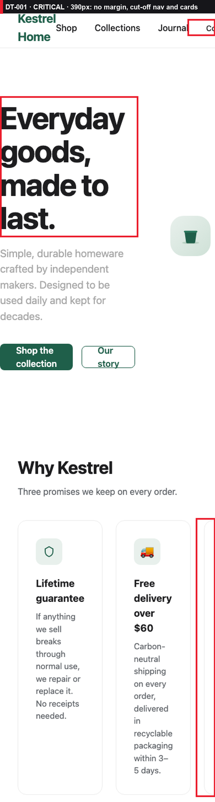
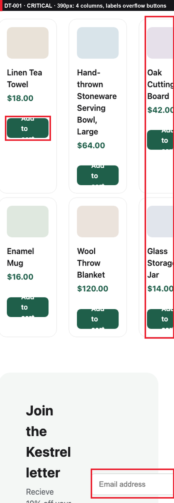
- Problem: No media queries. At 390px: document 667px wide (277px horizontal scroll); hero h1 starts at x=0 (no margin, `.hero` padding overrides `.container`); nav "Contact" cut at the right edge; 3rd feature card starts at x=370; product grid stays 4 columns, buttons 85px wide with "Add to cart" wrapping out of a 40px height; newsletter input at x=220–520, off-screen. (`easy.html:11-64 (no @media); :23 .hero padding; :45 .products; :52 .newsletter`)
- (a) Add one `@media (max-width:760px)` block: hero 1 column, `.hero{padding:56px 32px}`→16px side padding, features 1 column, products 2 columns, newsletter stacked, nav links in a menu button (effort M): covers 90% of phones with one breakpoint
- (b) Fluid grids: `repeat(auto-fit,minmax(240px,1fr))` for features/products, `flex-wrap` on newsletter and nav (effort S): fewer rules, less control at 360px
- (c) Mobile-first rewrite of the landing CSS with 3 breakpoints (360/760/1024) (effort L): best result, most work
- **My pick: (a)** because half of US retail traffic is mobile; one breakpoint fixes every collision found at 390px

**Q2. 🔴 Product page buy box off-screen on phones: At 390px the info column starts at x=418: title, price, sizes and Add to cart are off-screen (Add to cart 30.5px wide)** (DT-015)
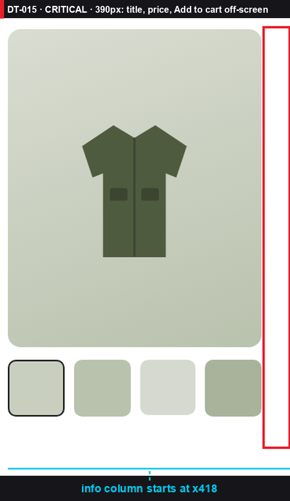
- Problem: `.pdp{grid-template-columns:1fr 1fr; gap:64px}` has no breakpoint. At 390px the document is 650px wide; the gallery takes the viewport and the whole buy box sits to the right of it. Tabs wrap "Reviews (126)" onto two lines; the related rail shows 1.2 cards. (`medium.html:23, :45, :50 (no @media)`)
- (a) `@media (max-width:760px){.pdp{grid-template-columns:1fr;gap:24px}}` plus sizes 5→ wrap, buy row full width (effort S): minimal
- (b) Mobile layout with a sticky bottom Add-to-cart bar (effort M): more code, better conversion
- (c) Mobile-first rewrite of the PDP (effort L): most work
- **My pick: (a)** because one rule makes the page purchasable on phones

**Q3. 🔴 Order math is wrong: $68.90 + $19.99 = $88.89, subtotal shows $88.99 (+$0.10); 2× Enamel Mug = $68.90 ($34.45 each) vs $16.00 on the landing; Tea Towel $19.99 vs $18.00** (DT-034)
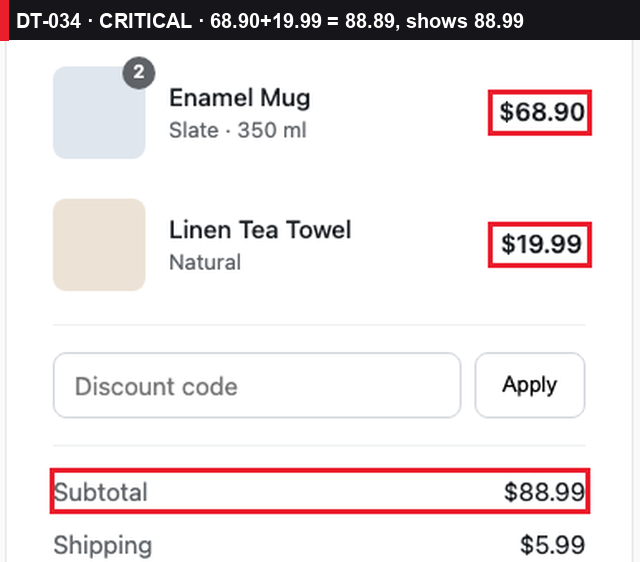
- Problem: Line items do not add up to the subtotal, and both items cost more than the landing page lists them for (mugs $32.00 expected → $68.90; towel $18.00 → $19.99). Tax $7.12 and total $102.10 are computed from the wrong subtotal. A shopper who checks will abandon; charging this is a refund/chargeback issue. (`hard.html:172-173, :177, :204 (hard-coded 88.99)`)
- (a) Compute subtotal, tax and total from line items in one function; fix item prices to the catalog ($32.00, $18.00) (effort S): none
- (b) Load the cart from the same product data the landing uses (effort M): needs a data source
- (c) Add a server-side total check before payment (effort L): backend work
- **My pick: (a)** because removes every hard-coded money number on the page

**Q4. 🔴 Shipping charged despite the free-shipping promise: $88.99 order charged $5.99 Standard shipping; landing promises "Free delivery over $60", PDP "Free delivery and returns"** (DT-035)

- Problem: The checkout breaks a promise made on both previous pages, at the moment of payment. No "free shipping applied" line exists. (`hard.html:150, :178; easy.html:112; medium.html:148`)
- (a) Standard = $0.00 ("Free") when subtotal ≥ $60, Express stays $12.99 (effort S): none
- (b) Change the landing promise to match the real policy (effort S): weaker offer
- **My pick: (a)** because keeps the promise that sells

**Q5. 🟠 Hero 32px off the page grid: Hero content starts at x=120, logo and every section at x=152 (Δ32px); hero art ends at 1320 vs 1288** (DT-002)
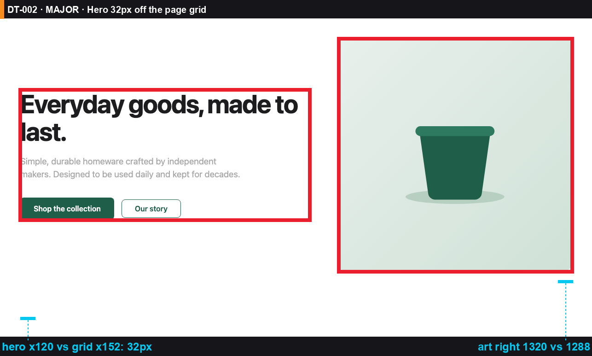
- Problem: `.container.hero` uses `padding: 96px 0 80px`, which wipes the container's 32px side padding. Hero text left edge x=120 vs logo/sections x=152 (Δ32px); hero art right edge 1320 vs content edge 1288 (Δ32px). The hero is the one block that is wider than everything else. (`easy.html:23 (.hero padding shorthand), :86`)
- (a) Change to `padding-top:96px; padding-bottom:80px` (keep container side padding) (effort S): one-line fix, hero 64px narrower
- (b) Wrap the hero grid in an inner div so `.container` keeps its padding (effort S): extra element
- (c) Make the hero intentionally full-bleed with a background band (effort M): a design change, needs art
- **My pick: (a)** because restores one left edge for the whole page with a one-line change

**Q6. 🟠 Hero subtitle unreadable: Subtitle `#A8A8A8` on white: 2.38:1 (needs 4.5:1)** (DT-003)
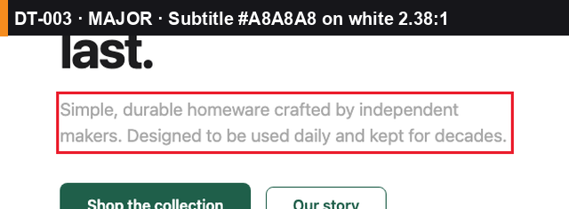
- Problem: The only sentence that explains what the store sells is `#A8A8A8` on `#FFFFFF` = 2.38:1 at 19px regular. It disappears in the blur test. (`easy.html:25`)
- (a) Use the existing body grey `#5F6368` (6.05:1) (effort S): none
- (b) Use `#6B6B70` from the PDP (5.3:1) (effort S): one more grey
- (c) Darken to `#1D1D1F` at 80% weight for a stronger hero (effort S): less hierarchy between h1 and p
- **My pick: (a)** because reuses a token already on the page

**Q7. 🟠 OS emoji among SVG icons: "Free delivery" uses the 🚚 emoji; the other two cards use 1.8px green line SVGs** (DT-004)
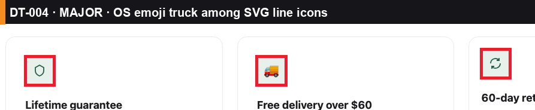
- Problem: Feature icons: shield = SVG stroke `#1F5F4A` 1.8px; returns = SVG; delivery = OS emoji 🚚 (full-color, renders differently on Windows/Android/iOS, cannot be themed). (`easy.html:111`)
- (a) Replace with a 24px truck line SVG, stroke `#1F5F4A`, width 1.8 (effort S): none
- (b) Use one icon set (e.g. the same family for all three) (effort S): adds a dependency
- (c) Drop icons from all three cards (effort S): less scannable
- **My pick: (a)** because matches the other two icons exactly

**Q8. 🟠 "Save 20%" is wrong: $74.00 vs $89.00 is 16.9% off, badge says Save 20%** (DT-016)

- Problem: (89−74)/89 = 16.85%. Overstating a discount is a FTC/state pricing-law risk and a trust killer. (`medium.html:117-119`)
- (a) Badge "Save 17%" (or "Save $15") (effort S): none
- (b) Set the price to $71.20 to make 20% true (effort S): margin change
- (c) Compute the badge from the two prices in code (effort M): needs templating
- **My pick: (c)** because this bug class disappears for every product

**Q9. 🟠 Five full stars for a 4.2 rating: `★★★★★` shown for 4.2; stars `#E0A100` on white 2.27:1** (DT-017)
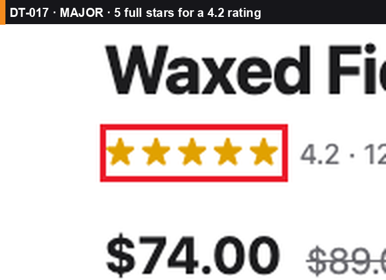
- Problem: Static 5 full stars regardless of rating; a 4.2 should show 4 full + a partial star. Star color below 3:1 for graphics. (`medium.html:115, :33`)
- (a) Render stars from the rating (4 full + 20% fill) and darken to `#B07D00` (3.4:1) (effort S): none
- (b) Show one star + "4.2" (effort S): less visual
- **My pick: (a)** because accurate and readable

**Q10. 🟠 Three different review counts: Rating says 128 reviews, tab says Reviews (126), the tab lists 2** (DT-018)
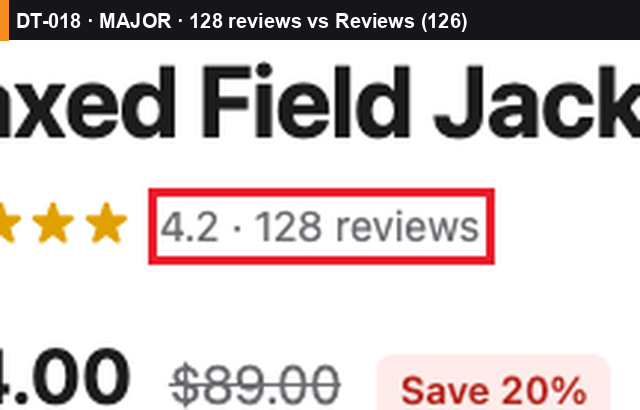
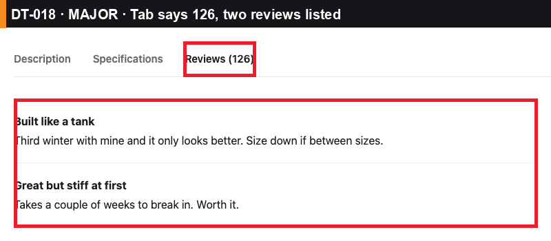
- Problem: Three numbers for one fact. The tab shows two reviews with no "load more", no star per review, no author or date. (`medium.html:115, :155, :171-172`)
- (a) Use one count from one source; show "Showing 2 of 128" + "Load more" (effort S): none
- (b) Show only the count you can display (effort S): hides social proof
- **My pick: (a)** because consistent and honest

**Q11. 🟠 Chalk swatch is invisible: Chalk = white fill + inline white border on a white page: 1.0:1; when selected, still no ring (inline style beats `.selected`)** (DT-019)
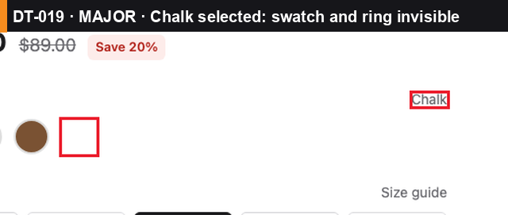
- Problem: `style="background:#ffffff; border-color:#fff"` makes the 4th swatch invisible: shoppers see 3 colors. Clicking the empty spot selects it, the label changes to "Chalk", and no swatch looks selected. (`medium.html:127, :43`)
- (a) Remove the inline border-color so Chalk gets the default `#DDD` border; add an inner ring for light swatches (effort S): none
- (b) Give light swatches a 1px `#8A8A8E` inset ring (effort S): extra rule
- **My pick: (a)** because removes the override that causes it

**Q12. 🟠 Swatch selected and focus states invisible: Selected ring `#C8C8C8` vs default `#DDDDDD`: 1.23:1 between states; `outline:none` removes the keyboard focus ring** (DT-020)
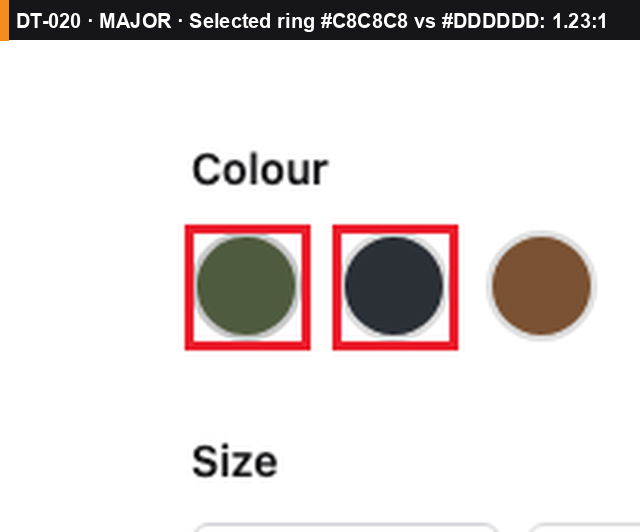
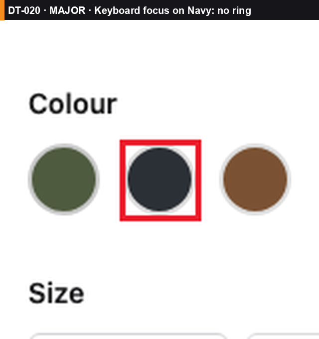
- Problem: Selected = 2px `#C8C8C8` (1.67:1 vs white), unselected = 2px `#DDD`. Nobody can tell which color is chosen except by reading the label. `outline:none` with no replacement: keyboard users get no focus indicator (WCAG 2.4.7). (`medium.html:42-43`)
- (a) Selected: `box-shadow:0 0 0 2px #fff, 0 0 0 4px #1C1C1E`; focus: `:focus-visible{outline:2px solid #1C1C1E; outline-offset:3px}` (effort S): none
- (b) Selected: checkmark inside the swatch (effort M): needs per-color contrast
- **My pick: (a)** because same black as the selected size button

**Q13. 🟠 Quantity goes negative: Three clicks on − from 1 gives -2; no min, no max, minus never disables** (DT-021)

- Problem: `qty.value = Number(qty.value) - 1` with no clamp: 0 and negative quantities can be added to cart. (`medium.html:190`)
- (a) Clamp to 1–10 and disable − at 1 (`disabled` + 40% opacity) (effort S): none
- (b) Replace with a select 1–10 (effort S): different control
- **My pick: (a)** because smallest change, standard pattern

**Q14. 🟠 No cart or search on the product page: PDP header has only Men/Women/Gear/Sale; the landing header has search + cart icons** (DT-022)
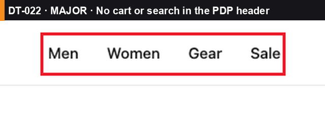
- Problem: After "Add to cart" there is no cart icon, count or link anywhere on the page. (`medium.html:85-90`)
- (a) Reuse the landing header (search + cart with count) (effort S): none
- (b) Add a cart drawer that opens on Add to cart (effort M): more code
- **My pick: (a)** because one shared header

**Q15. 🟠 Checkout form cards overflow the phone screen: At 390px form cards are 382px wide in a 358px column: right edge at 398 (8px past the screen), summary card keeps a 16px margin** (DT-036)

- Problem: `.card-num{min-width:340px}` + 21px card padding + border forces the form column wider than the viewport; every form card loses its right border and the page scrolls sideways. (`hard.html:57, :81-89`)
- (a) Delete `min-width:340px` (inputs are already `width:100%`) (effort S): none
- (b) Wrap it in `@media (min-width:761px)` (effort S): dead rule stays
- **My pick: (a)** because the rule does nothing useful on desktop either

**Q16. 🟠 Expiry field cannot hold MM/YY: Placeholder MM/YY (5 chars), `maxlength="4"`: typing "12/28" stops at "12/2"** (DT-037)

- Problem: The format the field asks for does not fit. No auto-insert of "/". (`hard.html:161`)
- (a) `maxlength="5"`, `inputmode="numeric"`, auto-insert "/" after 2 digits (effort S): none
- (b) Two selects (month, year) (effort M): slower to fill
- **My pick: (a)** because matches the placeholder and autofill

**Q17. 🟠 Tab order CVC → Expiry, screen shows Expiry → CVC: DOM order CVC then Expiry; CSS `order` swaps them visually: Tab jumps right, then back left** (DT-038)

- Problem: Keyboard and screen-reader order disagree with the visual order (WCAG 2.4.3); autofill users land in CVC first. (`hard.html:55-56, :160-161`)
- (a) Swap the two `
`s in the HTML and delete the `order` rules (effort S): none
- **My pick: (a)** because smallest change that removes the defect

**Q18. 🟠 Weak email error state: Error text `#E57373` on white 2.99:1; input border stays grey `#D1D5DB`; error appears above the hint and pushes the page 24px; empty email never errors** (DT-039)
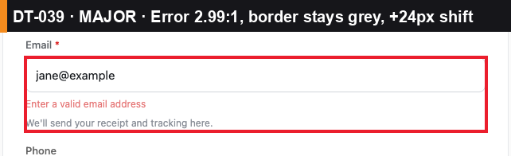
- Problem: The only validation on the page is low-contrast, has no field highlight, no icon, no `aria-invalid`/`aria-describedby`, causes layout shift, and skips the empty case. (`hard.html:42-43, :121-122, :196-198`)
- (a) Error color `#B91C1C` (6.5:1), red border + `aria-invalid`, error replaces the hint (no shift), validate empty on submit (effort S): none
- (b) Inline validation on every field with one shared pattern (effort M): covers DT-040 too
- **My pick: (b)** because one pattern fixes this and the missing validation in DT-040

**Q19. 🟠 Place order does nothing on an empty form: `novalidate` + `onsubmit="return false"`: clicking Place order with every field empty gives no feedback** (DT-040)
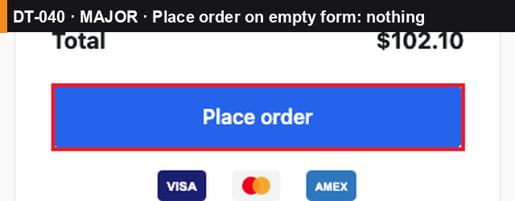
- Problem: No required-field errors, no scroll to the first error, no disabled/loading state. The shopper does not know what happened. (`hard.html:114, :182`)
- (a) On submit: validate required fields, show errors (DT-039 style), focus the first invalid field; loading state on the button (effort S): none
- (b) Remove `novalidate` and use native validation (effort S): inconsistent native bubbles
- **My pick: (a)** because consistent with the rest of the page

**Q20. 🟠 No State field for a US address: Address = street, city, ZIP, country; no State (and no apartment line); Canada/UK offered with a "ZIP code" label** (DT-041)
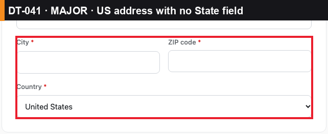
- Problem: US shipping and sales tax need the state; the 8% tax line cannot be correct without it. (`hard.html:134-144`)
- (a) Add State select (autocomplete `address-level1`) and "Apt, suite" line; relabel ZIP per country (effort S): none
- (b) Address autocomplete service (effort M): external service needs approval
- **My pick: (a)** because smallest change that removes the defect

**Q21. 🟠 Place order hover fails contrast: Hover background `#60A5FA` with white text: 2.54:1 (rest state `#2563EB` is 5.17:1)** (DT-042)

- Problem: Hover makes the primary button lighter and harder to read at the most important click. (`hard.html:76`)
- (a) Hover `#1D4ED8` (darker, 6.7:1) (effort S): none
- **My pick: (a)** because smallest change that removes the defect

**Q22. 🟠 Three brands, three primary colors: "Kestrel Home" green `#1F5F4A` / "Kestrel Outdoor" black `#1C1C1E` / "Kestrel" blue `#2563EB`; header 72/64/64px; container 1200/1200/1120px** (DT-052)

- Problem: The three pages of one purchase flow look like three different stores: different store name, logo color and size (22px green vs 20px black), primary button color, header height and content width. A homeware landing leads to a jacket PDP from "Kestrel Outdoor" and a checkout from "Kestrel". (`easy.html:15, :28; medium.html:16, :54; hard.html:15, :75, :11`)
- (a) One shared header and token set: name "Kestrel", primary `#1F5F4A`, header 64px, container 1200px (effort M): touches all three files
- (b) Keep sub-brands but share logo, header and primary (effort S): sub-brand names stay confusing
- **My pick: (a)** because a checkout that looks like another site is a classic phishing signal for shoppers

**Q23. 🟡 Hero buttons 48px vs 40px: "Shop the collection" 48px tall, "Our story" 40px (Δ8px, 17%)** (DT-005)
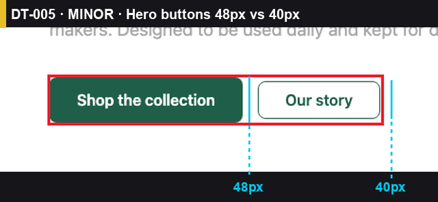
- Problem: `.btn-secondary` overrides height to 40px; the pair sits on one row with centers aligned but different heights. (`easy.html:27-29`)
- (a) Remove `height:40px` from `.btn-secondary` (effort S): none
- (b) Keep 40px and make it a text link (effort S): weaker secondary
- **My pick: (a)** because paired buttons should share a height

**Q24. 🟡 Third feature card has different padding: Card 3 padding 20px vs 32px: its icon sits 12px higher and 12px further left** (DT-006)
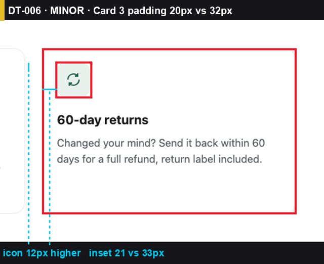
- Problem: `.feature--compact` sets padding 20px. Icon top y=973 vs 985 in cards 1–2; content inset 21px vs 33px; title baseline 12px higher. (`easy.html:39, :115`)
- (a) Delete the `feature--compact` class from the third card (effort S): none
- (b) Delete the `.feature--compact` rule (effort S): none
- **My pick: (a)** because one-word fix, the three cards become identical

**Q25. 🟡 Product grid row gap 8px vs column gap 24px: Grid `gap: 8px 24px`: rows nearly touch (8px) while columns get 24px** (DT-007)
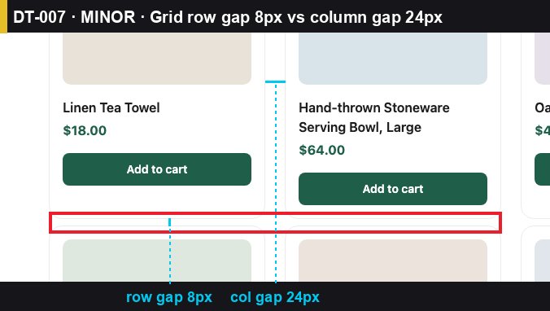
- Problem: Rows of cards are separated by 8px, columns by 24px; the grid reads as vertical strips. (`easy.html:45`)
- (a) `gap: 24px` (effort S): none
- (b) `gap: 32px 24px` for more air between rows (effort S): taller page
- **My pick: (a)** because one value, same as the features grid

**Q26. 🟡 Long product name pushes price and button down: "Hand-thrown Stoneware Serving Bowl, Large" wraps to 2 lines: its price and button sit 24px lower than the row** (DT-008)
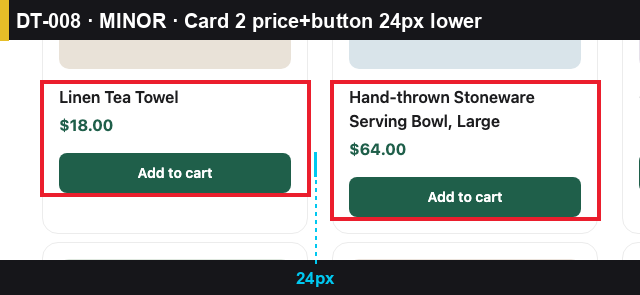
- Problem: Cards are block flow. Card 2 title 48px tall vs 24px; its button y=1751.7 vs 1727.7 in the other three; row-1 cards 356px vs row-2 332px. (`easy.html:46-50, :130`)
- (a) Make `.product` a flex column and give the button `margin-top:auto` (effort S): buttons align, empty space above them in short cards
- (b) Clamp titles to 2 lines with a fixed 48px title block (effort S): every card 24px taller
- (c) Shorten the name to "Stoneware Serving Bowl" (effort S): content fix only
- **My pick: (a)** because aligns buttons for any title length

**Q27. 🟡 Newsletter button shorter than the input: Input 44px, Subscribe 38px (Δ6px) on one row** (DT-009)
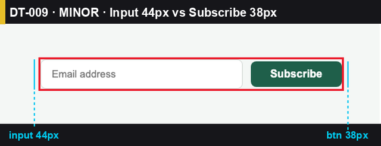
- Problem: `.newsletter .btn{height:38px}` next to a 44px input; tops at y 2290.7 vs 2293.7. (`easy.html:56-57`)
- (a) Set the button to 44px (or both to 48px, the hero button height) (effort S): none
- (b) Join input and button into one 48px field group (effort M): new component
- **My pick: (a)** because one control height per row

**Q28. 🟡 Typo "Recieve": Newsletter copy: "Recieve 10% off…"** (DT-010)
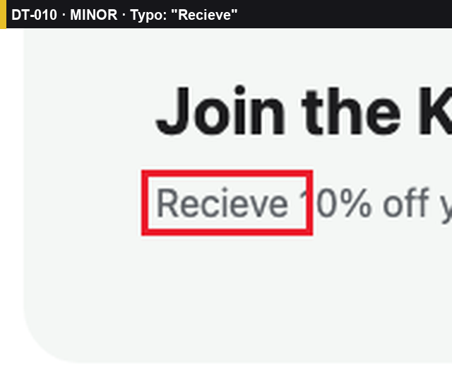
- Problem: Spelling error in a conversion sentence. (`easy.html:145`)
- (a) "Receive 10% off your first order…" (effort S): none
- (b) "Get 10% off your first order…" (effort S): none
- **My pick: (b)** because shorter and fixes the typo

**Q29. 🟡 "Contact" smaller than its siblings: Nav "Contact" 14px vs 16px for Shop/Collections/Journal; top 28 vs 27** (DT-011)
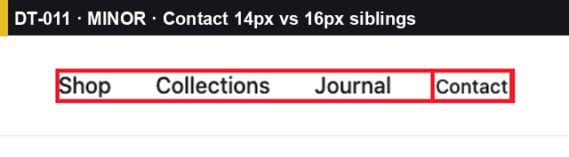
- Problem: `.nav-links a.contact{font-size:14px}` makes one nav item smaller and its baseline 1px off. (`easy.html:18`)
- (a) Remove the `.contact` rule (effort S): none
- (b) Move Contact to the footer (effort S): one less nav item
- **My pick: (a)** because consistent nav

**Q30. 🟡 Footer links are plain text; email input has no label: 12 footer items (Shipping, Returns, FAQ…) are `<li>` text with no links; email field has only a placeholder** (DT-012)
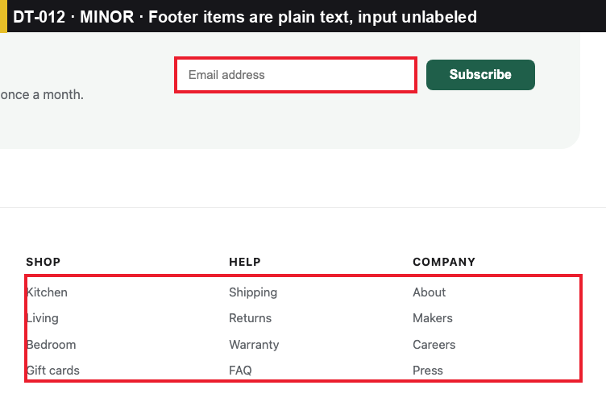
- Problem: Footer Shop/Help/Company items are not anchors: a shopper looking for Returns or Shipping cannot click them. The newsletter `<input>` has no `<label>`/`aria-label`; the placeholder disappears on typing. (`easy.html:162-164, :148`)
- (a) Wrap each item in `<a href>`; add `aria-label="Email address"` (or a visually-hidden label) (effort S): none
- (b) Add links only for Help items now (effort S): partial
- **My pick: (a)** because footer links are where shoppers look for policies

**Q31. 🟡 Sold-out sizes barely differ from available ones: S and XL: same border `#D4D4D8`, only faded text (opacity 0.85 on the UA disabled color); no strike-through or "sold out" hint** (DT-023)
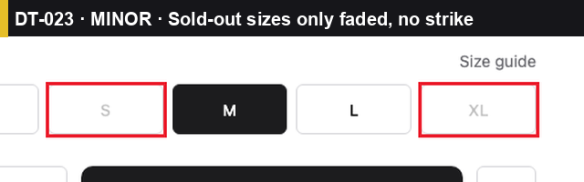
- Problem: Disabled sizes only differ by text color; no cue says why they cannot be picked or offers "notify me". (`medium.html:48, :133, :136`)
- (a) Diagonal strike + `#F4F4F5` fill + `aria-label="S, sold out"` (effort S): none
- (b) Add "Notify me" when a sold-out size is tapped (effort M): backend
- **My pick: (a)** because standard retail pattern

**Q32. 🟡 Related rail clipped with no scroll control: 5 cards × 270px + gaps = 1446px in a 1136px box with `overflow:hidden`: card 4 cut at 1288 (254/270px), card 5 unreachable** (DT-024)
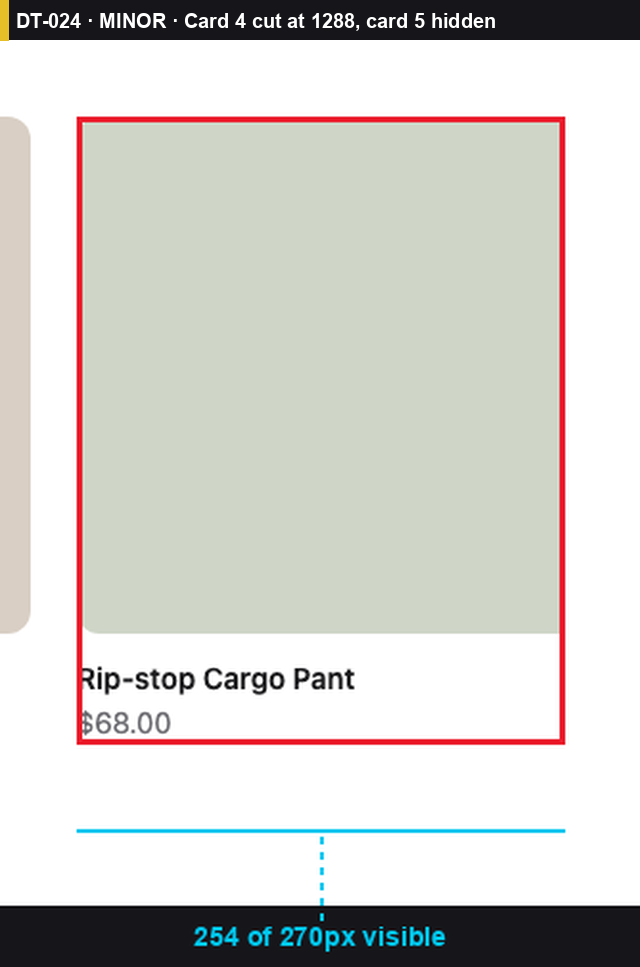
- Problem: No arrows, no scroll, no peek affordance; the 5th product (Wax Restoring Kit, the obvious add-on) can never be seen. (`medium.html:76-77, :182`)
- (a) `overflow-x:auto; scroll-snap-type:x mandatory` + arrows (effort S): none
- (b) Show 4 cards in a 4-column grid (effort S): drops one product
- **My pick: (a)** because keeps all 5

**Q33. 🟡 Active tab underline floats 1px above the divider: Underline at y 1012–1013, white gap at 1014, divider at 1015** (DT-025)
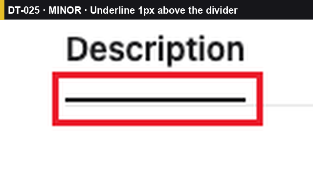
- Problem: `.tab.active::after{bottom:1px}` leaves a 1px gap instead of sitting on the divider. (`medium.html:62`)
- (a) `bottom:-1px` so the underline covers the divider (effort S): none
- **My pick: (a)** because smallest change that removes the defect

**Q34. 🟡 Specs table zigzags and contradicts itself: Odd rows right-aligned, even rows left-aligned; "1.2kg" vs "800 g"; packed weight 800 g lighter than the 1.2 kg jacket** (DT-026)
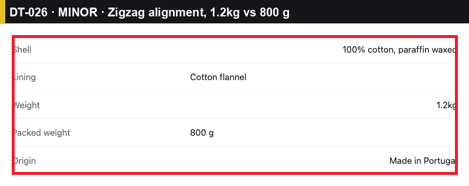
- Problem: `.specs tr:nth-child(odd) td:last-child{text-align:right}` alternates value alignment. Unit spacing inconsistent. A packed weight cannot be lower than the item weight. (`medium.html:70, :165-166`)
- (a) Remove the nth-child rule (all left); write "1.2 kg"; fix or remove packed weight (effort S): needs the real number
- **My pick: (a)** because smallest change that removes the defect

**Q35. 🟡 Three radii in the buy row: Qty box radius 6, Add to cart 10, wishlist 6 (sizes 6, landing buttons 8)** (DT-027)
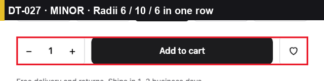
- Problem: One row, two radii. (`medium.html:51, :54, :55`)
- (a) Add to cart radius 6 (or all 8 to match the landing) (effort S): none
- **My pick: (a)** because smallest change that removes the defect

**Q36. 🟡 Third thumbnail 2px smaller: Thumb 3 70×70, others 72×72; its bottom edge 2px higher** (DT-028)
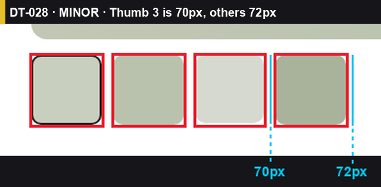
- Problem: `.thumb--alt{width:70px;height:70px}`. (`medium.html:29, :108`)
- (a) Remove `thumb--alt` (effort S): none
- **My pick: (a)** because smallest change that removes the defect

**Q37. 🟡 Thumbnails do nothing: Thumbs have `cursor:pointer` and an active border, but no click handler** (DT-029)
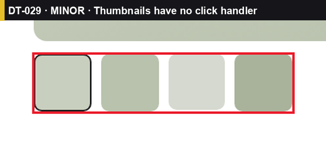
- Problem: Clicking a thumbnail never changes the main image or the active border. (`medium.html:27, :105-110, script :187-207`)
- (a) Add a click handler that swaps the main image and moves `.active`; make thumbs `<button>`s (effort S): none
- **My pick: (a)** because smallest change that removes the defect

**Q38. 🟡 "Colour" on a US store; color names don't match swatches: UK spelling "Colour" for a US audience; "Navy" swatch is `#2B2F36` (charcoal), "Tan" is `#7A5233` (dark brown)** (DT-030)
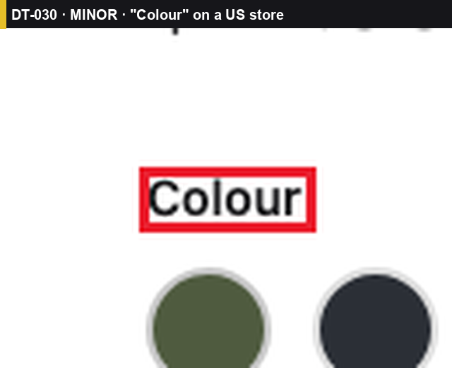
- Problem: Spelling mismatch with the US market; two swatch names describe colors the swatches are not (unverified against real product photos). (`medium.html:122, :125-126`)
- (a) "Color"; rename swatches "Charcoal"/"Brown" or recolor to real navy/tan (effort S): none
- **My pick: (a)** because smallest change that removes the defect

**Q39. 🟡 Phone is required but not marked: Phone input has `required`, label has no asterisk and the hint says "For delivery updates only"; label color `#616161` vs `#5F6368`** (DT-043)
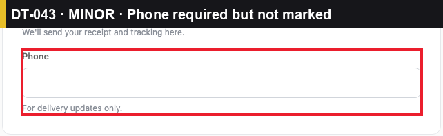
- Problem: Required/optional signal contradicts itself. (`hard.html:36, :124-127`)
- (a) Make it optional: remove `required`, label "Phone (optional)" (effort S): none
- (b) Keep required and add the asterisk (effort S): more friction
- **My pick: (a)** because less friction

**Q40. 🟡 City and ZIP inputs misaligned: City input y 803–847, ZIP 801–844: tops Δ2px, bottoms Δ3px (ZIP 43px tall, label gap 8 vs 6)** (DT-044)
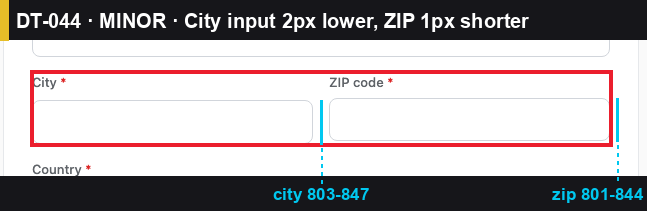
- Problem: `.field--city label{margin-bottom:8px}` and `.field--zip input{height:43px}`. (`hard.html:35, :38`)
- (a) Delete both one-off rules (effort S): none
- **My pick: (a)** because smallest change that removes the defect

**Q41. 🟡 Stepper connectors 2px low: Connector center y=119, dot center y=117** (DT-045)
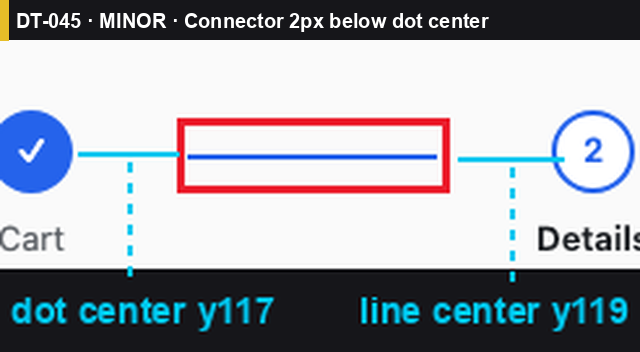
- Problem: `.line{margin-top:17px}` for a 32px dot and 2px line; should be 15px. (`hard.html:25`)
- (a) `margin-top:15px` (effort S): none
- **My pick: (a)** because smallest change that removes the defect

**Q42. 🟡 Stepper says "Details", page already asks for payment: Step 2 "Details" is current, step 3 "Payment" is grey, yet the Payment card is on the same page** (DT-046)
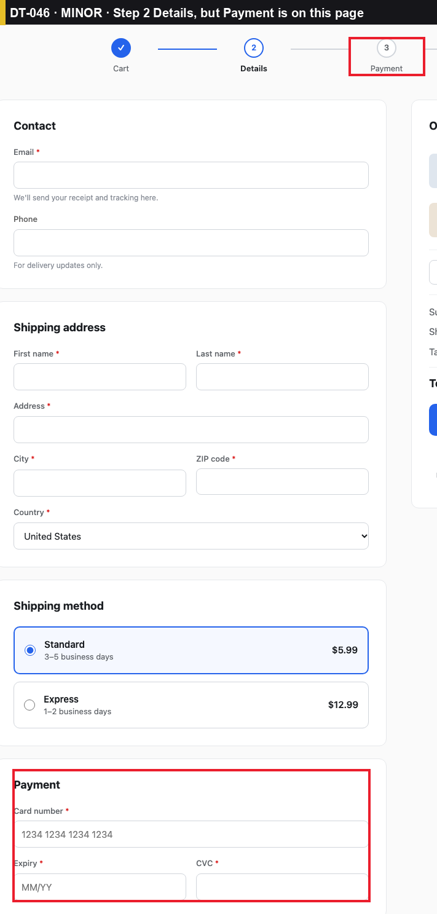
- Problem: The progress indicator lies about where the shopper is; "Review" (step 4) never appears either. (`hard.html:102-110, :155-164`)
- (a) Steps: Cart · Checkout · Confirmation (effort S): none
- (b) Split payment into a real step 3 (effort M): extra page
- **My pick: (a)** because smallest change that removes the defect

**Q43. 🟡 Selecting a shipping option shifts the layout: Selected option border 2px vs 1px: card 78px vs 76px, content shifts 1px right, everything below moves 2px** (DT-047)
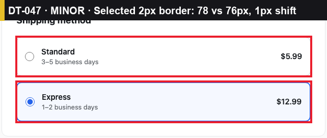
- Problem: Border width changes between states. (`hard.html:46-47`)
- (a) Keep 1px border and add `box-shadow:0 0 0 1px #2563EB` when selected (effort S): none
- **My pick: (a)** because smallest change that removes the defect

**Q44. 🟡 Hints and legal text below 4.5:1: Hints `#8A8F98` 12px and legal 11px on white: 3.25:1** (DT-048)
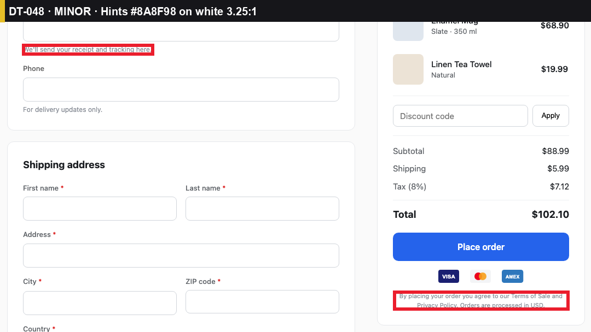
- Problem: Small text below AA; legal text is also 11px. (`hard.html:41, :79`)
- (a) Use `#5F6368` (6.05:1), legal 12px (effort S): none
- **My pick: (a)** because smallest change that removes the defect

**Q45. 🟡 Line-item amounts not right-aligned: $19.99 ends at x=1217, $68.90 at 1219 (`.item:nth-child(2) .amt{padding-right:2px}`)** (DT-049)
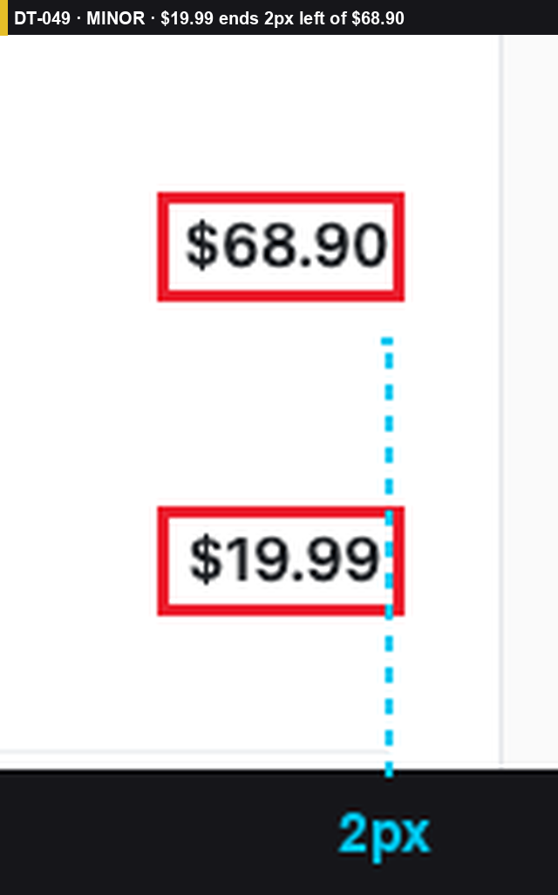
- Where: `hard.html:67`
- (a) Delete the rule (effort S): none
- **My pick: (a)** because smallest change that removes the defect

**Q46. 🟡 Promo row off the form system: "Apply" text 13.3px (button font not inherited) vs 15px; promo controls 40px vs 44px fields** (DT-050)
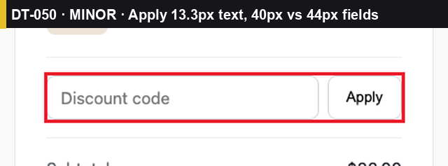
- Where: `hard.html:69-70`
- (a) `font:inherit` on the button; height 44px (effort S): none
- **My pick: (a)** because smallest change that removes the defect

**Q47. 🟡 Button and radius sprawl: Button heights 38 / 40 / 44 / 48 / 52px, radii 6 / 8 / 10px across the flow** (DT-053)
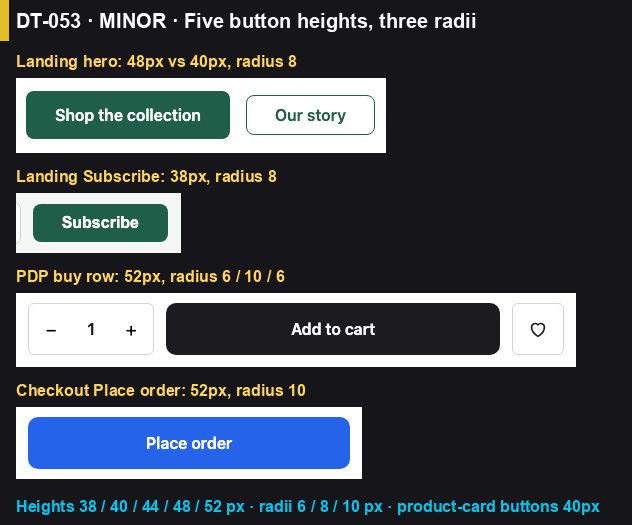
- Problem: No size scale; see ui-tokens.json for the proposed set. (`easy.html:27-29,50,57; medium.html:46,51,54,55; hard.html:37,70,75`)
- (a) Tokens: control height 44 (inputs, secondary) / 52 (primary CTA), radius 8 everywhere (effort S): none
- **My pick: (a)** because smallest change that removes the defect

**Q48. 🟡 Input borders below 3:1: Field borders `#D1D5DB` 1.47:1, `#D0D5D2` 1.49:1, `#D4D4D8` 1.48:1 (WCAG 1.4.11 needs 3:1)** (DT-054)
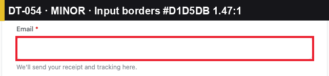
- Problem: Empty inputs are hard to locate, especially on the `#FAFAFA` checkout background. (`hard.html:37; easy.html:56; medium.html:46,51`)
- (a) Border `#8A8F98` (3.25:1) on all inputs (effort S): heavier look
- **My pick: (a)** because smallest change that removes the defect

**Nitpicks** (one line each, no options needed)
- Q49 (DT-013) ⚪ Help column indented 12px: HELP column has `padding-left:12px`: heading at x=852 vs column x=840. Fix: Remove `.footer-col--help` padding (`easy.html:63`) · [DT-013_footer-help-indent.png](../screenshots/issues/DT-013_footer-help-indent.png)
- Q50 (DT-014) ⚪ Nav links 16px right of center: Nav group center x=736 vs page center 720 (space-between with a 133px logo and 100px icon group). Fix: Use a 3-column grid `1fr auto 1fr` for the header (`easy.html:14`) · [DT-014_nav-off-center.png](../screenshots/issues/DT-014_nav-off-center.png)
- Q51 (DT-031) ⚪ Breadcrumb separator spacing: "/" has **4px** before and **10px** after. Fix: `margin:0 8px` (`medium.html:20`) · [DT-031_breadcrumb-spacing.png](../screenshots/issues/DT-031_breadcrumb-spacing.png)
- Q52 (DT-032) ⚪ Two line-heights in one description: Paragraph 1 line-height **1.5**, paragraph 2 **1.65** (`p + p` rule). Fix: Remove the `p + p` rule (`medium.html:66`) · [DT-032_paragraph-line-height.png](../screenshots/issues/DT-032_paragraph-line-height.png)
- Q53 (DT-033) ⚪ "Size guide" not styled as a link: Same grey `#6B6B70`, no underline: reads as a label. Fix: Underline it (`medium.html:40, :130`) · [DT-033_size-guide-link.png](../screenshots/issues/DT-033_size-guide-link.png)
- Q54 (DT-051) ⚪ Payment badges uneven: AMEX **39.3×24** (viewBox 36×22) vs 38×24; Mastercard tile `#F3F4F6` on white 1.1:1 (no edge). Fix: Same viewBox 38×24 for all; 1px `#E5E7EB` border on the light tile (`hard.html:184-186`) · [DT-051_payment-badges.png](../screenshots/issues/DT-051_payment-badges.png)

> **Report saved to `docs/harsh-design-critic/design-review/reviews/2026-10-26-review.md`. My picks are pre-selected. Nothing else has been changed.**
> Reply with one of:
> - `approve all` — apply my pick for every Q, in severity order
> - `approve Q1, Q3` — apply my picks for those Qs only
> - `Q1b, Q2a` — choose a different option per Q
> - `approve quick wins` / `approve all critical`
> - `skip` · `more detail on Q<n>` · `won't fix Q<n> because …`
