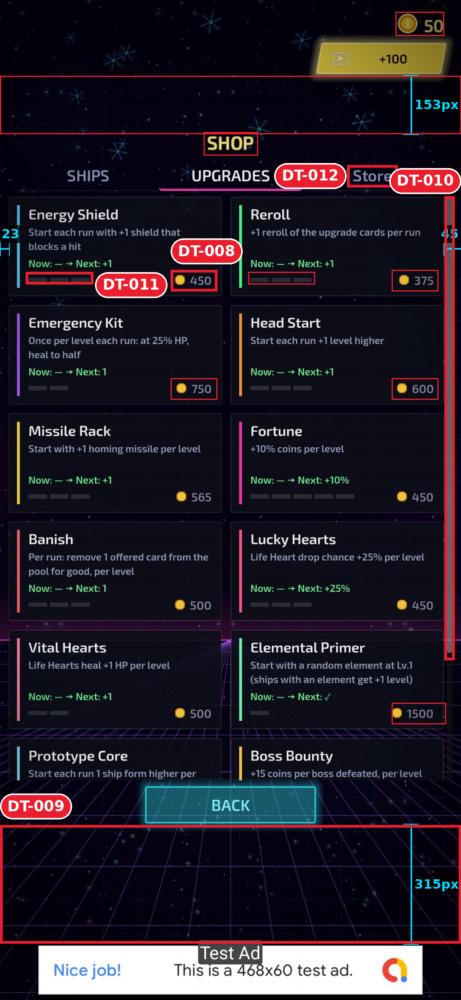

# Test 2 · Synthwave survivor shooter — 5/10

> "Strong synthwave mood, but the menu is four different button systems and the shop sells things I can't afford without telling me."

12 issues across 2 screens.

**Main menu**

| ID | Level | Issue |
|---|---|---|
| [DT&#8209;001](design-review/screenshots/issues/DT-001_menu-button-widths.png) | 🟠&nbsp;Major | Four button widths (**861 / 599 / 1071 / 605px**) and five heights; left edge jumps from 164 to 59 |
| [DT&#8209;002](design-review/screenshots/issues/DT-002_grid-gaps.png) | 🟠&nbsp;Major | Grid column gap **7px** vs row gap **23px** |
| [DT&#8209;003](design-review/screenshots/issues/DT-003_story-reads-as-reward.png) | 🟠&nbsp;Major | STORY uses the same yellow as the reward buttons, and out-shines START in grayscale |
| [DT&#8209;006](design-review/screenshots/issues/DT-006_dev-button.png) | 🟠&nbsp;Major | DEV button visible in the build, label at **2.93:1** |
| [DT&#8209;004](design-review/screenshots/issues/DT-004_lines-through-labels.png) | 🟡&nbsp;Minor | Grid and horizon lines run through MISSIONS and HOW TO PLAY |
| [DT&#8209;005](design-review/screenshots/issues/DT-005_difficulty-label.png) | 🟡&nbsp;Minor | "DIFFICULTY: NORMAL" is **17px** tall text with no control look |
| [DT&#8209;007](design-review/screenshots/issues/DT-007_quit-button.png) | 🟡&nbsp;Minor | QUIT (605×114) takes the thumb zone; Android back already exits |
**Shop**

| ID | Level | Issue |
|---|---|---|
| [DT&#8209;008](design-review/screenshots/issues/DT-008_cant-afford.png) | 🟠&nbsp;Major | Balance **50**, cheapest price **375**, yet every price looks buyable |
| [DT&#8209;009](design-review/screenshots/issues/DT-009_dead-space.png) | 🟠&nbsp;Major | **315px** dead space under BACK and 153px above SHOP while the list is cut mid-card |
| [DT&#8209;010](design-review/screenshots/issues/DT-010_unequal-margins.png) | 🟡&nbsp;Minor | Margins **23px** left vs **45px** right; content 11px left of center |
| [DT&#8209;011](design-review/screenshots/issues/DT-011_level-pips.png) | 🟡&nbsp;Minor | Level pips `#2B2C36` on `#090B16`: **1.42:1** |
| [DT&#8209;012](design-review/screenshots/issues/DT-012_tab-case.png) | 🟡&nbsp;Minor | Tabs "SHIPS · UPGRADES · Store": one tab breaks the uppercase set |

## Input screenshots
Real Android screenshots in [`input/`](input/): `01-main-menu`, `02-shop-upgrades`. They are 1189 × 2576px, and the game runs full screen, so nothing was removed. The banner at the bottom is the app's own AdMob test ad, not a system bar; it was kept on purpose.

## Files
- [Full review](design-review/reviews/2026-10-26-review.md)
- [Annotated screens](design-review/screenshots/screens/) · [one crop per issue](design-review/screenshots/issues/)
