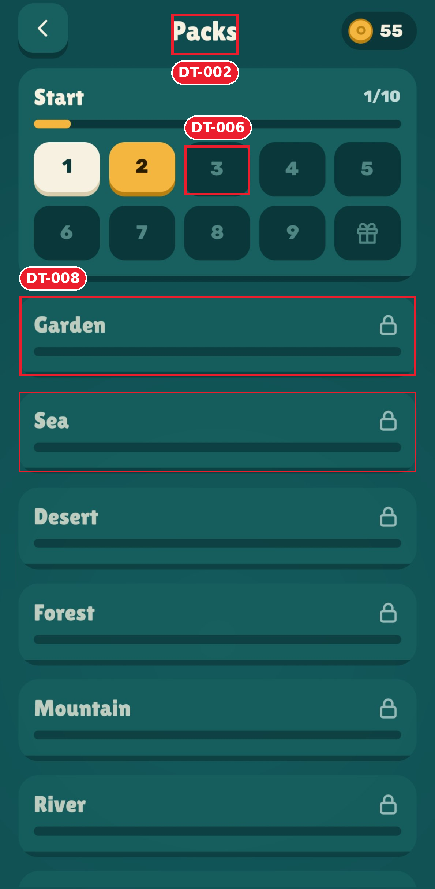

# Test 3 · Swipe-to-spell word puzzle — 6/10

> "Clean and calm, but locked, unearned and disabled all look the same faded teal."

8 issues across 4 screens. What works: home margins equal to the pixel, one tight palette, primary action always in thumb reach.

**Home**

| ID | Level | Issue |
|---|---|---|
| [DT&#8209;001](design-review/screenshots/issues/DT-001_top-bar-heights.png) | 🟠&nbsp;Major | Gear button **136×151** with a 3D lip next to flat **105px** pills; top edges at y 9 vs 32 |
| [DT&#8209;007](design-review/screenshots/issues/DT-007_nav-label-padding.png) | 🟡&nbsp;Minor | "More games" label has **12px** padding in its tile: Arabic or Hebrew won't fit |
**Daily reward**

| ID | Level | Issue |
|---|---|---|
| [DT&#8209;003](design-review/screenshots/issues/DT-003_locked-label-contrast.png) | 🟠&nbsp;Major | Locked day labels `#73A1A1` on `#135758`: **2.90:1** |
| [DT&#8209;005](design-review/screenshots/issues/DT-005_coin-icon-styles.png) | 🟡&nbsp;Minor | Day 1 coin is an outline ring; every other coin is filled |
**Challenges**

| ID | Level | Issue |
|---|---|---|
| [DT&#8209;004](design-review/screenshots/issues/DT-004_rewards-look-disabled.png) | 🟠&nbsp;Major | Rewards you can still earn look disabled: number `#8EB4B0` on `#2A6A69`, **2.77:1** |
| [DT&#8209;001](design-review/screenshots/issues/DT-001_top-bar-heights.png) | 🟠&nbsp;Major | Back button with a 3D lip next to the flat coin pill |
| [DT&#8209;002](design-review/screenshots/issues/DT-002_header-title-offset.png) | 🟡&nbsp;Minor | Title centered between two buttons, **35px** left of the screen center |
**Packs**

| ID | Level | Issue |
|---|---|---|
| [DT&#8209;008](design-review/screenshots/issues/DT-008_locked-packs-no-goal.png) | 🟡&nbsp;Minor | Locked packs show an empty bar and never say how to unlock them |
| [DT&#8209;006](design-review/screenshots/issues/DT-006_level-digit-offset.png) | 🟡&nbsp;Minor | Level digits **7px** lower on locked tiles than on unlocked ones |
| [DT&#8209;002](design-review/screenshots/issues/DT-002_header-title-offset.png) | 🟡&nbsp;Minor | Title 35px left of the screen center, as on every screen |

## Input screenshots
Real Android screenshots in [`input/`](input/): `01-daily-reward`, `02-home`, `03-challenges`, `04-packs`. They are 1189 × 2425px; the status bar, the gesture bar and a system edge-panel handle were removed (rows 0–109 and 2535–2575), so every pixel belongs to the app.

## Files
- [Full review](design-review/reviews/2026-10-26-review.md)
- [Annotated screens](design-review/screenshots/screens/) · [one crop per issue](design-review/screenshots/issues/)
